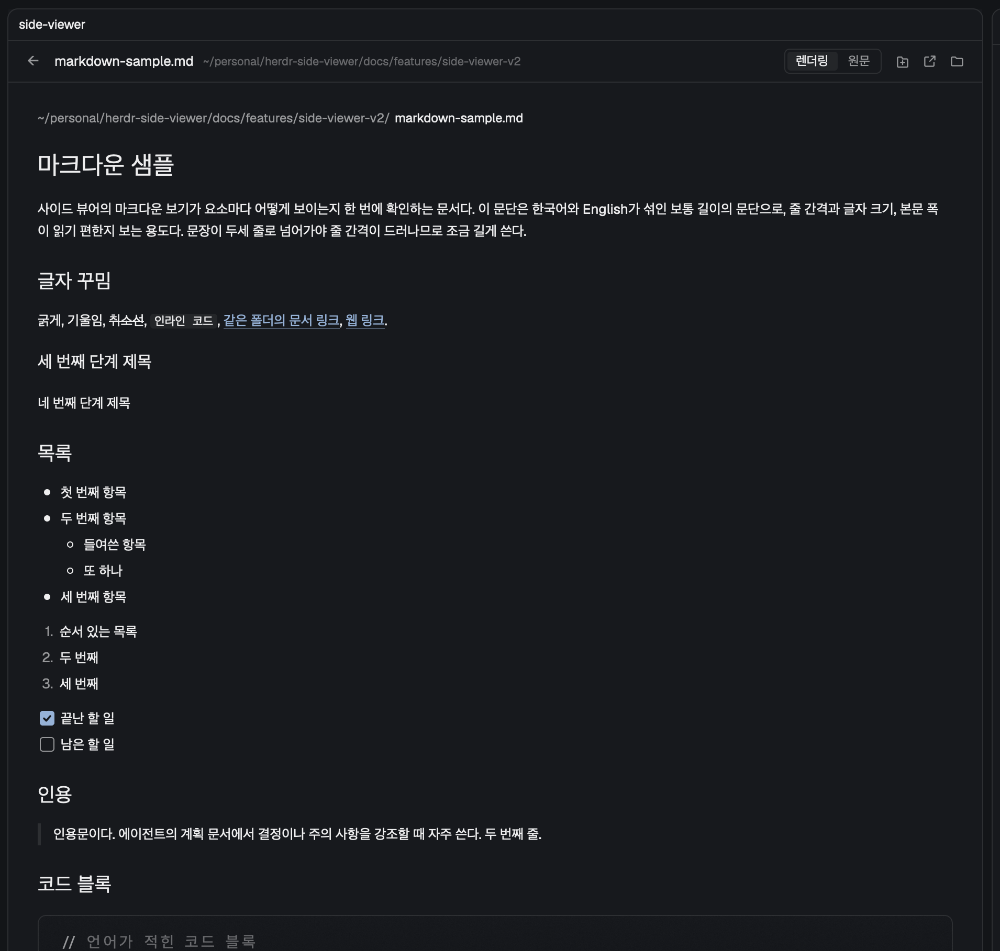

# Side Viewer

[English](README.md) | **한국어**

[Herdr](https://herdr.dev) 데스크톱 앱에 사이드 뷰어를 더하는 mod입니다. macOS 전용입니다.
에이전트 대화에서 파일 경로를 cmd-클릭하면 그 파일이 다른 앱이 아니라 대화 오른쪽 pane에
열립니다. 블록마다 그린 마크다운을 읽고, 구문 색이 있는 코드를 읽고 고치고, 이미지를 보고,
cmd+S로 저장하고, 파일 하나에 탭 하나를 따로 주고, 문서 속 셸 명령을 터미널 입력 칸에
넣습니다. `cmd-o`는 대화에 나온 경로를 모아 보여 주고 고른 것을 여는데, 다른 기계의
공간에서 파일을 여는 길도 이것입니다.



- **마크다운**(`md`, `markdown`, `mdx`): Warp의 마크다운 보기처럼 블록마다 그리고, 코드
  블록은 카드로 그립니다. 머리줄의 `렌더링 | 원문` 전환으로 원문 보기로 바꾸면 고칠 수
  있습니다.
- **코드와 텍스트**: 줄 번호와 구문 색이 있는 편집기로 열리고, 고칠 수 있습니다. 여기서
  `html`은 코드입니다. 페이지가 아니라 원문을 보고 고칩니다.
- **이미지**: pane 폭을 넘지 않게 그립니다. `svg`에도 `렌더링 | 원문` 전환이 있고, 원문을
  고칠 수 있습니다.
- **저장**(cmd+S): 고친 내용은 cmd+S나 머리줄의 `저장` 버튼으로만 저장하고, 저절로
  저장하지 않습니다. 예외는 고친 것이 없는 파일의 체크박스 클릭 하나입니다([고치기와 저장](#고치기와-저장)
  참고).
- **탭마다 뷰어 하나**: 탭에 이미 떠 있는 뷰어가 다음 파일을 받으니 pane이 쌓이지 않고,
  `←`로 앞의 파일로 돌아갑니다. 디스크에서 파일이 바뀌면 뷰어가 다시 읽습니다.
- **뷰어 탭**: 머리줄의 `새 탭으로 열기` 버튼이 그 파일에 탭을 따로 줍니다.
- **셸 블록의 `>_`**: 코드 블록의 명령을 뷰어 아래 셸 pane에 입력해 두고, 실행하지는
  않습니다(zsh의 키맵이 뷰어가 기억한 것과 다를 때와 터미널의 인터럽트 문자를 바꿨을 때는
  예외, [한계](#한계) 참고).
- **경로 고르기 창**(`cmd-o`): 포커스된 대화에 나온 파일 경로를 팝업으로 보여 주고, 고르면
  대화 옆에 엽니다([경로 고르기 창](#경로-고르기-창cmd-o) 참고).
- **원격 공간**: Linux 기계나 다른 Mac의 공간에서는 그 기계의 파일을 보여 주고 고치고
  저장하며, `>_`는 그곳의 셸에 넣습니다([원격 공간](#원격-공간) 참고).
- **Herdr 밖**(Finder, 다른 터미널)에서는 같은 파일이 전에 열리던 앱에서 그대로 열립니다.

### 동작 방식

Herdr는 cmd-클릭한 경로를 macOS에 넘기고, macOS는 그 종류의 파일을 기본 앱으로 엽니다.
그래서 이 저장소에는 작은 백그라운드 앱인 **라우터**가 있고, 이것을 확장자 목록의 기본
앱으로 정합니다. 라우터는 파일을 받을 때마다 앞에 있는 앱을 봅니다. Herdr면 파일을 사이드
뷰어로, 그 밖이면 **원래 앱**(넘겨받기 전에 기본 앱이던 앱)으로 보냅니다. 라우터는 아래의
넘겨받기 명령을 실행했을 때만 기본 앱 자리를 차지하고(예외 하나는 [한계](#한계)에
있습니다), 명령 하나로 전부 되돌립니다.

### 경로 고르기 창(cmd-o)

`cmd-o`는 창 위쪽에 팝업을 열어 포커스된 대화에 나온 파일 경로를 보여 주고, 고른 파일을
사이드 뷰어에 엽니다. 이 Mac의 공간과 [원격 공간](#원격-공간)에서 똑같이 동작하며, 원격
공간에서는 이것이 입구입니다. 그곳의 cmd-클릭은 파일이 이 Mac에 없어서 아무것도 열지
않습니다. 이 Mac에서는 라우터가 넘겨받지 않은 확장자의 파일도 이 창으로 열 수 있습니다.

- **어떤 경로.** 포커스된 터미널의 화면과 그 위 1000줄에서 찾습니다. 절대 경로, `~` 경로,
  터미널의 지금 폴더 기준 상대 경로, 줄 번호가 붙은 경로(`a.md:12`, `a.md:12:3`,
  `a.md:12-20`, 줄 번호는 뗍니다), 백틱으로 감싼 경로입니다. 그중 [목록](#확장자)의
  확장자이면서 그 터미널의 기계에 실제 있는 파일만, 가장 최근(화면 아래쪽)에 나온 것부터,
  같은 파일은 한 번만, 최대 30개입니다. 줄마다 파일 이름과 폴더가 보입니다.
- **고르기.** 글자를 치면 그 글자가 들어 있는 경로만 남습니다(대소문자 무시). ↑↓로 옮기고
  Enter나 클릭으로 엽니다. Esc, `Esc` 버튼, 팝업 밖 누르기는 창을 닫고 아무것도 바꾸지
  않습니다.
- **열리는 곳.** 대화와 같은 탭에 사이드 뷰어가 보이면 그 뷰어가 파일을 받아 pane이 늘지
  않습니다. 없으면 대화 오른쪽에 새 뷰어가 열립니다. 창은 그것이 정해진 뒤, 0.5초 안쪽에
  닫힙니다.
- **포커스.** 포커스가 대화 옆 사이드 뷰어에 있으면, 그 탭에 마지막으로 파일을 보낸
  대화(cmd-클릭이나 이 창)가 아직 그 탭의 터미널일 때 그 대화를 읽고, 아니면 탭의 대화(에이전트의
  터미널 먼저)를 읽습니다. 그 밖에 터미널이 없는 곳(뷰어 탭, 다른 mod)이면
  `대화 터미널을 누른 뒤 다시 눌러 주세요`를 보입니다.
- **그 밖의 글**: `찾는 중`, `이 대화에 열 수 있는 파일 경로가 없어요`, `맞는 경로가 없어요`,
  아래의 원격 안내 두 가지, 그리고 그 밖의 실패(터미널이 닫힘 등)에는
  `경로를 찾지 못했어요: <이유>`입니다.

### 원격 공간

사이드 뷰어는 자기가 놓인 공간의 기계에서 파일을 읽고 씁니다. Herdr에 연결한 다른 기계의
공간에서는 `cmd-o`로 파일을 엽니다. 그 뒤의 링크, `←`, 뷰어 탭도 그 기계에 머뭅니다.
Linux와 macOS 기계를 지원합니다.

- **이 Mac과 같은 것**: 마크다운(렌더링과 원문), 코드, svg 전환을 포함한 이미지, 마크다운
  속 그림(문서 폴더 기준 상대 경로나 절대 경로, 그 기계의 파일), 크기 한도와 안내 화면,
  고치기, cmd+S, 체크박스, `외부에서 바뀌었어요`, 저장 실패, 그리고 `새 탭으로 열기`입니다.
  새 탭은 같은 원격 공간에 열리고, 저장하지 않은 수정도 함께 옮겨 갑니다.
- **`원래 앱으로 열기`와 `Finder에서 보기`가 없습니다.** 둘 다 이 Mac에서 동작하는데 파일이
  이 Mac에 없기 때문입니다.
- **바뀐 내용은 약 3초 안에 보입니다.** 뷰어가 3초마다 그 기계에 파일의 체크섬을 묻고, 값이
  바뀌었을 때만 다시 읽습니다. 저장하지 않은 수정이 있으면 그 위에 덮어 읽지 않고, 이 Mac과
  같이 `외부에서 바뀌었어요`를 보입니다.
- **저장**은 그 기계의 파일에 씁니다. 쓰기 직전에 다시 읽어서, 마지막으로 읽은 내용과
  다르면 아무것도 쓰지 않고 상태 글이 `외부에서 바뀌었어요`가 됩니다. 파일 권한은 그대로
  남고(실행 파일은 계속 실행 파일), 심볼릭 링크로 연 파일은 링크가 남은 채 대상이 바뀝니다.
  내용은 이 Mac의 데이터 폴더에 사본으로 잠깐 두었다가 넘기고, 쓰기가 끝나면 지웁니다.
  실패는 이 Mac과 같이 보입니다(`쓰기 권한이 없어요`, `파일이 지워졌어요`,
  `너무 커서 저장할 수 없어요`, `저장하지 못했어요`).
- **링크.** 원격 문서의 링크 가운데 마크다운, 코드, 이미지 파일은 뷰어에 열립니다. 그 밖의
  파일은 `이 파일은 보여 줄 수 없어요` 알림과 그 경로를 띄웁니다. `~`는 그 기계의 홈입니다.
  웹·메일 링크는 이 Mac에서 열립니다.
- **연결이 끊기면** 뷰어는 `이 파일은 더 이상 없습니다.` 대신
  `<기계> 기계에 연결할 수 없어요.`를 보이고, 경로 고르기 창도 같은 글을 보입니다. 저장하지
  않은 수정은 편집기에 남고, 파일 이름 옆 상태 글이 `<기계> 기계에 연결할 수 없어요`가 되며
  저장 버튼은 그대로 있습니다. 그동안의 저장도 같은 이유로 실패합니다. 기계가 돌아오면 상태
  글이 사라지고 다음 확인 때 파일을 다시 읽습니다.
- **Herdr를 막 켰을 때** 아직 Herdr가 공간을 보여 주지 않은 원격 뷰어는 `불러오는 중…`을
  보이고 아무것도 읽거나 저장하지 않습니다. 공간이 보이면 파일을 읽습니다.
- **Windows 기계는 지원하지 않습니다.** 뷰어와 경로 고르기 창이
  `Windows 기계의 파일은 아직 볼 수 없어요.`를 보입니다.
- **원격 공간에서는 라우터가 뷰어를 열지 않습니다.** 원격 공간에 포커스가 있을 때 라우터로
  온 파일(이 Mac에도 같은 경로가 있는 파일 등)은 원래 앱으로 열립니다.
- **`>_`는 그 기계의 셸에 넣습니다.** 셸 pane은 그 기계에서, 뷰어 옆 대화 터미널(그 탭에
  마지막으로 파일을 보낸 대화 먼저)의 폴더(그 기계의 경로)에서 열립니다. 뷰어 탭에서는 문서의 폴더, 둘 다 없으면 그 기계의 홈입니다. zsh는
  그 기계 로그인 셸의 `command -v zsh`가 찾은 것을 쓰고, 없으면 그곳의 `/bin/zsh`,
  `/usr/bin/zsh`, `/usr/local/bin/zsh`, `/opt/homebrew/bin/zsh` 가운데 처음 있는 것을 씁니다.
  하나도 없으면 pane을 열지 않고 `그 기계에 zsh가 없어 넣을 수 없습니다. 복사 버튼으로 붙여
  넣으세요.` 알림을 띄웁니다. 명령은 그 기계의 `~/.cache/side-viewer/shell/`에 있는 파일(폴더
  권한 700)을 거치고, 셸이 가져가면서 지웁니다. zsh의 키맵은 그 옆의 `.keymap` 파일을
  거치고, 뷰어가 읽은 뒤 지웁니다. 이 Mac의 데이터 폴더에는 아무것도 쓰지
  않습니다. 그 셸은 더 오래 기다립니다. 키를 누르고 1.5초, 준비 줄을 보내고 5초입니다.
- **닿지 않는 기계에서 `>_`**는 pane을 열지 않고 아무것도 넣지 않으며,
  `<기계> 기계에 연결할 수 없어요` 알림을 띄웁니다.

### 고치기와 저장

- **고칠 수 있는 곳.** 마크다운 원문, svg 원문, 코드 보기에서 글자를 칠 수 있습니다.
  마크다운 렌더링, 이미지(svg의 그림 포함), 문서 안 코드 블록 카드, 안내 화면에서는 칠 수
  없습니다. 비었거나 공백뿐인 마크다운·svg 파일은 렌더링 쪽에 `이 파일은 비어 있습니다.`
  안내를 보이고, `렌더링 | 원문`의 원문에서 바로 칠 수 있습니다. 쓴 뒤 렌더링으로 바꾸면 쓴
  글로 그린 문서·그림이 보입니다. 비었거나 공백뿐인 코드 파일은 빈 코드 보기로 열립니다.
  빈 `svgz`·그림은 그대로 안내만입니다. `svgz`에는 원문 보기가
  없습니다. 원문 보기는 긴 줄을 pane 폭에 맞춰 접고, 코드
  보기는 접지 않습니다. 셋 다 줄 번호가 있습니다.
- **편집됨.** 무언가 고치면 머리줄에 `편집됨`과 `저장` 버튼이 보입니다. cmd+S나
  버튼으로 파일을 쓰면 둘 다 사라지고, 고친 것을 손으로 되돌려도 사라집니다. 고친 것이
  없을 때 cmd+S는 아무것도 하지 않습니다. 머리줄의 그 자리는 파일의 상태 글입니다. 저장
  실패나 디스크의 변경도 `편집됨` 대신 그 자리에 빨간 글자로 보입니다. pane이 좁으면 파일
  이름과 폴더가 먼저 잘리고 그다음 상태 글이 잘리며, 마우스를 올리면 전문이 보입니다.
- **pane을 닫을 때까지 파일마다 남습니다.** 저장하지 않은 수정은 그 뷰어에 파일마다
  남습니다. 링크를 따라가거나 뒤로 가거나 다른 파일을 cmd-클릭했다가 그 파일로 돌아오면
  수정과 상태 글이 그대로 있습니다. pane을 닫거나 Herdr를 끄면 묻지 않고 버립니다.
- **저장 전에 미리 보기.** 고친 원문을 `렌더링`으로 바꾸면 고친 내용으로 그린 문서나 svg
  그림이 보입니다. 파일은 쓰지 않습니다.
- **밖에서 바뀐 경우.** 고친 내용이 있는 동안 디스크의 파일이 바뀌면(예를 들어 에이전트가
  썼을 때) 뷰어는 그것을 수정 위에 덮어 읽지 않습니다. 상태 글이 `외부에서 바뀌었어요`가
  되고, `저장` 대신 버튼 두 개가 있습니다. `다시 읽기`(수정을 버리고 디스크 내용을
  보임)와 `덮어쓰기`(내 것을 그 위에 저장)입니다. 저장할 때 뷰어가 마지막으로 읽은 뒤
  파일이 바뀌었으면 아무것도 쓰지 않고 같은 상태를 보입니다. 그동안에도 계속 칠 수
  있습니다. 고친 것이 없으면 전처럼 뷰어가 저절로 다시 읽습니다.
- **저장 실패.** 저장이 실패하면 상태 글이 이유를 말하고, `저장` 버튼과 수정은 남습니다.
  `쓰기 권한이 없어요`(권한 없음), `파일이 지워졌어요`(파일이 지워짐. 고친 파일이
  사라지면 바로 이것도 뜹니다), `너무 커서 저장할 수 없어요`(1 MiB, 1,048,576바이트
  초과), 그 밖에는 `저장하지 못했어요`이고 마우스를 올리면 오류 내용이 보입니다.
- **체크박스.** 렌더링에서 할 일 상자(`- [ ]`)를 누르면 상자가 바뀌고 그 원문 줄의 `[ ]`가
  `[x]`로, 또는 거꾸로 바뀝니다. 파일에 고친 것이 없으면 바로 저장합니다. "저절로 저장하지
  않는다"의 유일한 예외입니다. 그사이 디스크의 파일이 바뀌었으면 아무것도 쓰지 않고
  상태 글이 `외부에서 바뀌었어요`가 됩니다. 고친 것이 있으면 클릭이 그 수정에 더해지고
  `편집됨`으로 남습니다.

### 새 탭으로 열기

머리줄의 `새 탭으로 열기` 버튼(오른쪽 아이콘 셋 가운데 맨 왼쪽. 파일이 그려져 있을 때
있고, `뷰어에서 열기에는 너무 큽니다.`나 `이 파일은 더 이상 없습니다.` 같은 안내
화면에는 없습니다)은 **뷰어 탭**을 엽니다. 지금 탭 바로 뒤, 같은 space에 이 파일의 사이드
뷰어 하나만 있는 탭을 만들고 그리로 넘어갑니다. 탭 이름은 파일 이름이고, 링크, `←`, 새
파일을 따라 바뀝니다. 기록은 빈 채로 시작합니다. 같은 파일이라도 매번 새 탭을 엽니다.
저장하지 않은 수정은 파일을 따라 옮겨 갑니다. 새 탭에는 수정이 상태 글과 함께
보이고, 떠나온 뷰어에는 디스크의 글이 보입니다. 뷰어 탭이 화면에 있는 동안 cmd-클릭한
파일은 새 pane이 아니라 그 탭에 열립니다.

### 마크다운 보기

- **폭 전체.** 문서는 pane 폭을 다 쓰고 본문은 13pt이며, 맨 위에 폴더(흐리게)와 파일
  이름이 있습니다.
- **블록.** 제목은 세 크기(24, 19, 16pt. 4단계부터는 본문 크기 굵게)이고 밑줄이 없습니다.
  목록은 채운 점, 한 단계 안쪽은 빈 점, 번호, 체크박스로 그리고, 빈 줄로 나뉜 다른 종류의
  목록은 따로 그립니다. 표는 내용만큼 넓고, 머리 행은 굵고, 행 사이에만 선이 있고, 열
  정렬을 지킵니다. `---`는 두꺼운 구분선입니다. 인용은 왼쪽 막대와 흐린 글자로 그리고,
  안의 블록도 같은 방식으로 그립니다. 각주는 위첨자 번호로 달고 문서 끝에 모아 둡니다. 문단 안의
  링크, 굵게, 기울임, 인라인 코드, 취소선은 전처럼 동작합니다.
- **코드 블록**은 카드가 됩니다. 모서리가 둥글고 테두리가 있으며, 어두운 테마에서는 위에서
  아래로 옅어지고 밝은 테마에서는 한 가지 색입니다. 왼쪽 아래에 언어가 붙습니다. 아는
  언어면 그 이름(`JavaScript`, `Python`, `HTML` 등), 셸 명령은 `Shell`, `mermaid`는
  `Mermaid`, 그 밖에는 `Code`입니다. 오른쪽 아래의 복사 버튼은 블록 전체를 클립보드에 넣고
  잠깐 체크 표시로 바뀝니다. 구문 색이 있고, 긴 줄은 카드 안에서 접힙니다. 카드는 코드만큼
  높고 따로 스크롤하지 않아서, 카드 위에서 휠을 굴리면 문서가 스크롤됩니다. 카드를 눌러도
  커서가 생기지 않고, 글자를 고르거나 고칠 수 없습니다. 목록 속 코드 블록은 항목 글과 같이
  들여 쓰고, 인용 속 코드 블록은 인용 막대 안에 놓입니다.
- **셸 블록의 `>_`.** 언어가 없거나 `sh`, `shell`, `bash`, `zsh`, `fish`, `console`인
  블록에는 `>_` 버튼도 있습니다. 누르면 뷰어 아래에 셸 pane을 열고 그 입력 칸에 명령을
  입력합니다. Enter는 누르지 않고 클립보드도 건드리지 않습니다. 확인한 뒤 Enter는 직접
  누르세요. 셸은 zsh이고, 뷰어 옆 대화 터미널의 폴더(뷰어 탭에서는 문서의 폴더)에서
  시작합니다. 탭에 대화가 둘이면 그 탭에 마지막으로 파일을 보낸 대화(cmd-클릭이나 경로 고르기
  창)가 아직 있을 때 그 대화이고, 아니면 에이전트의 터미널 먼저입니다. 셸 pane이 열려 있는 동안 다음 `>_`도 같은 pane에 넣습니다. 그 셸이 프로그램을
  실행 중이면 아무것도 넣지 않고 알림으로 알립니다(`터미널에 넣지 않았습니다`). 셸 pane을
  처음 열 때 명령을 데이터 폴더의 파일에 쓰고, zsh에 `ctrl+alt+F12` 키 하나를 가르치고 그
  파일의 명령을 넣은 뒤 화면을 지우는 줄 하나를 보내므로, 셸 화면에 남는 줄은 없습니다. 그
  뒤 `>_`는 파일을 쓰고 그 키만 누릅니다. 프롬프트에 쳐 두었던 글은 zsh의 push-line으로 밀어
  두었다가 명령 뒤에 돌아옵니다(vi 키에서도 같습니다). 그 줄은 zsh의 키맵도 명령 파일 옆의
  파일에 누를 때마다 새 표식과 함께 남깁니다. 그래서 그 pane에서 새로 띄운 zsh를 다시 가르칠
  때, emacs 키면 쳐 두었던 글을 거기서도 밀어 두고, vi 키이거나 키맵을 모르면 실행하지 않고
  지웁니다. 그 파일에 다른 누름의 표식이 있으면 키맵을 모르는 것으로 봅니다([한계](#한계)
  참고). 키를 누르고 0.5초(줄을 보내고 3초)
  안에 셸이 파일을 가져가지 않으면 명령이 들어가지 않았다고 알리고(`터미널에 넣지 못했습니다`),
  다음 `>_`가 셸을 다시 가르칩니다. 원격 공간에서는 셸과 그 파일이 그 기계에 있습니다
  ([원격 공간](#원격-공간) 참고).
- **그림.** 한 줄을 혼자 차지한 로컬 그림(``, 문서 폴더 기준 상대 경로나
  절대 경로)은 문서 안에 그립니다. 폭은 pane 폭까지, 원래 크기보다 크지 않게, 높이는 최대
  420, 가운데 정렬입니다. 읽을 수 없는 그림 자리에는 `그림을 못 읽음: <경로>`가 보입니다.

### 언어

뷰어와 라우터 명령의 안내는 macOS의 첫 번째 선호 언어(`defaults read -g AppleLanguages`의
첫 항목)가 한국어면 한국어, 그 밖에는 영어입니다. 바꾸는 스위치는 없습니다.

- **뷰어**는 열릴 때 언어를 읽고, 모든 뷰어(뷰어 탭 포함)는 가장 최근에 열린 뷰어가 읽은
  언어를 따릅니다. 시스템 언어를 바꾼 뒤에는 새 뷰어를 하나 열어야(뷰어가 없는 탭에서
  cmd-클릭하거나 `새 탭으로 열기`) 이미 열린 뷰어도 바뀝니다. 열린 뷰어가 스스로 다시 읽지는
  않습니다.
- **읽지 못하면** 뷰어는 쓰던 언어(처음이면 영어)를 그대로 두고 1초, 3초, 10초 뒤에, 그다음엔
  답을 얻을 때까지 15초마다 다시 읽습니다.
- **라우터 명령**은 실행할 때마다 한 번 읽고, 읽지 못하면 영어로 찍습니다.
- **바꾸지 않는 것**: 코드 블록 이름표(`Shell`, `JavaScript` 등), 파일 이름과 경로, Herdr가
  준 오류 글(`저장하지 못했어요`에 마우스를 올리면 보이는 글), 파일이 없을 때 머리줄의
  `Side Viewer`.

## 추가하기 전에

- **실행하는 프로그램**: 라우터는 내 컴퓨터에서
  [`mods/side-viewer/router/main.swift`](mods/side-viewer/router/main.swift)로 빌드하고
  ad hoc 서명을 합니다. mod와 라우터는 셸 명령(`sh`, `open`, `stat`, `cp`, `rm` 같은 것과
  `herdr-app`)을 실행하고, 여는 파일을 읽습니다. 언어를 고르려고 뷰어와 라우터 명령이
  `defaults read -g AppleLanguages`를 실행합니다. 경로 고르기 창은 포커스된 터미널을
  `hc read`로 읽고, 어느 경로가 파일인지 그 터미널의 기계에서 `sh` 한 번으로 확인합니다.
- **다른 기계에서 실행하는 프로그램**: 원격 공간의 뷰어는 Herdr를 거쳐 그 기계에서
  `sh`(`stat`, `head`, `od`, `uname`, `printf`와 함께)와 `cksum`을 실행하고, 그곳의 파일을
  읽습니다. 그곳에 저장하거나 그림의 바이트를 가져올 때는 이 Mac에서 Herdr의 `hc` 명령줄
  도구(`hc file write --on`, `hc exec --on … cat`)를 실행합니다. `PATH`의 `hc`, 없으면
  `~/.local/bin/hc`를 씁니다. `>_`를 위해서는 그 기계의 로그인 셸에 zsh를 한 번
  묻고(`sh -l -c`), 명령 파일을 `sh`(`mkdir`, `chmod`, `printf`)로 쓰고, 셸이 남긴 파일을
  `rm`으로 지우며, 그곳에 zsh pane을 엽니다.
- **Herdr 공유 상태**: 뷰어는 마지막으로 읽은 언어를 `side-viewer.lang`(`"en"` 또는
  `"ko"`)에 두고, 모든 뷰어가 이 값을 읽습니다. 탭마다 마지막으로 파일을 보낸 대화 pane은
  `side-viewer.conversations`(`{ "<탭 id>": "<pane id>" }`)에 두고, 없어진 탭의 항목은
  지웁니다. 새로 연 뷰어의 열기는 `side-viewer.openings`에 `{ "id": "<열기 id>", "tab":
  "<탭 id>" }`로 두고(탭을 아직 모르면 `tab`은 null이고, 뷰어가 그 대화 옆이나 그 탭에서 다시
  시작할 때 채웁니다), 열려 있는 탭의 것은 모두, 나머지는
  최근 50개를 남깁니다. 그래서 다시 시작한 뷰어(mod 파일 저장이나 앱 재시작 뒤)가 그사이
  다른 대화가 보낸 기억을 되돌리지 않습니다.
- **내 파일에 쓰는 일**: mod는 파일을 저장하거나 그 파일의 체크박스를 누를 때 뷰어가 놓인
  공간의 기계에서 그 파일을 씁니다.
- **다른 기계의 홈 폴더**: 원격 공간의 `>_`는 그 기계의
  `~/.cache/side-viewer/shell/<기계>_<터미널>.txt`에 명령을 씁니다(폴더 권한 700, 파일 권한
  600). 셸이 입력 칸에 넣으면서 지우고, 셸이 가져가지 않으면 뷰어가 지웁니다. 준비
  줄은 그 옆의 `<기계>_<터미널>.keymap`에 그 누름의 표식과 키맵을 쓰고, 셸이 명령을 가져가면 뷰어가
  읽은 뒤 지웁니다.
- **Herdr 단축키**: `install.sh`가 Herdr의 `keys.json`에 `cmd-o`를 더합니다([설치](#설치)
  참고).
- **터미널**: `>_` 버튼은 zsh pane을 열고 Herdr의 `hc`(`hc send`, `hc keys`, `hc get`)로
  그 안에 입력합니다. 처음 연 셸에는 `ctrl+alt+F12`에 넣기 위젯을 묶는 줄을 한 번 보내고,
  그 안에서 zsh를 새로 띄우면 다시 보냅니다.
- **네트워크**: mod가 직접 여는 연결은 없습니다. 다른 기계의 파일은 Herdr가 그 기계와
  맺은 연결로 읽고 씁니다. 문서 안에서 누른 웹·메일 링크는 macOS에 넘깁니다.
- **데이터 폴더**(`~/.config/herdr-app/data/side-viewer/`): mod와 라우터가 여기에 씁니다.
  - `original-apps.tsv`: 원래 앱 기록
  - `request.json`과 `answer-<id>`: 라우터나 경로 고르기 창이 뷰어에 넘기는 요청
  - `images/`: 본 이미지와 마크다운 문서 속 그림의 사본(다른 기계의 것 포함)
  - `remote-saves/`: 다른 기계로 저장하는 내용을 넘기는 동안의 사본. 쓰기가 끝나면 지웁니다
    (도중에 앱이 꺼져 남은 것은 10분이 지난 뒤의 원격 저장 때 지웁니다).
  - `previews/`: 저장하기 전에 그리는, 고친 svg 원문의 사본
  - `handoff-<id>.json`: 새 뷰어 탭에 넘기는 저장하지 않은 수정. 탭이 읽으면 지웁니다(그
    사이에 Herdr가 꺼지면 하나 남을 수 있습니다).
  - `shell/<터미널>.txt`: `>_`가 이 Mac의 셸 pane에 넘기는 명령. 셸이 입력 칸에 넣으면서 지우고, 셸이
    가져가지 않으면 뷰어가 지웁니다(`hc` 호출이 실패하면 하나 남을 수 있고, 다음 `>_`가
    덮어씁니다).
  - `shell/<터미널>.keymap`: 그 누름의 표식과, 그 셸 pane에서 마지막으로 준비한 zsh의 키맵. 준비 줄이
    쓰고, 뷰어가 읽은 뒤 지웁니다(셸이 줄을 늦게 받으면 하나 남을 수 있고, 다음 줄이
    덮어씁니다).

  `images/`나 `previews/`의 사본은 같은 파일의 새 사본이 대신하거나 30일 동안 보이지
  않으면 지웁니다.

구조와 주의점은 [RECIPE.md](RECIPE.md)에 있습니다.

## 설치

Herdr 앱(`PATH`에 `herdr-app`)과, 라우터를 빌드하는 Xcode 명령줄 도구
(`xcode-select --install`)가 필요합니다.

```sh
git clone https://github.com/ukkiee/herdr-side-viewer
cd herdr-side-viewer && ./install.sh
```

`install.sh`는 mod에 `herdr-app check`를 돌리고, `~/Applications/Side Viewer Router.app`을
빌드하고, mod를 `~/.config/herdr-app/mods/side-viewer`(또는 `$HERDR_APP_HOME`)에
복사합니다. check나 빌드가 실패하면 설치되어 있던 mod와 라우터는 그대로 둡니다. 아래의
넘겨받기 명령은 실행하지 않습니다. 다만 빌드만으로도 다른 앱이 맡지 않은 확장자는 라우터가
기본 앱이 될 수 있습니다([한계](#한계)의 "빌드만으로 기본 앱이 바뀔 수 있습니다" 참고).
**업데이트하려면 `git pull` 뒤에 다시 실행하세요.**

### cmd-o 단축키

`install.sh`는 경로 고르기 창의 키도 Herdr의 `keys.json`에 합칩니다. `global`에
`"cmd-o": "mod.open:side-viewer"`입니다. 한 일은 `Shortcut keys` 아래에 찍습니다.

- **이미 있으면** 그대로 두므로, 다시 실행해도 줄이 늘지 않습니다.
- **`cmd-o`가 다른 동작에 묶여 있으면**, 어느 칸(`global`, `terminal`, `layout:*`,
  `mod:*`)이든 그대로 두고 그렇다고 알립니다. `mod.open:side-viewer`는 다른 키에 직접
  묶으세요.
- **`keys.json`이 아직 없거나, 올바른 JSON이 아니거나, Node가 없으면** 아무것도 바꾸지 않고
  손으로 넣을 줄을 보여 줍니다.
- 다른 키는 건드리지 않고, 링크인 `keys.json`은 링크로 남습니다.

**손댄 `keys.json`은 새 기본 단축키를 받지 않습니다.** Herdr는 업그레이드할 때 아무도 고치지
않은 키 파일에만 새 기본 단축키를 넣습니다. 이 줄이 들어간 뒤로는 새 기본 키를 손으로
더해야 합니다.

### 확장자 넘겨받기

라우터의 명령은 그 실행 파일의 옵션입니다. 셸 함수 하나를 두면 덜 칩니다.

```sh
router() { "$HOME/Applications/Side Viewer Router.app/Contents/MacOS/SideViewerRouter" "$@"; }

router --make-default        # 마크다운과 이미지 확장자
router --make-default code   # 위와 같고, 코드 확장자까지
```

macOS는 기본 앱을 바꿀 때마다 파일 종류마다 한 번씩 확인을 받고, 어떤 앱도 대신 답할 수
없습니다. 한 파일 종류의 확장자들(`jpg`, `jpeg`, `jpe`)은 창 하나를 함께 씁니다. 명령은
먼저 창이 몇 번 뜰지 찍고(`macOS 확인 창이 N번 뜹니다.`), 요청을 하나씩 보내며 답마다 최대
300초를 기다립니다. 라우터가 아직 맡지 않은 것만 묻기 때문에 N은 아래 숫자보다 작을 수
있습니다.

요청마다 그 직전에, 다음에 뜰 창을 한 줄로 찍습니다:
`확인 창 i/N: <확장자들> (지금 <지금 앱> → <바뀔 앱>)`. N은 첫 줄과 같습니다. 예를 들면
`확인 창 1/1: md (지금 TextEdit → Side Viewer Router)`입니다. 앱은 Finder가 보이는 이름으로,
macOS가 그 앱을 찾지 못하면 bundle id로, 그 확장자에 기본 앱이 없으면 `-`로 나옵니다.

창마다 **Side Viewer Router**를 고르세요. 지금 앱을 유지하는 버튼을 고르면 그 확장자는
그대로이고, 명령은 그것을 실패가 아니라 `유지를 선택함`에 적습니다. 바뀐 확장자는 `바뀜`에,
진짜 실패는 이유와 함께 `실패`에 적습니다.

묻기 전에 명령은 확장자마다 원래 앱을
`~/.config/herdr-app/data/side-viewer/original-apps.tsv`에 기록합니다. 다시 실행해도 이
기록을 라우터 자신으로 바꾸지 않습니다.

종료 코드: `0` 요청한 것이 모두 바뀜(또는 바꿀 것이 없음), `1` 요청 하나가 실패, `2` 잘못된
사용, `3` 실패는 없지만 일부에서 지금 앱을 유지함.

### 코드 확장자 넘겨받기

코드 파일(`html` 포함)은 라우터가 코드 묶음을 맡은 뒤에야 뷰어에 열리고 그곳에서 고칠 수
있습니다. `./install.sh`를 포함해 그 무엇도 이것을 대신 하지 않습니다. 할지, 언제 할지는
직접 고릅니다.

1. 지금 상태를 봅니다: `router --status`. 아직 다른 앱이 적힌 코드 확장자가 물어볼
   대상입니다.
2. `router --make-default code`를 실행합니다. 라우터가 아직 아무것도 맡지 않은 Mac에서는
   확인 창이 최대 **35번** 뜹니다. 마크다운과 이미지 7번, **코드 28번**입니다. 명령이 찍는 첫 줄이
   실제 횟수입니다.
3. 창마다 **Side Viewer Router**를 고릅니다. `html` 창에는 지금 앱으로 쓰는 브라우저 이름이
   나옵니다. 거기서 라우터를 골라야 `html` 파일이 뷰어로 옵니다. Herdr 밖에서는 여전히 그
   브라우저에서 열립니다.
4. 출력을 확인합니다. 바뀐 것은 `바뀜`, 지금 앱을 유지한 창은 `유지를 선택함`에 있습니다.
   명령을 다시 실행하면 그것들만 다시 묻습니다.

되돌리려면 아래의 `router --restore`가 브라우저의 `html`까지 전부 돌려줍니다.

### 되돌리기

```sh
router --restore
```

라우터가 아직 맡고 있는 확장자를 모두 원래 앱으로 돌려 달라고 macOS에 요청합니다. 창이
다시 파일 종류마다 한 번씩 뜨고, 이번에는 **원래 앱**을 골라야 합니다. 지금 앱을 유지하면
그 확장자는 라우터에 남습니다. 그사이 직접 기본 앱을 바꾼 확장자는 건드리지 않습니다.
기록된 원래 앱이 그 뒤에 지워졌으면 명령이 그렇게 알리고, 대신 형제 확장자의 앱이나
TextEdit(이미지는 미리보기)으로 돌려 달라고 요청합니다.

창마다 그 직전에 같은 `확인 창 i/N` 줄을 찍고, 바뀔 앱은 원래 앱입니다. 원래 앱이 없으면
그렇게 알리는 줄 뒤에, 대신 요청하는 앱으로 같은 창의 줄을 한 번 더 찍습니다:

```text
확인 창 1/2: md (지금 Side Viewer Router → com.example.Gone)
md: 원래 앱 com.example.Gone 이 없어 com.apple.TextEdit 으로 돌립니다.
확인 창 1/2: md (지금 Side Viewer Router → TextEdit)
```

**라우터 앱을 지우기 전에 실행하세요.** 되돌리는 데 쓰는 기록은 이 명령 없이는 쓸모가
없습니다.

### 지금 상태 보기

```sh
router --status
```

확장자마다 한 줄씩, 탭으로 나눠 확장자, 지금 기본 앱, 기록된 원래 앱(없으면 `-`)을 번들
ID로 찍습니다.

```
md	dev.ukkiee.side-viewer-router	com.apple.TextEdit
png	com.apple.Preview	-
```

여기서 `md`는 라우터가 맡고 있고 `png`는 아닙니다.

## 확장자

목록은 [`mods/side-viewer/extensions.json`](mods/side-viewer/extensions.json)에 있고,
라우터와 뷰어가 같이 읽습니다.

| 묶음 | 확장자 | 넘겨받는 명령 |
|---|---|---|
| markdown | `md` `markdown` `mdx` | `--make-default` |
| image | `png` `jpg` `jpeg` `jpe` `gif` `webp` `svg` `svgz` | `--make-default` |
| code | `log` `json` `jsonc` `yaml` `yml` `toml` `js` `mjs` `jscript` `javascript` `cjs` `jsx` `ts` `tsx` `css` `scss` `py` `go` `rs` `rb` `rbw` `java` `jav` `kt` `swift` `c` `h` `cpp` `cp` `c++` `cc` `cxx` `sh` `zsh` `sql` `xml` `csv` `html` `htm` `shtml` `shtm` | `--make-default code` |

macOS가 기본 앱을 파일 종류마다 정하기 때문에 형제와 함께 딸려 오는 것들이 있습니다.
`jpg`의 `jpe`, `svg`의 `svgz`, `js`의 `jscript`와 `javascript`, `rb`의 `rbw`, `java`의
`jav`, `cpp`의 `cp` `c++` `cc` `cxx`, `html`의 `htm` `shtml` `shtm`입니다. `xhtml`은 따로인
파일 종류라 목록에 없습니다.

## 한계

- **macOS 전용입니다.** 이 mod가 도는 Herdr 앱 기준입니다. 원격 공간은 Linux나 macOS
  기계일 수 있고, **Windows 기계는 지원하지 않습니다**(뷰어가 그렇다고 알립니다).
- **줄 번호는 무시합니다.** `app.ts:12`를 누르거나 골라도 파일을 맨 위부터 보여 줍니다.
- **목록에 없는 것은 모두 지금처럼 열립니다.** 확장자 없는 파일, 목록 밖 확장자, 그리고
  일부러 뺀 `txt`, `diff`, `patch`입니다(`txt`는 `README` 같은 확장자 없는 텍스트 파일까지
  끌고 오고, `diff`와 `patch`는 파일 종류가 같지만 원래 앱이 다를 수 있습니다).
- **`html`이 브라우저로 돌아갈 수 있습니다(확인하지 못함).** 기본 브라우저를 바꾸면 macOS가
  `html`을 브라우저에 돌려줄 수 있습니다. 그러면 `router --status`에 `html`의 기본 앱으로
  브라우저가 보이고, cmd-클릭한 `html` 파일이 거기서 열립니다. `router --make-default code`가
  다시 요청합니다.
- **`html`은 코드로 보여 주고**, 페이지로 그리지 않습니다.
- **마크다운에서 그리지 않는 것**: `mermaid` 다이어그램(코드 카드로 보임), 수식, GitHub 알림
  상자, HTML 태그, 정의 목록, 웹 그림(`https`), 한 줄을 혼자 차지하지 않고 문단 안에 있는
  그림. 웹 그림은 받아 오지 않습니다.
- **자동 저장도, "저장할까요?" 확인도 없습니다.** 저장하지 않은 수정은 pane을 닫거나 Herdr를
  끄면 사라집니다. cmd+S 없이 저장하는 것은 고친 것이 없는 파일의 체크박스 클릭 하나뿐입니다.
- **셸 pane에서 zsh를 새로 띄운 뒤의 첫 `>_`는 화면을 지우고, 한 번 더 눌러야 할 수
  있습니다.** 그 셸 안에서 `zsh`를 실행했거나 마지막으로 준비한 zsh와 다른 인자로
  `exec zsh`를 실행했다면, 뷰어가 새 zsh로 알아보고 준비 줄을 다시 보낸 뒤 `clear`로
  지웁니다. 인자가 같으면(예: `exec zsh`를 연달아 두 번) 알아보지 못해, 그 `>_`는 입력 칸에
  `;7~`를 남기고 `터미널에 넣지 못했습니다` 알림을 띄우며, 다음 `>_`가 셸을 다시
  준비합니다. 준비 줄을 보내기 전에, 프롬프트에 쳐 두었던 글은 그 pane에서 마지막으로 준비한
  zsh의 키맵으로 치웁니다. emacs 키면 alt+q로 밀어 두었다가 명령 뒤에 돌려주고, vi 키이거나
  키맵을 모르면 `ctrl+c`로 지웁니다. 글은 사라지지만 실행되지는 않습니다. 뷰어는 zsh를
  준비할 때만 키맵을 알게 되므로, 두 경우에는 기억한 키맵이 틀려 vi 키 zsh가 alt+q를 받고
  쳐 두었던 글이 준비 줄과 함께 실행될 수 있습니다. 하나는 준비한 뒤 같은 zsh에서 키맵을
  바꾸고(`bindkey -v`) 그 zsh를 다시 준비할 때(`터미널에 넣지 못했습니다` 알림 뒤의 `>_`)이고,
  다른 하나는 앞서 준비한 zsh는 emacs 키였는데 새 zsh가 vi 키일 때(예: 새 zsh를 다른 설정으로
  띄움)입니다. 터미널의 인터럽트 문자를 바꿨다면(`stty intr`) vi 키이거나 키맵을 모를 때도
  마찬가지입니다. `ctrl+c`가 입력 칸을 비우지 못해, 쳐 두었던 글이 준비 줄과 함께 실행될 수
  있습니다. zsh를 다시 준비하는 `>_`, 곧 새 zsh를 띄운 뒤의 첫 `>_`와 그 알림 뒤의 `>_`
  전에는 프롬프트를 비우세요.
- **`>_`에는 zsh가 있어야 합니다. 다른 기계도 마찬가지입니다.** zsh가 없는 기계에는 셸
  pane을 열지 않고 알림만 띄웁니다. 거기서는 복사 버튼을 쓰세요.
- **블록 사이 키보드 이동이 없습니다.** 원문 전환용 `cmd+E`도, 명령 속 `{{placeholders}}`
  채우기도 없습니다.
- **끝에 글자가 붙은 경로는 열리지 않습니다.** Herdr는 경로 바로 뒤의 글자까지 경로로
  읽어서(`/tmp/notes/plan.md에서`) 파일을 찾지 못합니다. 경로 뒤에 빈칸이 있으면 열립니다.
- **원격 공간의 cmd-클릭은 아무것도 열지 않습니다.** 파일이 이 Mac에 없어서 라우터까지
  오지 않습니다. `cmd-o`를 쓰세요.
- **원격 저장에는 1초가 안 되는 틈이 있습니다.** 뷰어는 쓰기 직전에 그 기계의 파일을 다시
  읽으므로, 그 사이에 들어온 변경은 `외부에서 바뀌었어요` 없이 덮어씁니다.
- **경로 고르기 창이 못 찾는 경로가 있습니다.** 빈칸이나 `,;=*` 가운데 하나가 든 경로는
  백틱 안에서만 찾습니다. 터미널 폭보다 길어 화면에서 두 줄로 접힌 경로는 찾습니다.
- **새 뷰어 탭은 한 번 클릭해야 키보드를 받습니다.** `새 탭으로 열기` 직후에는 cmd+S가
  아무것도 하지 않으니, 탭 안을 한 번 누른 뒤 cmd+S로 저장하세요.
- **웹 주소는 뷰어가 아니라 브라우저로 갑니다.** 마크다운 문서 안의 웹·메일 링크는 macOS에
  넘기고, 다른 마크다운 파일로 가는 링크는 뷰어에 열고, 그 밖의 로컬 파일 링크는 Finder에서
  보여 주기만 합니다(원격 공간은 [원격 공간](#원격-공간) 참고).
- **너무 커서 그리지 않는 것**: 1 MB가 넘는 텍스트와 20 MB가 넘는 이미지는 대신 안내가
  뜹니다. 이 Mac에서는 머리줄 버튼으로 원래 앱에서 열거나 Finder에서 볼 수 있습니다. 1 MB가 넘는
  `svg`는 그리지만 원문 전환이 없습니다.
- **되돌리기가 한 파일 종류 안의 앱을 하나로 합칠 수 있습니다.** macOS는 파일 종류마다 기본
  앱을 하나만 두지만, 한 종류의 두 확장자가 서로 다른 앱에서 열릴 수 있습니다(`js`와 `mjs`에서
  봤고, `svg`/`svgz`, `rb`/`rbw`, `cpp`/`cp`에서도 가능합니다). 라우터가 맡는 동안에는 각자
  자기 원래 앱으로 갑니다. `--restore` 뒤에는 모두 목록에서 앞에 오는 확장자의 원래 앱에서
  열립니다.
- **빌드만으로 기본 앱이 바뀔 수 있습니다.** 설치된 어떤 앱도 맡지 않은 확장자(`mdx`,
  `jsonc`, `rbw`, `cp`에서 봤습니다)는 `--make-default` 전에도 라우터를 빌드하자마자 라우터로
  갑니다. 이것들은 기록된 원래 앱이 없어서 라우터가 TextEdit(이미지는 미리보기)으로 엽니다.
  같은 파일 종류의 형제 확장자가 있는 것(`rbw`의 `rb`, `cp`의 `cpp`)은 `--restore` 뒤에도
  라우터에 남고, 명령은 그것을 `라우터에 남음`에 적습니다. macOS는 기본 앱을 파일 종류마다
  정하고, 그 확장자 자체를 맡는 앱은 라우터뿐이기 때문입니다. 라우터는 계속 TextEdit이나
  미리보기로 열고, 라우터 앱을 지우면 풀립니다. 그런 형제가 없는 것(`mdx`, `jsonc`)은
  TextEdit이나 미리보기로 갑니다.
- **`.ts` 비디오 파일도 라우터를 거칩니다.** macOS는 `.ts`를 MPEG-2 비디오로 분류합니다.
  Herdr 밖에서는 여전히 원래 앱으로 갑니다.
- **넘겨받은 확장자의 파일은 Finder에서 열어도 모두 라우터를 거칩니다.** 라우터는 파일을 원래
  앱에 넘기고 끝납니다.
- **라우터는 기본 위치만 봅니다**: `~/.local/bin/herdr-app`과 `~/.config/herdr-app`. Herdr가
  다른 곳에 있거나 5초 안에 답하지 않으면 파일은 원래 앱에서 열립니다.
- **영어와 한국어뿐이고**, macOS의 첫 번째 선호 언어로만 정해집니다([언어](#언어) 참고).
  이미 열린 뷰어는 새 뷰어가 열릴 때에야 바뀐 시스템 언어를 따릅니다.

## 라이선스

MIT
