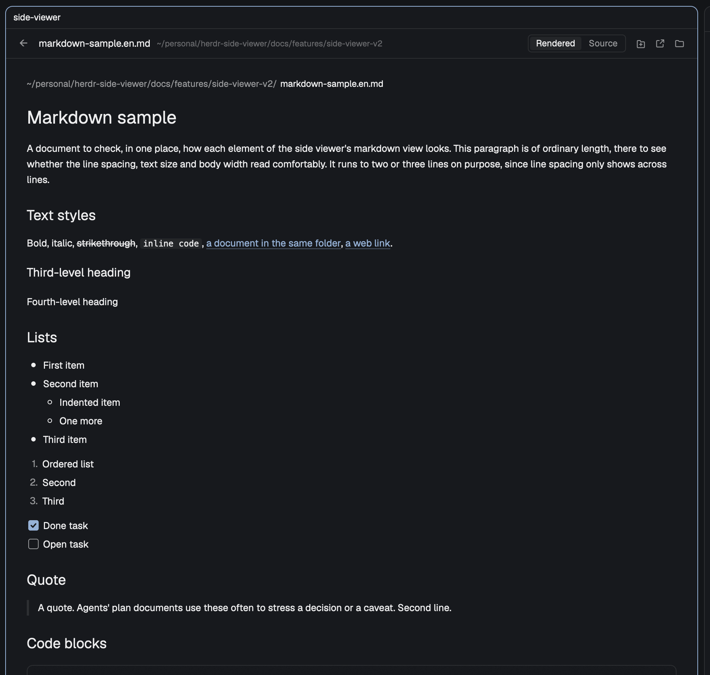

# Side Viewer

[English](README.md) | **한국어**

[Herdr](https://herdr.dev) 데스크톱 앱에 사이드 뷰어를 더하는 mod입니다. macOS 전용입니다.
에이전트 대화에서 파일 경로를 cmd-클릭하면 그 파일이 다른 앱이 아니라 대화 오른쪽 pane에
열립니다. 블록마다 그린 마크다운을 읽고, 구문 색이 있는 코드를 읽고 고치고, 이미지를 보고,
cmd+S로 저장하고, 파일 하나에 탭 하나를 따로 주고, 문서 속 셸 명령을 터미널 입력 칸에
넣습니다.



- **마크다운**(`md`, `markdown`, `mdx`): Warp의 마크다운 보기처럼 블록마다 그리고, 코드
  블록은 카드로 그립니다. 머리줄의 `렌더링 | 원문` 전환으로 원문 보기로 바꾸면 고칠 수
  있습니다.
- **코드와 텍스트**: 줄 번호와 구문 색이 있는 편집기로 열리고, 고칠 수 있습니다. 여기서
  `html`은 코드입니다. 페이지가 아니라 원문을 보고 고칩니다.
- **이미지**: pane 폭을 넘지 않게 그립니다. `svg`에도 `렌더링 | 원문` 전환이 있고, 원문을
  고칠 수 있습니다.
- **저장**(cmd+S): 고친 내용은 cmd+S나 머리줄의 `저장` 버튼으로만 저장하고, 저절로
  저장하지 않습니다. 예외는 고친 것이 없는 파일의 체크박스 클릭 하나입니다([고치기와 저장](#고치기와-저장)
  참고).
- **탭마다 뷰어 하나**: 탭에 이미 떠 있는 뷰어가 다음 파일을 받으니 pane이 쌓이지 않고,
  `←`로 앞의 파일로 돌아갑니다. 디스크에서 파일이 바뀌면 뷰어가 다시 읽습니다.
- **뷰어 탭**: 머리줄의 `새 탭으로 열기` 버튼이 그 파일에 탭을 따로 줍니다.
- **셸 블록의 `>_`**: 코드 블록의 명령을 뷰어 아래 셸 pane에 입력해 두고, 실행하지는
  않습니다(zsh vi 키의 좁은 예외 하나는 [한계](#한계) 참고).
- **Herdr 밖**(Finder, 다른 터미널)에서는 같은 파일이 전에 열리던 앱에서 그대로 열립니다.

### 동작 방식

Herdr는 cmd-클릭한 경로를 macOS에 넘기고, macOS는 그 종류의 파일을 기본 앱으로 엽니다.
그래서 이 저장소에는 작은 백그라운드 앱인 **라우터**가 있고, 이것을 확장자 목록의 기본
앱으로 정합니다. 라우터는 파일을 받을 때마다 앞에 있는 앱을 봅니다. Herdr면 파일을 사이드
뷰어로, 그 밖이면 **원래 앱**(넘겨받기 전에 기본 앱이던 앱)으로 보냅니다. 라우터는 아래의
넘겨받기 명령을 실행했을 때만 기본 앱 자리를 차지하고(예외 하나는 [한계](#한계)에
있습니다), 명령 하나로 전부 되돌립니다.

### 고치기와 저장

- **고칠 수 있는 곳.** 마크다운 원문, svg 원문, 코드 보기에서 글자를 칠 수 있습니다.
  마크다운 렌더링, 이미지(svg의 그림 포함), 문서 안 코드 블록 카드, 안내 화면에서는 칠 수
  없습니다. 비었거나 공백뿐인 마크다운·svg 파일은 렌더링 쪽에 `이 파일은 비어 있습니다.`
  안내를 보이고, `렌더링 | 원문`의 원문에서 바로 칠 수 있습니다. 쓴 뒤 렌더링으로 바꾸면 쓴
  글로 그린 문서·그림이 보입니다. 비었거나 공백뿐인 코드 파일은 빈 코드 보기로 열립니다.
  빈 `svgz`·그림은 그대로 안내만입니다. `svgz`에는 원문 보기가
  없습니다. 원문 보기는 긴 줄을 pane 폭에 맞춰 접고, 코드
  보기는 접지 않습니다. 셋 다 줄 번호가 있습니다.
- **편집됨.** 무언가 고치면 머리줄에 `편집됨`과 `저장` 버튼이 보입니다. cmd+S나
  버튼으로 파일을 쓰면 둘 다 사라지고, 고친 것을 손으로 되돌려도 사라집니다. 고친 것이
  없을 때 cmd+S는 아무것도 하지 않습니다. 머리줄의 그 자리는 파일의 상태 글입니다. 저장
  실패나 디스크의 변경도 `편집됨` 대신 그 자리에 빨간 글자로 보입니다. pane이 좁으면 파일
  이름과 폴더가 먼저 잘리고 그다음 상태 글이 잘리며, 마우스를 올리면 전문이 보입니다.
- **pane을 닫을 때까지 파일마다 남습니다.** 저장하지 않은 수정은 그 뷰어에 파일마다
  남습니다. 링크를 따라가거나 뒤로 가거나 다른 파일을 cmd-클릭했다가 그 파일로 돌아오면
  수정과 상태 글이 그대로 있습니다. pane을 닫거나 Herdr를 끄면 묻지 않고 버립니다.
- **저장 전에 미리 보기.** 고친 원문을 `렌더링`으로 바꾸면 고친 내용으로 그린 문서나 svg
  그림이 보입니다. 파일은 쓰지 않습니다.
- **밖에서 바뀐 경우.** 고친 내용이 있는 동안 디스크의 파일이 바뀌면(예를 들어 에이전트가
  썼을 때) 뷰어는 그것을 수정 위에 덮어 읽지 않습니다. 상태 글이 `외부에서 바뀌었어요`가
  되고, `저장` 대신 버튼 두 개가 있습니다. `다시 읽기`(수정을 버리고 디스크 내용을
  보임)와 `덮어쓰기`(내 것을 그 위에 저장)입니다. 저장할 때 뷰어가 마지막으로 읽은 뒤
  파일이 바뀌었으면 아무것도 쓰지 않고 같은 상태를 보입니다. 그동안에도 계속 칠 수
  있습니다. 고친 것이 없으면 전처럼 뷰어가 저절로 다시 읽습니다.
- **저장 실패.** 저장이 실패하면 상태 글이 이유를 말하고, `저장` 버튼과 수정은 남습니다.
  `쓰기 권한이 없어요`(권한 없음), `파일이 지워졌어요`(파일이 지워짐. 고친 파일이
  사라지면 바로 이것도 뜹니다), `너무 커서 저장할 수 없어요`(1 MiB, 1,048,576바이트
  초과), 그 밖에는 `저장하지 못했어요`이고 마우스를 올리면 오류 내용이 보입니다.
- **체크박스.** 렌더링에서 할 일 상자(`- [ ]`)를 누르면 상자가 바뀌고 그 원문 줄의 `[ ]`가
  `[x]`로, 또는 거꾸로 바뀝니다. 파일에 고친 것이 없으면 바로 저장합니다. "저절로 저장하지
  않는다"의 유일한 예외입니다. 그사이 디스크의 파일이 바뀌었으면 아무것도 쓰지 않고
  상태 글이 `외부에서 바뀌었어요`가 됩니다. 고친 것이 있으면 클릭이 그 수정에 더해지고
  `편집됨`으로 남습니다.

### 새 탭으로 열기

머리줄의 `새 탭으로 열기` 버튼(오른쪽 아이콘 셋 가운데 맨 왼쪽. 파일이 그려져 있을 때
있고, `뷰어에서 열기에는 너무 큽니다.`나 `이 파일은 더 이상 없습니다.` 같은 안내
화면에는 없습니다)은 **뷰어 탭**을 엽니다. 지금 탭 바로 뒤, 같은 space에 이 파일의 사이드
뷰어 하나만 있는 탭을 만들고 그리로 넘어갑니다. 탭 이름은 파일 이름이고, 링크, `←`, 새
파일을 따라 바뀝니다. 기록은 빈 채로 시작합니다. 같은 파일이라도 매번 새 탭을 엽니다.
저장하지 않은 수정은 파일을 따라 옮겨 갑니다. 새 탭에는 수정이 상태 글과 함께
보이고, 떠나온 뷰어에는 디스크의 글이 보입니다. 뷰어 탭이 화면에 있는 동안 cmd-클릭한
파일은 새 pane이 아니라 그 탭에 열립니다.

### 마크다운 보기

- **폭 전체.** 문서는 pane 폭을 다 쓰고 본문은 13pt이며, 맨 위에 폴더(흐리게)와 파일
  이름이 있습니다.
- **블록.** 제목은 세 크기(24, 19, 16pt. 4단계부터는 본문 크기 굵게)이고 밑줄이 없습니다.
  목록은 채운 점, 한 단계 안쪽은 빈 점, 번호, 체크박스로 그리고, 빈 줄로 나뉜 다른 종류의
  목록은 따로 그립니다. 표는 내용만큼 넓고, 머리 행은 굵고, 행 사이에만 선이 있고, 열
  정렬을 지킵니다. `---`는 두꺼운 구분선입니다. 인용은 왼쪽 막대와 흐린 글자로 그리고,
  안의 블록도 같은 방식으로 그립니다. 각주는 위첨자 번호로 달고 문서 끝에 모아 둡니다. 문단 안의
  링크, 굵게, 기울임, 인라인 코드, 취소선은 전처럼 동작합니다.
- **코드 블록**은 카드가 됩니다. 모서리가 둥글고 테두리가 있으며, 어두운 테마에서는 위에서
  아래로 옅어지고 밝은 테마에서는 한 가지 색입니다. 왼쪽 아래에 언어가 붙습니다. 아는
  언어면 그 이름(`JavaScript`, `Python`, `HTML` 등), 셸 명령은 `Shell`, `mermaid`는
  `Mermaid`, 그 밖에는 `Code`입니다. 오른쪽 아래의 복사 버튼은 블록 전체를 클립보드에 넣고
  잠깐 체크 표시로 바뀝니다. 구문 색이 있고, 긴 줄은 카드 안에서 접힙니다. 카드는 코드만큼
  높고 따로 스크롤하지 않아서, 카드 위에서 휠을 굴리면 문서가 스크롤됩니다. 카드를 눌러도
  커서가 생기지 않고, 글자를 고르거나 고칠 수 없습니다. 목록 속 코드 블록은 항목 글과 같이
  들여 쓰고, 인용 속 코드 블록은 인용 막대 안에 놓입니다.
- **셸 블록의 `>_`.** 언어가 없거나 `sh`, `shell`, `bash`, `zsh`, `fish`, `console`인
  블록에는 `>_` 버튼도 있습니다. 누르면 뷰어 아래에 셸 pane을 열고 그 입력 칸에 명령을
  입력합니다. Enter는 누르지 않고 클립보드도 건드리지 않습니다. 확인한 뒤 Enter는 직접
  누르세요. 셸은 zsh이고, 뷰어 옆 대화 터미널의 폴더(뷰어 탭에서는 문서의 폴더)에서
  시작합니다. 셸 pane이 열려 있는 동안 다음 `>_`도 같은 pane에 넣습니다. 그 셸이 프로그램을
  실행 중이면 아무것도 넣지 않고 알림으로 알립니다(`터미널에 넣지 않았습니다`). 셸 pane을
  처음 열 때 명령을 데이터 폴더의 파일에 쓰고, zsh에 `ctrl+alt+F12` 키 하나를 가르치고 그
  파일의 명령을 넣은 뒤 화면을 지우는 줄 하나를 보내므로, 셸 화면에 남는 줄은 없습니다. 그
  뒤 `>_`는 파일을 쓰고 그 키만 누릅니다. 프롬프트에 쳐 두었던 글은 zsh의 push-line으로 밀어
  두었다가 명령 뒤에 돌아옵니다(vi 키에서도 같습니다). 키를 누르고 0.5초(줄을 보내고 3초)
  안에 셸이 파일을 가져가지 않으면 명령이 들어가지 않았다고 알리고(`터미널에 넣지 못했습니다`),
  다음 `>_`가 셸을 다시 가르칩니다. 다른 기계의 셸에는 아무것도 보내지 않고 같은 알림을
  띄웁니다. 파일이 이 Mac에 있기 때문입니다.
- **그림.** 한 줄을 혼자 차지한 로컬 그림(``, 문서 폴더 기준 상대 경로나
  절대 경로)은 문서 안에 그립니다. 폭은 pane 폭까지, 원래 크기보다 크지 않게, 높이는 최대
  420, 가운데 정렬입니다. 읽을 수 없는 그림 자리에는 `그림을 못 읽음: <경로>`가 보입니다.

## 추가하기 전에

- **실행하는 프로그램**: 라우터는 내 컴퓨터에서
  [`mods/side-viewer/router/main.swift`](mods/side-viewer/router/main.swift)로 빌드하고
  ad hoc 서명을 합니다. mod와 라우터는 셸 명령(`sh`, `open`, `stat`, `cp`, `rm` 같은 것과
  `herdr-app`)을 실행하고, 여는 파일을 읽습니다.
- **내 파일에 쓰는 일**: mod는 파일을 저장하거나 그 파일의 체크박스를 누를 때 그 파일을
  씁니다.
- **터미널**: `>_` 버튼은 zsh pane을 열고 Herdr의 `hc`(`hc send`, `hc keys`, `hc get`)로
  그 안에 입력합니다. 처음 연 셸에는 `ctrl+alt+F12`에 넣기 위젯을 묶는 줄을 한 번 보내고,
  그 안에서 zsh를 새로 띄우면 다시 보냅니다.
- **네트워크**: 밖으로 나가는 것은 없습니다. 문서 안에서 누른 웹·메일 링크는 macOS에
  넘깁니다.
- **데이터 폴더**(`~/.config/herdr-app/data/side-viewer/`): mod와 라우터가 여기에 씁니다.
  - `original-apps.tsv`: 원래 앱 기록
  - `request.json`과 `answer-<id>`: 라우터가 뷰어에 넘기는 요청
  - `images/`: 본 이미지와 마크다운 문서 속 그림의 사본
  - `previews/`: 저장하기 전에 그리는, 고친 svg 원문의 사본
  - `handoff-<id>.json`: 새 뷰어 탭에 넘기는 저장하지 않은 수정. 탭이 읽으면 지웁니다(그
    사이에 Herdr가 꺼지면 하나 남을 수 있습니다).
  - `shell/<터미널>.txt`: `>_`가 셸 pane에 넘기는 명령. 셸이 입력 칸에 넣으면서 지우고, 셸이
    가져가지 않으면 뷰어가 지웁니다(`hc` 호출이 실패하면 하나 남을 수 있고, 다음 `>_`가
    덮어씁니다).

  `images/`나 `previews/`의 사본은 같은 파일의 새 사본이 대신하거나 30일 동안 보이지
  않으면 지웁니다.

구조와 주의점은 [RECIPE.md](RECIPE.md)에 있습니다.

## 설치

Herdr 앱(`PATH`에 `herdr-app`)과, 라우터를 빌드하는 Xcode 명령줄 도구
(`xcode-select --install`)가 필요합니다.

```sh
git clone https://github.com/ukkiee/herdr-side-viewer
cd herdr-side-viewer && ./install.sh
```

`install.sh`는 mod에 `herdr-app check`를 돌리고, `~/Applications/Side Viewer Router.app`을
빌드하고, mod를 `~/.config/herdr-app/mods/side-viewer`(또는 `$HERDR_APP_HOME`)에
복사합니다. check나 빌드가 실패하면 설치되어 있던 mod와 라우터는 그대로 둡니다. 아래의
넘겨받기 명령은 실행하지 않습니다. 다만 빌드만으로도 다른 앱이 맡지 않은 확장자는 라우터가
기본 앱이 될 수 있습니다([한계](#한계)의 "빌드만으로 기본 앱이 바뀔 수 있습니다" 참고).
**업데이트하려면 `git pull` 뒤에 다시 실행하세요.**

### 확장자 넘겨받기

라우터의 명령은 그 실행 파일의 옵션입니다. 셸 함수 하나를 두면 덜 칩니다.

```sh
router() { "$HOME/Applications/Side Viewer Router.app/Contents/MacOS/SideViewerRouter" "$@"; }

router --make-default        # 마크다운과 이미지 확장자
router --make-default code   # 위와 같고, 코드 확장자까지
```

macOS는 기본 앱을 바꿀 때마다 파일 종류마다 한 번씩 확인을 받고, 어떤 앱도 대신 답할 수
없습니다. 한 파일 종류의 확장자들(`jpg`, `jpeg`, `jpe`)은 창 하나를 함께 씁니다. 명령은
먼저 창이 몇 번 뜰지 찍고(`macOS 확인 창이 N번 뜹니다.`), 요청을 하나씩 보내며 답마다 최대
300초를 기다립니다. 라우터가 아직 맡지 않은 것만 묻기 때문에 N은 아래 숫자보다 작을 수
있습니다.

창마다 **Side Viewer Router**를 고르세요. 지금 앱을 유지하는 버튼을 고르면 그 확장자는
그대로이고, 명령은 그것을 실패가 아니라 `유지를 선택함`에 적습니다. 바뀐 확장자는 `바뀜`에,
진짜 실패는 이유와 함께 `실패`에 적습니다.

묻기 전에 명령은 확장자마다 원래 앱을
`~/.config/herdr-app/data/side-viewer/original-apps.tsv`에 기록합니다. 다시 실행해도 이
기록을 라우터 자신으로 바꾸지 않습니다.

종료 코드: `0` 요청한 것이 모두 바뀜(또는 바꿀 것이 없음), `1` 요청 하나가 실패, `2` 잘못된
사용, `3` 실패는 없지만 일부에서 지금 앱을 유지함.

### 코드 확장자 넘겨받기

코드 파일(`html` 포함)은 라우터가 코드 묶음을 맡은 뒤에야 뷰어에 열리고 그곳에서 고칠 수
있습니다. `./install.sh`를 포함해 그 무엇도 이것을 대신 하지 않습니다. 할지, 언제 할지는
직접 고릅니다.

1. 지금 상태를 봅니다: `router --status`. 아직 다른 앱이 적힌 코드 확장자가 물어볼
   대상입니다.
2. `router --make-default code`를 실행합니다. 라우터가 아직 아무것도 맡지 않은 Mac에서는
   확인 창이 최대 **35번** 뜹니다. 마크다운과 이미지 7번, **코드 28번**입니다. 명령이 찍는 첫 줄이
   실제 횟수입니다.
3. 창마다 **Side Viewer Router**를 고릅니다. `html` 창에는 지금 앱으로 쓰는 브라우저 이름이
   나옵니다. 거기서 라우터를 골라야 `html` 파일이 뷰어로 옵니다. Herdr 밖에서는 여전히 그
   브라우저에서 열립니다.
4. 출력을 확인합니다. 바뀐 것은 `바뀜`, 지금 앱을 유지한 창은 `유지를 선택함`에 있습니다.
   명령을 다시 실행하면 그것들만 다시 묻습니다.

되돌리려면 아래의 `router --restore`가 브라우저의 `html`까지 전부 돌려줍니다.

### 되돌리기

```sh
router --restore
```

라우터가 아직 맡고 있는 확장자를 모두 원래 앱으로 돌려 달라고 macOS에 요청합니다. 창이
다시 파일 종류마다 한 번씩 뜨고, 이번에는 **원래 앱**을 골라야 합니다. 지금 앱을 유지하면
그 확장자는 라우터에 남습니다. 그사이 직접 기본 앱을 바꾼 확장자는 건드리지 않습니다.
기록된 원래 앱이 그 뒤에 지워졌으면 명령이 그렇게 알리고, 대신 형제 확장자의 앱이나
TextEdit(이미지는 미리보기)으로 돌려 달라고 요청합니다.

**라우터 앱을 지우기 전에 실행하세요.** 되돌리는 데 쓰는 기록은 이 명령 없이는 쓸모가
없습니다.

### 지금 상태 보기

```sh
router --status
```

확장자마다 한 줄씩, 탭으로 나눠 확장자, 지금 기본 앱, 기록된 원래 앱(없으면 `-`)을 번들
ID로 찍습니다.

```
md	dev.ukkiee.side-viewer-router	com.apple.TextEdit
png	com.apple.Preview	-
```

여기서 `md`는 라우터가 맡고 있고 `png`는 아닙니다.

## 확장자

목록은 [`mods/side-viewer/extensions.json`](mods/side-viewer/extensions.json)에 있고,
라우터와 뷰어가 같이 읽습니다.

| 묶음 | 확장자 | 넘겨받는 명령 |
|---|---|---|
| markdown | `md` `markdown` `mdx` | `--make-default` |
| image | `png` `jpg` `jpeg` `jpe` `gif` `webp` `svg` `svgz` | `--make-default` |
| code | `log` `json` `jsonc` `yaml` `yml` `toml` `js` `mjs` `jscript` `javascript` `cjs` `jsx` `ts` `tsx` `css` `scss` `py` `go` `rs` `rb` `rbw` `java` `jav` `kt` `swift` `c` `h` `cpp` `cp` `c++` `cc` `cxx` `sh` `zsh` `sql` `xml` `csv` `html` `htm` `shtml` `shtm` | `--make-default code` |

macOS가 기본 앱을 파일 종류마다 정하기 때문에 형제와 함께 딸려 오는 것들이 있습니다.
`jpg`의 `jpe`, `svg`의 `svgz`, `js`의 `jscript`와 `javascript`, `rb`의 `rbw`, `java`의
`jav`, `cpp`의 `cp` `c++` `cc` `cxx`, `html`의 `htm` `shtml` `shtm`입니다. `xhtml`은 따로인
파일 종류라 목록에 없습니다.

## 한계

- **macOS 전용입니다.**
- **줄 번호는 무시합니다.** `app.ts:12`를 눌러도 파일을 맨 위부터 보여 줍니다.
- **목록에 없는 것은 모두 지금처럼 열립니다.** 확장자 없는 파일, 목록 밖 확장자, 그리고
  일부러 뺀 `txt`, `diff`, `patch`입니다(`txt`는 `README` 같은 확장자 없는 텍스트 파일까지
  끌고 오고, `diff`와 `patch`는 파일 종류가 같지만 원래 앱이 다를 수 있습니다).
- **`html`이 브라우저로 돌아갈 수 있습니다(확인하지 못함).** 기본 브라우저를 바꾸면 macOS가
  `html`을 브라우저에 돌려줄 수 있습니다. 그러면 `router --status`에 `html`의 기본 앱으로
  브라우저가 보이고, cmd-클릭한 `html` 파일이 거기서 열립니다. `router --make-default code`가
  다시 요청합니다.
- **`html`은 코드로 보여 주고**, 페이지로 그리지 않습니다.
- **마크다운에서 그리지 않는 것**: `mermaid` 다이어그램(코드 카드로 보임), 수식, GitHub 알림
  상자, HTML 태그, 정의 목록, 웹 그림(`https`), 한 줄을 혼자 차지하지 않고 문단 안에 있는
  그림. 웹 그림은 받아 오지 않습니다.
- **자동 저장도, "저장할까요?" 확인도 없습니다.** 저장하지 않은 수정은 pane을 닫거나 Herdr를
  끄면 사라집니다. cmd+S 없이 저장하는 것은 고친 것이 없는 파일의 체크박스 클릭 하나뿐입니다.
- **셸 pane에서 zsh를 새로 띄운 뒤의 첫 `>_`는 화면을 지우고, 한 번 더 눌러야 할 수
  있습니다.** 그 셸 안에서 `zsh`를 실행했거나 마지막으로 가르친 zsh와 다른 인자로
  `exec zsh`를 실행했다면, 뷰어가 새 zsh로 알아보고 넣기 키를 다시 가르치는 줄을 보낸 뒤
  `clear`로 지웁니다. 인자가 같으면(예: `exec zsh`를 연달아 두 번) 알아보지 못해, 그 `>_`는
  입력 칸에 `;7~`를 남기고 `터미널에 넣지 못했습니다` 알림을 띄우며, 다음 `>_`가 셸을 다시
  가르칩니다. 이 줄을 보낼 때만 쳐 두었던 글을 alt+q로 밀어 두므로, 그 새 zsh가 vi 키맵이고
  프롬프트에 글이 있으면 그 글이 준비 줄과 함께 실행될 수 있습니다. 새 zsh를 띄운 뒤 첫
  `>_` 전에는 프롬프트를 비우세요.
- **다른 기계의 셸에는 `>_`로 넣지 못합니다.** 명령이 이 Mac의 파일을 거치는데 그 셸은 이
  파일을 읽지 못하므로, 알림으로 알립니다. 복사 버튼을 쓰세요.
- **블록 사이 키보드 이동이 없습니다.** 원문 전환용 `cmd+E`도, 명령 속 `{{placeholders}}`
  채우기도 없습니다.
- **끝에 글자가 붙은 경로는 열리지 않습니다.** Herdr는 경로 바로 뒤의 글자까지 경로로
  읽어서(`/tmp/notes/plan.md에서`) 파일을 찾지 못합니다. 경로 뒤에 빈칸이 있으면 열립니다.
- **다른 머신의 터미널이 찍은 경로는 지원하지 않습니다.**
- **웹 주소는 뷰어가 아니라 브라우저로 갑니다.** 마크다운 문서 안의 웹·메일 링크는 macOS에
  넘기고, 다른 마크다운 파일로 가는 링크는 뷰어에 열고, 그 밖의 로컬 파일 링크는 Finder에서
  보여 주기만 합니다.
- **너무 커서 그리지 않는 것**: 1 MB가 넘는 텍스트와 20 MB가 넘는 이미지는 대신 안내가
  뜹니다. 머리줄 버튼으로 원래 앱에서 열거나 Finder에서 볼 수는 있습니다. 1 MB가 넘는
  `svg`는 그리지만 원문 전환이 없습니다.
- **되돌리기가 한 파일 종류 안의 앱을 하나로 합칠 수 있습니다.** macOS는 파일 종류마다 기본
  앱을 하나만 두지만, 한 종류의 두 확장자가 서로 다른 앱에서 열릴 수 있습니다(`js`와 `mjs`에서
  봤고, `svg`/`svgz`, `rb`/`rbw`, `cpp`/`cp`에서도 가능합니다). 라우터가 맡는 동안에는 각자
  자기 원래 앱으로 갑니다. `--restore` 뒤에는 모두 목록에서 앞에 오는 확장자의 원래 앱에서
  열립니다.
- **빌드만으로 기본 앱이 바뀔 수 있습니다.** 설치된 어떤 앱도 맡지 않은 확장자(`mdx`,
  `jsonc`, `rbw`, `cp`에서 봤습니다)는 `--make-default` 전에도 라우터를 빌드하자마자 라우터로
  갑니다. 이것들은 기록된 원래 앱이 없어서 라우터가 TextEdit(이미지는 미리보기)으로 엽니다.
  같은 파일 종류의 형제 확장자가 있는 것(`rbw`의 `rb`, `cp`의 `cpp`)은 `--restore` 뒤에도
  라우터에 남고, 명령은 그것을 `라우터에 남음`에 적습니다. macOS는 기본 앱을 파일 종류마다
  정하고, 그 확장자 자체를 맡는 앱은 라우터뿐이기 때문입니다. 라우터는 계속 TextEdit이나
  미리보기로 열고, 라우터 앱을 지우면 풀립니다. 그런 형제가 없는 것(`mdx`, `jsonc`)은
  TextEdit이나 미리보기로 갑니다.
- **`.ts` 비디오 파일도 라우터를 거칩니다.** macOS는 `.ts`를 MPEG-2 비디오로 분류합니다.
  Herdr 밖에서는 여전히 원래 앱으로 갑니다.
- **넘겨받은 확장자의 파일은 Finder에서 열어도 모두 라우터를 거칩니다.** 라우터는 파일을 원래
  앱에 넘기고 끝납니다.
- **라우터는 기본 위치만 봅니다**: `~/.local/bin/herdr-app`과 `~/.config/herdr-app`. Herdr가
  다른 곳에 있거나 5초 안에 답하지 않으면 파일은 원래 앱에서 열립니다.
- **뷰어의 버튼, 안내, 툴팁과 명령의 출력은 한국어입니다.**

## 라이선스

MIT
