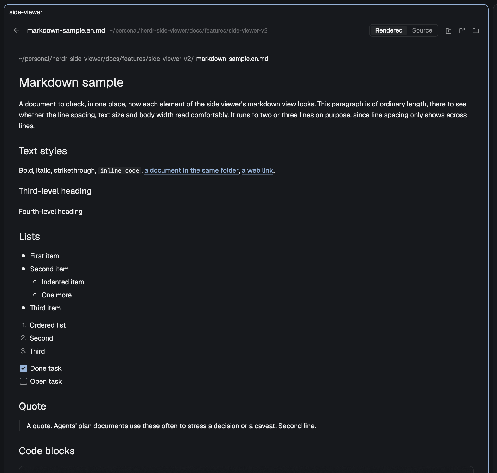

# Side Viewer

**English** | [한국어](README.ko.md)

A side viewer for the [Herdr](https://herdr.dev) desktop app, macOS only. Cmd-click a file
path in an agent's conversation and the file opens in a pane to the right of it, instead of
in another app. Read markdown drawn block by block, read and edit code with syntax colors,
look at images, save with cmd+S, give a file a tab of its own, and put a document's shell
command into a terminal's input line. `cmd-o` lists the paths a conversation printed and
opens the one you pick, which is also how files open in a space on another machine.



- **Markdown** (`md`, `markdown`, `mdx`): rendered block by block, in the manner of Warp's
  markdown view, with code blocks as cards. The header's `Rendered | Source` switch shows the
  source, which you can edit.
- **Code and text**: an editor with line numbers and syntax colors, and you can edit them.
  `html` is code here: you see and edit its source, not the page.
- **Images**: drawn no wider than the pane. An `svg` also has the `Rendered | Source` switch,
  and its source can be edited.
- **Saving** (cmd+S): edits are saved with cmd+S or the header's `Save` button, never on
  their own. The one exception is a checkbox click in a file without edits (see
  [Edit and save](#edit-and-save)).
- **One viewer per tab**: a viewer already showing in the tab takes the next file, so panes
  don't pile up, and `←` goes back to the file before. The viewer reloads when the file
  changes on disk.
- **Viewer tab**: the header's `Open in New Tab` button gives the file a tab of its own.
- **`>_` on shell blocks**: types a code block's command into a shell pane below the viewer,
  without running it (one narrow case with zsh's vi keys, see [Limits](#limits)).
- **Path picker** (`cmd-o`): a popup of the file paths in the focused conversation; pick
  one to open it beside the conversation (see [The path picker](#the-path-picker-cmd-o)).
- **Remote spaces**: in a space on a Linux machine or another Mac, the viewer shows, edits
  and saves that machine's files (see [Remote spaces](#remote-spaces)).
- **Outside Herdr** (Finder, another terminal) the same files keep opening in the app they
  opened in before.

### How it works

Herdr hands a cmd-clicked path to macOS, which opens it in the default app for that kind of
file. So this repo ships a small background app, the **router**, that you make the default
app for a list of extensions. For each file it receives, it looks at which app is in front:
Herdr sends the file to the side viewer, anything else sends it to the **original app**,
the one that was the default before. The router takes over only when you run the take-over
command below (the one exception is under [Limits](#limits)), and one command gives
everything back.

### The path picker (cmd-o)

`cmd-o` opens a popup at the top of the window with the file paths the focused conversation
printed, and opens the one you pick in the side viewer. It works the same in a space on this
Mac and in a [remote space](#remote-spaces), where it is the way in: a cmd-click there opens
nothing, because the file is not on this Mac. On this Mac it also opens files whose
extension the router has not taken over.

- **Which paths.** From the focused terminal's screen and the 1000 lines above it: absolute
  paths, `~` paths, paths relative to the terminal's folder, paths with a line number
  (`a.md:12`, `a.md:12:3`, `a.md:12-20`; the number is dropped) and paths in backticks. Only
  files with an extension in the [list](#extensions) that exist on that terminal's machine,
  newest (lowest on screen) first, each once, at most 30. Each row shows the file name and
  its folder.
- **Picking.** Type to keep only the paths that contain what you typed (case ignored). ↑↓
  move, Enter or a click opens. Esc, the `Esc` button or a click beside the popup closes it
  and changes nothing.
- **Where it opens.** A side viewer showing in the conversation's tab takes the file, so no
  pane is added; otherwise a new viewer splits off to the right of the conversation. The
  popup closes once that is settled, within about half a second.
- **Focus.** With focus on a side viewer beside a conversation, the picker reads that
  conversation (an agent's terminal first). Anywhere else without a terminal (a viewer tab,
  another mod) it says `Click a conversation terminal, then press again.`
- **Its other lines**: `Finding…`, `This conversation shows no file path to open.`,
  `No path matches.`, the two remote notices below, and `Couldn't look for paths: <reason>`
  for any other failure (the terminal closed, say).

### Remote spaces

A side viewer reads and writes the files of the machine its space is on. In a space on
another machine connected to Herdr, open a file with `cmd-o`; links, `←` and viewer tabs
then stay on that machine. Linux and macOS machines are supported.

- **The same as on this Mac**: markdown (rendered and source), code, images with the svg
  switch, pictures in markdown (relative to the document's folder, or absolute, on that
  machine), the size limits and notices, editing, cmd+S, checkboxes, `Changed on disk`,
  the save failures, and `Open in New Tab`, which opens the tab in the same remote space and
  takes unsaved edits along.
- **No `Open in Original App` or `Show in Finder`** in the header: both act on this Mac,
  where the file is not.
- **Changes show within about 3 seconds.** Every 3 seconds the viewer asks the machine for
  the file's checksum and reads the file again only when it changed. With unsaved edits it
  reads nothing over them and says `Changed on disk`, as on this Mac.
- **Saving** writes the file on that machine. Just before writing, the viewer reads it
  again: if it no longer holds the text last read, nothing is written and the status says
  `Changed on disk`. The file keeps its mode (an executable stays executable), and a file
  opened through a symbolic link stays a link, with its target changed. The text passes
  through a copy in the data folder on this Mac, deleted once the write ends. Failures show
  as on this Mac (`No write permission`, `File deleted`, `Too large to save`,
  `Couldn't save`).
- **Links** in a remote document: markdown, code and image files open in the viewer; any
  other file gets a notification, `Can't show this file`, with its path. `~` is that
  machine's home. Web and mail links open on this Mac.
- **Out of reach.** When the machine can't be reached, the viewer shows
  `Can't reach the machine <name>.` instead of `This file no longer exists.`, and the
  picker says the same. Unsaved edits stay in the editor, and a save meanwhile fails with
  that line as its status. Once the machine is back, the viewer reads the file again at
  its next check.
- **Windows machines are not supported.** The viewer and the picker show
  `Files on Windows machines can't be shown yet.`
- **The router stays out of remote spaces.** A file that reaches the router while a remote
  space has focus (a path that also exists on this Mac, say) opens in its original app.
- **`>_` doesn't type into a shell on another machine** (see [Limits](#limits)).

### Edit and save

- **Where.** The markdown source, the svg source and the code view take typing. The
  markdown rendering, images (an svg's picture too), the code block cards inside a
  document and the notices do not. An empty (or blank) markdown or svg file shows
  `This file is empty.` on its rendering side, and its `Rendered | Source` source is ready
  to type; back on the rendering, what was typed is drawn. An empty (or blank) code file
  opens as an empty code view. An empty `svgz` or picture still gets only the notice.
  An `svgz` has no source view. The sources wrap long
  lines to the pane; the code view does not. All three have line numbers.
- **Edited.** Once you change something, the header shows `Edited` and a `Save`
  button. cmd+S or the button writes the file and both go away; so does undoing your
  change by hand. cmd+S with nothing changed does nothing. That spot in the header is the
  file's status: a failed save or a change on disk shows there too, in red, in place of
  `Edited`. In a narrow pane the file name and folder are cut first, then the status;
  hover it to read all of it.
- **Kept per file, until the pane closes.** Edits not yet saved stay with that viewer, for
  each file: follow a link, go back, or cmd-click another file, and when you return to the
  file your edits and their status are back. Closing the pane or quitting Herdr drops them,
  and nothing asks first.
- **Preview before saving.** Switch an edited source to `Rendered` and you see the document,
  or the svg's picture, drawn from your edits. The file is not written.
- **Changed outside.** If the file changes on disk while you have edits (an agent wrote
  it, say), the viewer does not read it over them. The status says `Changed on disk`,
  and two buttons take the place of `Save`: `Reload` (drop your edits and show the
  disk) and `Overwrite` (save yours over it). A save that finds the file changed since the
  viewer last read it writes nothing and shows the same. You can keep typing meanwhile.
  Without edits the viewer reloads by itself, as before.
- **Save failures.** When a save fails, the status says why, `Save` stays, and your
  edits stay: `No write permission`, `File deleted` (this also shows as soon as an edited
  file disappears), `Too large to save` (over 1 MiB, 1,048,576 bytes), or `Couldn't save`
  for anything else, where hovering it shows the error.
- **Checkboxes.** Clicking a task box (`- [ ]`) in the rendering flips it and turns that
  source line's `[ ]` into `[x]` or back. With no edits in the file it is saved at once,
  the one exception to "never on their own"; if the file changed on disk meanwhile, nothing
  is written and the status says `Changed on disk`. With edits, the click joins them and
  stays `Edited`.

### Open in a new tab

The header's `Open in New Tab` button (the leftmost of the three icons on the right, there
while a file is drawn, not on a notice such as `Too large to open in the viewer.` or
`This file no longer exists.`) opens a
**viewer tab**: a tab right after the current one, in the same space, holding only a side
viewer of this file, and switches to it. The tab is named after the file and follows it
through links, `←` and new files. It starts with an empty history. The same file opens a new
tab every time. Unsaved edits move with the file: the new tab shows them with their status,
and the viewer you left shows the disk text. While a viewer tab is on screen, a cmd-clicked
file opens in it, not in a new pane.

### The markdown view

- **Full width.** The document uses the pane's whole width, body text at 13pt, with the
  folder (dimmed) and the file name at the top.
- **Blocks.** Headings in three sizes (24, 19 and 16pt; level 4 and below bold body size),
  no underline. Lists with filled dots, hollow dots one level in, numbers and checkboxes;
  lists of a different kind separated by a blank line are drawn apart. Tables as wide as
  their content, bold header row, lines between rows only, column alignment kept. A thick
  rule for `---`. Quotes with a bar on the left and dimmed text, the blocks inside drawn
  the same way. Footnotes as superscript numbers, listed at the end. Links, bold, italic,
  inline code and strikethrough inside a paragraph work as before.
- **Code blocks** become cards: rounded, with a border, a top-to-bottom fade on a dark theme
  and one flat color on a light one. Bottom left the language: its name when known
  (`JavaScript`, `Python`, `HTML` and so on), `Shell` for shell commands, `Mermaid` for
  `mermaid`, otherwise `Code`. Bottom right a copy button that puts the whole block on the
  clipboard and turns into a check mark for a moment. Syntax colors; long lines wrap inside
  the card; the card is as tall as its code, with no scrolling of its own, so the wheel over
  it scrolls the document. Clicking a card puts no cursor in it, and its text can't be
  selected or edited. A code block in a list is indented with the item's text, one in a quote
  sits inside the quote's bar.
- **`>_` on shell blocks.** A block with no language or with `sh`, `shell`, `bash`, `zsh`,
  `fish` or `console` also has a `>_` button. It opens a shell pane below the viewer and
  types the command into its input line. It does not press Enter and does not touch the
  clipboard: check it, then press Enter yourself. The shell is zsh and starts in the folder of
  the conversation terminal beside the viewer (in a viewer tab, the document's folder). The
  next `>_` goes into the same shell pane while it is open. If that shell is running a
  program, nothing is typed and a notification says so (`Not inserted into the terminal`). When it
  first opens the shell pane it writes the command to a file in the data folder and sends zsh
  one line that teaches it a key, `ctrl+alt+F12`, puts that file's command in and clears the
  screen, so no line is left on the shell's screen. After that `>_` writes the file and
  presses only that key. Text you had typed at the prompt is moved aside with zsh's push-line
  and comes back after the command (with vi keys too). If the shell has not taken the file
  half a second after the key (3 seconds after the line), a notification says the command did
  not go in (`Couldn't insert into the terminal`) and the next `>_` teaches the shell again. A shell on
  another machine gets nothing and the same notification: the file is on this Mac.
- **Pictures.** A local picture on a line of its own (``, relative to the
  document's folder, or absolute) is drawn in the document: as wide as the pane at most,
  never larger than itself, at most 420 high, centered. One that can't be read shows
  `Couldn't read image: <path>` in its place.

### Language

The viewer and the router's commands speak Korean when macOS's first preferred language
(the first entry of `defaults read -g AppleLanguages`) is Korean, and English otherwise.
There is no switch.

- **The viewer** reads the language when it opens, and every viewer, viewer tabs included,
  follows the language the newest one read. After you change the system language, viewers
  already open switch only once you open a new one (cmd-click a file in a tab without a
  viewer, or `Open in New Tab`); they don't read it again on their own.
- **When it can't be read**, a viewer keeps the language it had (English the first time)
  and asks again after 1, 3 and 10 seconds, then every 15 seconds until it gets an answer.
- **The router's commands** read it once per run, and speak English when they can't.
- **Not translated**: code block labels (`Shell`, `JavaScript` and so on), file names and
  paths, the error Herdr gives (shown when hovering `Couldn't save`), and the header's
  `Side Viewer` when no file is open.

## Before you add it

- **Programs**: the router is built on your machine from
  [`mods/side-viewer/router/main.swift`](mods/side-viewer/router/main.swift) and signed ad
  hoc. The mod and the router run shell commands (`sh`, `open`, `stat`, `cp`, `rm` and the
  like, and `herdr-app`), and read the files you open. To pick the language, the viewer and
  the router's commands run `defaults read -g AppleLanguages`. The path picker reads the
  focused terminal with `hc read` and checks which paths are files with one `sh` on that
  terminal's machine.
- **Programs on another machine**: in a remote space the viewer runs, on that machine
  through Herdr, `sh` (with `stat`, `head`, `od`, `uname`, `printf`) and `cksum`, and
  reads files there. To save a file there or copy a picture's bytes it runs Herdr's `hc`
  command line on this Mac (`hc file write --on`, `hc exec --on … cat`), the `hc` on your
  `PATH`, else `~/.local/bin/hc`.
- **Herdr's shared state**: the viewer keeps the language last read under
  `side-viewer.lang` (`"en"` or `"ko"`), which every viewer reads.
- **Your files**: the mod writes a file when you save it or click a checkbox in it, on the
  machine of the viewer's space.
- **Herdr's keys**: `install.sh` adds `cmd-o` to Herdr's `keys.json` (see [Install](#install)).
- **Terminal**: the `>_` button opens a zsh pane and types into it through Herdr's `hc`
  (`hc send`, `hc keys`, `hc get`). A shell it opens gets one line binding an insert widget
  to `ctrl+alt+F12`, and a new zsh started there gets it again.
- **Network**: the mod opens no connection of its own. A file on another machine is read
  and written through Herdr's connection to that machine. A web or mail link you click in a
  document is handed to macOS.
- **Data folder** (`~/.config/herdr-app/data/side-viewer/`): the mod and the router write:
  - `original-apps.tsv`, the record of original apps;
  - `request.json` and `answer-<id>`, the request passed from the router or the path
    picker to the viewer;
  - `images/`, copies of the images you view and of the pictures inside markdown documents,
    those from another machine too;
  - `remote-saves/`, the text of a save to another machine on its way there, deleted once
    the write ends (one left by a quit in the middle is deleted by a remote save at least
    10 minutes later);
  - `previews/`, copies of edited svg sources, drawn before they are saved;
  - `handoff-<id>.json`, the unsaved edits handed to a new viewer tab, deleted once the tab
    has read them (one can be left behind if Herdr quits in between);
  - `shell/<terminal>.txt`, the command `>_` hands to a shell pane, deleted by the shell as it
    puts it in the input line, or by the viewer when the shell has not taken it (one can be
    left behind if an `hc` call fails; the next `>_` replaces it).

  A copy in `images/` or `previews/` is deleted when a newer copy of the same file replaces
  it, or when not shown for 30 days.

How it is built and what to watch for: [RECIPE.md](RECIPE.md).

## Install

Needs the Herdr app (`herdr-app` on your `PATH`) and Xcode's command line tools
(`xcode-select --install`), which build the router.

```sh
git clone https://github.com/ukkiee/herdr-side-viewer
cd herdr-side-viewer && ./install.sh
```

`install.sh` runs `herdr-app check` on the mod, builds
`~/Applications/Side Viewer Router.app`, and copies the mod into
`~/.config/herdr-app/mods/side-viewer` (or `$HERDR_APP_HOME`). If the check or the build
fails, the mod and the router that were installed stay as they were. It does not run the
take-over command below; building alone can still make the router the default for an
extension no other app claims (see "Building alone can change a default" under
[Limits](#limits)). **Run it again after `git pull` to update.**

### The cmd-o shortcut

`install.sh` also merges the path picker's key into Herdr's `keys.json`:
`"cmd-o": "mod.open:side-viewer"` under `global`. It prints what it did under
`Shortcut keys`.

- **Already there**: left as it is, so running it again adds nothing.
- **`cmd-o` bound to something else**, in any section (`global`, `terminal`, `layout:*`,
  `mod:*`): left as it is, and the output says so. Bind `mod.open:side-viewer` to another
  key yourself.
- **No `keys.json` yet, a `keys.json` that isn't valid JSON, or no Node**: nothing is
  changed and the output shows the line to add by hand.
- Other keys are never touched, and a `keys.json` that is a link stays a link.

**A changed `keys.json` no longer gets new default keys.** On an upgrade Herdr gives new
default shortcuts only to a keys file nobody edited; once this line is in, any new default
key has to be added by hand.

### Take over the extensions

The router's commands are flags of its binary. A shell function saves typing:

```sh
router() { "$HOME/Applications/Side Viewer Router.app/Contents/MacOS/SideViewerRouter" "$@"; }

router --make-default        # markdown and image extensions
router --make-default code   # the same, plus the code extensions
```

macOS asks you to confirm every change of a default app, once per file type, and no app can
answer for you. Extensions of one file type (`jpg`, `jpeg`, `jpe`) share one window. The
command first prints how many windows are coming (`macOS will show N confirmation windows.`) and then
sends the requests one at a time, waiting up to 300 seconds for each answer. It asks only for
what the router does not hold yet, so N can be smaller than the counts below.

In each window pick **Side Viewer Router**. If you pick the button that keeps the current
app, that extension stays as it was, and the command lists it under `Chose to keep`
rather than as a failure. Changed extensions are listed under `Changed`, real failures
under `Failed` with the reason.

Before asking, the command records each extension's original app in
`~/.config/herdr-app/data/side-viewer/original-apps.tsv`. Running it again never replaces
that record with the router itself.

Exit codes: `0` everything asked for changed (or nothing needed changing), `1` a request
failed, `2` wrong usage, `3` nothing failed but you kept the current app for some.

### Taking over the code extensions

Code files, `html` among them, open in the viewer (and can be edited there) only once the
router holds the code group. Nothing does that for you, `./install.sh` included: whether
and when to run it is your choice.

1. See where things stand: `router --status`. Code extensions that still name another
   app are the ones that will be asked about.
2. Run `router --make-default code`. On a Mac where the router holds nothing yet that is at
   most **35 windows**: 7 for markdown and images and **28 for code**. The first line it
   prints gives the real number.
3. In every window pick **Side Viewer Router**. The `html` window names your browser as
   the current app; picking the router there is what sends `html` files to the viewer.
   Outside Herdr they still open in that browser.
4. Check the output: `Changed` for what changed, `Chose to keep` for any window where the
   current app was kept. Run the command again to be asked about those only.

To undo it, `router --restore` (below) gives everything back, the browser's `html`
included.

### Give them back

```sh
router --restore
```

asks macOS to return every extension the router still holds to its original app. The
windows come up again, once per file type, and this time you have to pick **the original
app**: keeping the current one leaves the router in place for that extension. An extension
whose default you changed yourself in the meantime is left alone. If a recorded original
app has been uninstalled since, the command says so and asks for a sibling extension's app
instead, or for TextEdit (Preview for images).

**Run it before you delete the router app**: the record it restores from is of no use
without the command.

### See where things stand

```sh
router --status
```

prints one line per extension, separated by tabs: the extension, its current default app,
and the recorded original app (`-` when there is none), as bundle ids.

```
md	dev.ukkiee.side-viewer-router	com.apple.TextEdit
png	com.apple.Preview	-
```

Here `md` is with the router and `png` is not.

## Extensions

The list lives in [`mods/side-viewer/extensions.json`](mods/side-viewer/extensions.json);
the router and the viewer both read it.

| Group | Extensions | Taken over by |
|---|---|---|
| markdown | `md` `markdown` `mdx` | `--make-default` |
| image | `png` `jpg` `jpeg` `jpe` `gif` `webp` `svg` `svgz` | `--make-default` |
| code | `log` `json` `jsonc` `yaml` `yml` `toml` `js` `mjs` `jscript` `javascript` `cjs` `jsx` `ts` `tsx` `css` `scss` `py` `go` `rs` `rb` `rbw` `java` `jav` `kt` `swift` `c` `h` `cpp` `cp` `c++` `cc` `cxx` `sh` `zsh` `sql` `xml` `csv` `html` `htm` `shtml` `shtm` | `--make-default code` |

Some are there only because macOS sets default apps per file type, so they come along with
a sibling: `jpe` with `jpg`, `svgz` with `svg`, `jscript` and `javascript` with `js`, `rbw`
with `rb`, `jav` with `java`, `cp` `c++` `cc` `cxx` with `cpp`, `htm` `shtml` `shtm` with
`html`. `xhtml` is a file type of its own and is not in the list.

## Limits

- **macOS only**, for the Herdr app this runs in. Remote spaces can be on Linux or macOS
  machines; **Windows machines are not supported** (the viewer says so).
- **Line numbers are ignored.** Clicking or picking `app.ts:12` shows the file from the top.
- **Everything not in the list opens as it does today**: files without an extension,
  extensions outside the list, and `txt`, `diff` and `patch`, which are left out on purpose
  (`txt` would drag in extensionless text files such as `README`; `diff` and `patch` share a
  file type but can have different original apps).
- **`html` may go back to the browser (not verified).** macOS may hand `html` back to the
  browser when you change your default browser. `router --status` then shows the browser
  for `html`, and cmd-clicked `html` files open there; `router --make-default code` asks for
  it again.
- **`html` is shown as code**, never drawn as a page.
- **Not drawn in markdown**: `mermaid` diagrams (shown as a code card), math, GitHub alert
  boxes, HTML tags, definition lists, pictures from the web (`https`), and pictures inside a
  paragraph rather than on a line of their own. Web pictures are never fetched.
- **No autosave and no "save changes?" prompt.** Edits not saved are gone when the pane
  closes or Herdr quits. The one save without cmd+S is a checkbox click on a file without
  edits.
- **The first `>_` after starting a new zsh in the shell pane clears its screen, and can take
  a second press.** If you ran `zsh` there, or `exec zsh` with other arguments than the zsh
  taught last, the viewer sees a new zsh and sends it the line that teaches it the insert key
  again, then `clear`. When the arguments match (a second `exec zsh` in a row, say), it
  can't tell: that `>_` leaves `;7~` in the input line, a notification says
  `Couldn't insert into the terminal`, and the next `>_` teaches the shell again. Only when that line is
  sent is a draft moved aside with alt+q, so if that new zsh uses vi keys and its prompt
  holds text, the text can run along with that line. Clear the prompt before the first `>_`
  after starting a new zsh.
- **`>_` doesn't type into a shell on another machine.** The command goes through a file on
  this Mac, which that shell can't read; a notification says so. Use the copy button.
- **No keyboard navigation** between blocks, no `cmd+E` for the source switch, no filling in
  of `{{placeholders}}` in commands.
- **A path with text stuck to its end doesn't open.** Herdr reads the letters right after a
  path as part of it (`/tmp/notes/plan.md에서`), so it finds no file. With a space after the
  path it opens.
- **A cmd-click in a remote space opens nothing.** The file is not on this Mac, so nothing
  reaches the router; use `cmd-o`.
- **A remote save has a gap of under a second.** The viewer reads the file there again just
  before writing it, so a change that lands in between is overwritten without
  `Changed on disk`.
- **A read-only file on another machine is saved anyway** when its folder is writable: a
  file with mode 444 is replaced and keeps 444. `No write permission` shows only for a
  folder without write permission. (On this Mac, Herdr's own save probably does the same:
  see RECIPE.md, Watch out.)
- **The path picker misses some paths.** A path with a space or one of `,;=*` in it is
  found only inside backticks. Whether a path longer than the terminal is wide, wrapped
  onto two lines on screen, is found has not been checked.
- **Web addresses go to the browser**, not the viewer. A web or mail link inside a markdown
  document is handed to macOS; a link to another markdown file opens in the viewer, and a
  link to any other local file only shows it in Finder (in a remote space, see
  [Remote spaces](#remote-spaces)).
- **Too big to draw**: text over 1 MB and images over 20 MB get a notice instead. On this
  Mac the header's buttons still open the file in its original app or show it in Finder. An `svg`
  over 1 MB is drawn but has no source switch.
- **Restore can merge apps within one file type.** macOS keeps one default per file type,
  yet two extensions of a type can open in different apps (seen with `js` and `mjs`; also
  possible for `svg`/`svgz`, `rb`/`rbw`, `cpp`/`cp`). While the router holds them, each
  still goes to its own original app. After `--restore` they all open in the original app
  of the extension that comes first in the list.
- **Building alone can change a default.** An extension that no installed app claims
  (seen with `mdx`, `jsonc`, `rbw`, `cp`) goes to the router as soon as it is built, before
  any `--make-default`. Those have no original app on record, so the router opens them in
  TextEdit (Preview for images). One with a sibling extension of the same file type (`rb`
  for `rbw`, `cpp` for `cp`) stays with the router after `--restore`, which lists it under
  `Stayed with the router`: macOS sets defaults per file type, and no app but the router claims that
  extension itself. The router keeps opening it in TextEdit or Preview, and deleting the
  router app frees it. One without such a sibling (`mdx`, `jsonc`) goes to TextEdit or
  Preview.
- **`.ts` video files pass through the router too.** macOS classes `.ts` as MPEG-2 video.
  Outside Herdr they still reach the original app.
- **Every file with a taken-over extension passes through the router**, also from Finder.
  It hands the file on to the original app and quits.
- **The router looks in the default places**: `~/.local/bin/herdr-app` and
  `~/.config/herdr-app`. With Herdr elsewhere, or if Herdr doesn't answer within 5 seconds,
  the file opens in its original app.
- **English and Korean only**, picked from macOS's first preferred language with no switch
  (see [Language](#language)). Viewers already open follow a changed system language only
  once a new viewer opens.

## License

MIT
