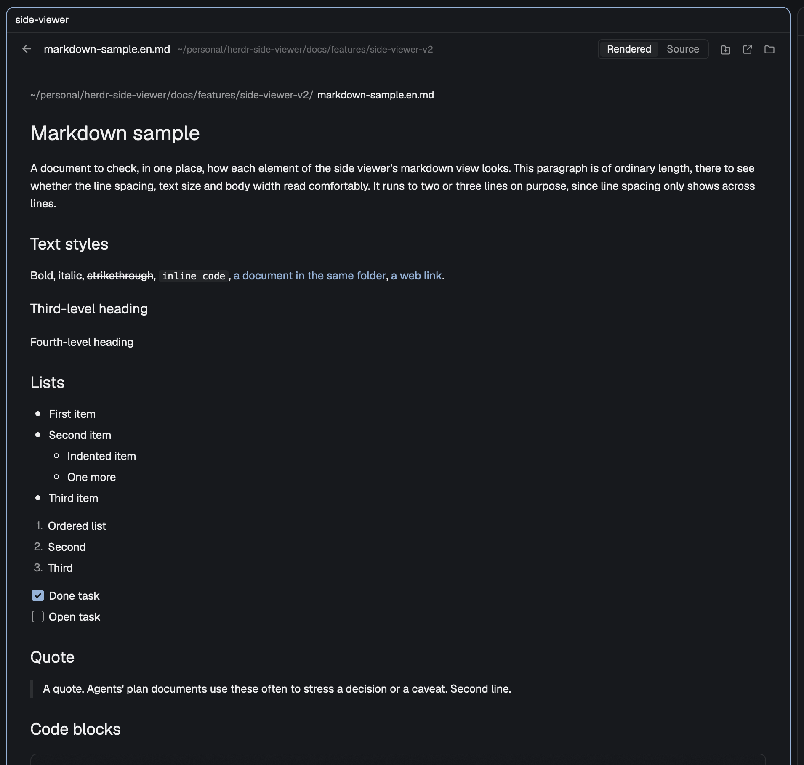

# Side Viewer

Cmd-click a file path in an agent's conversation and the file opens in a pane to the right:
markdown rendered block by block in the manner of Warp, with code blocks as cards; code and
text in an editor with line numbers and syntax colors; images as pictures. The markdown and
svg sources and the code can be edited and saved with cmd+S. A viewer already showing takes
the next file, `←` goes back, the content reloads when the file changes, and the header can
open the file in a tab of its own or in its **default app**. macOS only, Herdr 0.1.17 or
newer: the mod's **link handler** takes the cmd-click (Herdr's terminal link handlers), and
anything it does not show goes on to Herdr's usual opener. Outside Herdr nothing changes.
`cmd-o` opens the **path picker**, a popup of the file paths the focused conversation
printed, for what a cmd-click can't reach. A viewer reads, checks and writes the files of
its space's **machine**, so in a **remote space** (a space on a Linux machine or another
Mac) it shows that machine's files.



## What you see

Words on screen and command output are quoted here and below as a Korean screen shows
them; an English screen shows the matching entries of the `messages-*.js` tables (see
"Language" under How it behaves).

One pane, to the right of the conversation the file came from (the clicked pane for a
cmd-click, the picker's conversation for a pick). `background` fill, `foreground` text.
Top to bottom:

- **Header**, 40px tall, 12px side padding, 8px between items, a 1px `border` line under it.
  Left to right:
  - **Back**, only while there is a file to go back to: a 24×24 square, radius 4, `←` at
    14px in `muted`, `hover` background under the pointer.
  - **File name**, 13px semibold, cut with an ellipsis when the pane is narrow.
  - **Folder**, 11px `dim`, the home folder written as `~`. It takes the room that is left
    and is cut with an ellipsis.
  - **Status**, only while the shown file has unsaved edits: one line of text at 11px, then
    its buttons (24px tall, 8px side padding, radius 4, 1px `border`, 12px text), 6px apart
    (edit-state.js, `statusOf`). `편집됨` in `accent` with `저장` (tooltip `저장 (⌘S)`).
    A failed save in `blocked` with `저장`: `쓰기 권한이 없어요`, `파일이 지워졌어요`,
    `너무 커서 저장할 수 없어요`, or `저장하지 못했어요` for any other error. A change on
    disk, `외부에서 바뀌었어요` in `blocked`, with `다시 읽기` (tooltip `내 수정 버리고 다시
    읽기`) and `덮어쓰기` (tooltip `내 수정으로 덮어쓰기`) instead of `저장`. Hovering the text
    shows it whole, or for `저장하지 못했어요` Herdr's error without its function name. It
    is cut with an ellipsis only once the name and folder have given their room; the
    buttons never shrink.
  - **Switch**, only while a markdown document or an svg with a source is drawn:
    `렌더링 | 원문`, two cells in a 24px tall box with a 1px `border`, radius 5. The cell
    shown is filled with `hover` in `foreground`; the other is `muted` and switches on click.
  - **Buttons**, which never shrink: each a 24×24 square, radius 4, a 14px icon in `muted`,
    `hover` background under the pointer, a tooltip, 2px apart. While a markdown document,
    code, an image or an svg is drawn, `새 탭으로 열기` (open in a new tab); for every file
    `기본 앱으로 열기` (open in the default app) and `Finder에서 보기` (show in Finder). A
    notice has only those two. A file on another machine has neither of the two
    (machine.js, `headerActions`), so its notice has no buttons.
  - With no file the name reads `Side Viewer` and there are no buttons.
- **Body**, one of:
  - **Markdown view**: a scrolling column as wide as the pane, 28px side and 24px vertical
    padding, 13px text, 12px between blocks, selectable. At the top the folder in `muted`
    and the file name, 12px. Then the blocks:
    - Headings: levels 1 to 3 at 24, 19 and 16px, the rest at 13px, all semibold, no
      underline.
    - Lists: a filled 6px dot at the first level, a hollow one below, `n.` in `muted` for
      numbers, a 14×14 box (radius 3) for tasks, `accent` with a `✓` when checked. The
      item's blocks follow the marker, 6px after it.
    - Tables as wide as their content (scrolling sideways when wider than the pane), cells
      with 10px side padding, the header bold, a 1px `border` line between rows only, each
      column aligned as its `:---:` says.
    - A rule is a 3px `border` bar. A quote has a 3px `border` bar on the left, 12px in, text
      in `muted`. Footnotes are superscript numbers in the text and a 12px `muted` list
      after a `border` line at the end.
    - A picture alone on its line, centered, at most the column's width and 420 high, never
      larger than itself; `그림을 읽지 못했어요: <path>` in `muted` when it can't be read.
    - **Code block cards**: radius 8, a 1px `border`, on a dark theme a fade from `surface`
      at the top to the background darkened to three quarters at the bottom, on a light
      theme `surface` alone. 16px padding, the code at 13px with 21px lines, wrapped, in
      syntax colors, no line numbers. Below it the label at 12px in `muted` on the left and
      16px icons on the right: `>_` on shell blocks, then copy (a check mark for 1.5 s after
      a copy). A card in a list starts at the item's text, one in a quote inside its bar.
  - **Code view**: the app's code editor filling the body, editable, line numbers, no soft
    wrap, in the font from the app's settings. Colors: keyword `ansi5`, string `ansi2`,
    comment `dim`, function `ansi4`, type `ansi3`, number and boolean `ansi1`, constant
    `ansi6`, operator and punctuation `muted`. An extension with no known language draws
    without colors. The markdown source and the svg source are the same editor with soft
    wrap on: the markdown source without colors, the svg source with `xml`'s.
  - **Image view**: the image at its own size, centered, with 20px around it, shrunk to the
    pane's width when it is wider; it scrolls vertically when taller than the pane. An image
    whose size can't be read fills the width as a square. An svg with unsaved edits is drawn
    from them.
  - **Notice**: one line at 13px in `dim`, 20px padding. `열 파일이 없어요.` (no file),
    `이 파일은 비어 있어요.` (an empty `svgz` or picture; an
    empty or blank markdown or svg shows it on its rendering side, under the folder and
    name for markdown, with the `렌더링 | 원문` switch to a source ready to type, and an
    empty or blank code file opens as an empty code view),
    `이 파일이 없어졌어요.` (gone), `이 파일을 읽을 수 없어요.` (unreadable),
    `너무 커서 뷰어에서 열 수 없어요.` (too large),
    `뷰어에서 열 수 없는 종류의 파일이에요.` (no view for this file),
    `<machine> 기계에 연결할 수 없어요.` (the machine can't be reached),
    `Windows 기계의 파일은 아직 볼 수 없어요.` (a Windows machine).
  - **Loading**: no words, a 16px arc (`spinner.svg`) in `dim` at the top left of the body,
    where a notice's text starts (20px padding), turning once every 800 ms, while a newly opened file is read, an svg's preview is
    written, or a remote viewer waits for Herdr to list its space after a start.

The **path picker** is a separate popup over the window, not a pane (mod.json `overlay`: a
`popup` as large as the window with no frame of Herdr's, `frame: "none"`). It is clear, so the
window shows through, and holds one card about 49px below the window's top and about 8px
right of the window's middle:
640px wide, or the window's width less 16px each side when that is narrower (240px at the
least), and at most 0.8 of the window's height. The card is drawn like Herdr's own popup,
`popover` with a 1px `border`, radius 12 and a large shadow, 14px padding, 10px between its
parts:

- **Filter**: a 36px tall row, radius 9, a 1px `accent` border on `background`: the input at
  12.8px with the placeholder `경로 검색`, then a small `Esc` button (11px `dim`, `hover`
  under the pointer).
- **List**: rows 32px tall, radius 7, 10px side padding: the file name in `foreground` (at
  most 280px, cut with an ellipsis), then its folder at 11.5px in `dim`, cut with an
  ellipsis. The chosen row and the row under the pointer have `hover`. Taller than 352px,
  or than the card's 0.8 of the window leaves it (one row at the least), the list scrolls.
- **Status line** in place of the list, in `muted`: while paths are being found, a 14px arc
  (`spinner.svg`) turning once every 800 ms, at the left where the status line's text starts
  (10px in), as far below the filter as above the card's bottom edge; after that, when no
  list shows,
  `이 대화에 열 수 있는 파일 경로가 없어요`, `맞는 경로가 없어요`,
  `대화 터미널을 클릭한 뒤 단축키를 다시 눌러 주세요`, `경로를 찾지 못했어요: <reason>`, or the two
  remote notices above.

## How it behaves

The mod shows files, not agents, so it has no agent statuses.

- **Opening** (link.js `handleLink`, decisions in link-target.js). Herdr matches a
  cmd-clicked path in any terminal against mod.json's link rule (`kind: "file"`, a pattern of
  the extensions in `extensions.json`) and calls `handleLink({link, source})`. Herdr offers
  the paths it detects for its own clicks, missing and remote ones included; it makes no
  link of a bare file name (`RECIPE.md`, `c.json:3`) or a backslash path. In order:
  - Clicks are handled one at a time (link.js keeps them in a queue), so two quick clicks
    never write `request.json` over each other.
  - The conversation is the clicked pane, `source.pane`, not the focused one
    (`linkOpening`): the listed pane with that id, else, for a remote terminal, the one
    under `<source.machine>/`. `source.space` gives the space value (machine.js); no space
    passes. A click from no listed pane (a layout's terminal block) has no conversation: it
    still goes to a viewer showing in that space, but never splits a pane.
  - A remote terminal whose machine `machines()` lists as `unavailable` passes at once.
  - The file (`linkFile`): `link.path` when Herdr resolved it (a path on this Mac). Else
    `link.raw`: a file URI (`file:/…`, `file:///…`, `file://<host>/…`, any case) gives its
    decoded path when its host is none, `localhost` or the terminal machine's `hostname`
    (asked there only for such a URI); any other host passes. Plain text is the path up
    to the first space: for a path it could not resolve, Herdr may hand over the words after
    it too (`plan.md 파일.`). Backticks around it, a line number after it (`a.md:12`,
    `a.md:12:3`, `a.md:12-20`) and ASCII punctuation after it (`.,;:!?)]'"`) fall away, and the file shows
    from the top. Letters stuck to its end make it no path: `plan.md를` passes, `plan.md 를`
    opens. A relative path is taken from `source.cwd`, the clicked terminal's folder; `~/`
    is the home of the terminal's machine, asked there with `sh` only for an unresolved `~`
    path (file-access.js `home`, remembered per machine). The extension must have a view
    (views.js `viewOf`): markdown, image and code alike.
  - One existence check on the terminal's machine (`sh -c EXISTS`, links followed). A
    missing file passes.
  - Any failure on the way (a machine out of reach, a Windows machine, `extensions.json`
    not readable under the app home) passes.
  - Otherwise the file opens beside the conversation (open-beside.js, below) and the
    handler returns `"handled"`. Without a conversation and with no viewer taking it, or
    when Herdr refuses the split (the conversation closed meanwhile), it passes.

  A click that passes (`"pass"`) goes to the next mod in the layout's `link_handlers`; when
  all pass, Herdr opens a path of this Mac with its usual opener (the file's default app)
  and does nothing for a path in a remote space. A path whose extension is not in the rule
  (`txt`, say) never reaches the mod. The handler has 30 seconds to answer (Herdr's limit);
  a load or handler error stops the click, shows a toast and appears in `herdr-app status`.
- **Reuse** (open-beside.js `openBeside`, shared by a cmd-click and a pick). A side viewer
  showing in the conversation's tab (`openTargetOf`; one behind another pane's zoom doesn't
  count) takes the file: the pane count stays and only the content changes. The opener
  removes `answer-*` files older than a minute (request.js `CLEAR_ANSWERS`), writes `request.json` (`{"id","file","at","space","conversation"}`, id
  `<seconds>-link-<random>` for a cmd-click and `<seconds>-picker-<random>` for a pick,
  `conversation` the conversation's address on this screen, read only by viewers on this
  screen), runs `side-viewer.show`, looks for `answer-<id>` 8 times every 50 ms, and is done
  once it is there. No answer: it takes the answer's name itself and splits as below. A
  failed request write splits too. With no viewer showing in that tab (none, or only in
  another tab), it runs at once `pane.split {pane: <conversation>, direction: "right", mod:
  "side-viewer", props: {file, space, conversation, id}}` (path-picker.js `pickedSplit`):
  `pane` is the conversation's address on this screen, the props' `conversation` its id
  without the `<machine>/` prefix, and `id` the request's id, naming this opening. A viewer
  takes only a request for its own space (request.js), and a side without a space value (a
  viewer opened with no `space` in its props) counts as this Mac. A request without a
  string `conversation` is taken with none.
- **Sent conversation** (sent-conversation.js). Herdr's shared state
  `side-viewer.conversations` is `{ <tab id>: <pane id> }`: per tab, the conversation pane
  that last sent a file to its viewers. A viewer that takes a request naming a conversation,
  or first starts with an opening naming one (`afterRequest`, `afterStart`), writes that pane under the tab
  `panes()` puts it in (nothing when `panes()` does not list it). Props carry the pane id
  without its `<machine>/` prefix (ADR 0002); the viewer puts back the prefix its space id has
  on this screen, and takes none while its space is not listed. A request naming none, or a
  first start with an opening naming none, takes out the viewer's tab (`forgottenTabOf`: its
  pane by `viewerPaneOf`, else the focused tab). Each opening counts once, whenever its copy
  first starts (its tab may first show long after the split): the viewer adds `{ id, tab }`
  to shared state `side-viewer.openings`, a list, latest last, where `tab` is the tab whose
  entry it wrote or took out, or null while that tab is not known. Every opening of a tab `panes()`
  lists is kept, so a viewer still on screen never loses its own; of the rest (tabs gone,
  a remote tab hidden while its machine is cut off, or null), the latest 50 are kept. A bare
  id in that list, as an earlier viewer kept it, counts as `{ id, tab: null }`. A copy that
  starts again with an id already there (a mod file was saved, the app restarted and its tab
  shows) neither writes nor takes out anything; if that id's `tab` is null (a bare id
  included), it only fills in the tab `panes()` puts the props' conversation in, once
  `panes()` lists that pane. It never fills it from the focus or a viewer found by it
  (`viewerPaneOf` guesses the viewer's own pane from the focus, which may sit on another
  tab's viewer), and an opening naming no conversation stays with no tab. A copy whose own
  opening is left with no tab keeps it, and fills it in the same way when it takes a request
  and that pane shows, without starting again; the props' conversation is not written again.
  Props without an `id` (a viewer tab's, or an older version's) change nothing. Each write also drops tabs `panes()`
  no longer has, and the map and the list are set only when they change, since `setShared` draws every mod
  again. The picker popup never writes it. The shell pane's folder and the picker's
  conversation follow the tab's entry while that pane is a terminal in the tab; a pane that
  closed or moved to another tab falls back to the tab's first agent terminal. One tab with
  two viewers shares one entry.
- **Path picker** (`cmd-o`, bound to `mod.open:side-viewer`). The copy Herdr opens as the
  popup (`props().overlay`) is the picker, not a viewer. Once, as it opens, it takes the
  conversation from `focused()` and `panes()` (path-picker.js `conversationOf`): a focused
  terminal; for a focused side viewer, its tab's sent conversation (`shared`) while it is a
  terminal there, else a terminal in its tab, an agent's first; anything else
  says `대화 터미널을 클릭한 뒤 단축키를 다시 눌러 주세요`. The machine is the focused space's
  (machine.js). A machine `machines()` lists as `unavailable` gets the "can't reach" line at
  once. Otherwise, in order: the machine's home (`sh` there; a Windows machine fails here),
  `hc read <terminal> --lines 1000`, the candidates (`pathCandidates`: absolute, `~`,
  relative to the terminal's `cwd`, with `:12`, `:12:3` or `:12-20` cut off, in backticks;
  URLs out; only extensions in `extensions.json`; latest first; each once; at most 200), one
  existence check on the machine (`sh -c EXISTS`, links followed), and the first 30 that
  exist. Typing keeps the paths that contain the text, ignoring case; ↑↓ move and wrap;
  Enter or a click picks; Esc, the `Esc` button or a click beside the card closes it.
  A failed `hc read` shows its JSON error's `message` in `경로를 찾지 못했어요: <reason>`;
  `failureOf` sorts out "unreachable" and "windows" first.
- **Opening a pick** (main.js `openPicked`). The pick opens beside the picker's
  conversation as a cmd-click does ("Reuse" above, `kind` `picker`). The popup closes once
  that is settled: when a viewer's answer is there, or just before the split.
- **Remote files.** The viewer's machine is its space's: the props' `space` value is
  looked up in `spaces()` at every read (machine.js `machineOf`), and a viewer without one is
  on this Mac. A viewer whose space is not listed yet (just after the app starts) shows
  the loading spinner and reads and saves nothing; within 3 seconds of Herdr listing the space, or
  of the space's machine changing, it reads the file again. On another machine every read
  goes through file-access.js with Herdr's `on`: the probe (`sh` with `stat -c` on Linux,
  `stat -f` on macOS), `readTextFile(path, {on})` for text, and for an image the bytes in
  pieces of 4 MiB from `hc exec --on <machine> sh -c 'tail -c +<from> | head -c <n>'` (20
  seconds each, 120 for the whole copy), run by this Mac's `sh` into `<copy>.<pid>.part`, then
  moved to the copy under `images/`, named by a hash of `<machine>:<path>`, only when its size
  is the probe's. The size limits (20 MiB for an image), the first-bytes check and the
  notices are this Mac's. A machine that `machines()` lists as `unavailable`, or a refusal
  whose words hold `unreachable` or `timed out`, gives `<machine> 기계에 연결할 수 없어요.`;
  `cannot start sh: program not found` gives the Windows notice; any other refusal
  `이 파일을 읽을 수 없어요.`
- **Remote changes.** No folder is watched on another machine. Every 3 seconds, only while
  its file is on another machine or its space is not listed yet, the viewer runs
  `cksum <file>` there (10-second limit; a check still running skips its turn) and
  reads the file again only when the mark (`<sum> <size>`, `missing`, `unreadable`, or the
  failure kind) differs from the last one. The first mark of a file is only noted. Losing
  the machine is a mark too, so the viewer turns to the "can't reach" notice and reads the
  file again when it is back. The 15-second recheck runs as on this Mac. A file with unsaved
  edits is never read over them, so a lost machine leaves the editor and its edits on
  screen, and the header's status says `<machine> 기계에 연결할 수 없어요` (red, the save
  button stays, the whole line on hover) until the machine is back.
- **View by extension.** `md markdown mdx` → markdown view. `png jpg jpeg jpe gif webp svg
  svgz` → image view, and only when the file's first bytes are an image's (PNG, JPEG, GIF,
  WebP, SVG, or gzip for `.svgz`); otherwise the "no view" notice. A `.svg` whose bytes are
  svg and that is at most 1 MB also has a source; `.svgz` never does. The other extensions in
  `extensions.json` → code view, `html htm shtml shtm` among them (colors `html`). Anything
  else → the "no view" notice.
- **Limits.** Text over 1 MB (1,048,576 bytes) and images over 20 MB (20,971,520 bytes)
  show the "too large" notice and are never read. Exactly at the limit still draws.
- **Back.** Each viewer keeps its own history. Opening a file adds the one being left;
  opening the file already shown adds nothing. `←` returns to the previous file and drops
  the one left behind (there is no forward).
- **Reload.** On this Mac the viewer watches the shown file's folder (another machine's
  file: "Remote changes" above) and also checks the file again every 15 seconds. A file directly in the home folder or in `/` is not watched, only
  checked every 15 seconds. A text file whose size and modified time are as at the last
  read is not read again (unless it changed within the last 2 seconds, since the time is in
  whole seconds). While a read of the shown file is under way, a new change waits for it
  and the file is read once more afterwards; opening another file leaves the read behind.
  Unchanged content leaves the screen and the scroll position alone; changed code keeps
  its editor and only gets the new text. A deleted file turns into the "gone" notice, and
  its content comes back when the file does. "Loading" shows only for a newly opened file.
  A file with unsaved edits is never read over them: see "Changed outside". Nor is it
  replaced by a notice: coming back to one that is now gone, too large or unreadable, or
  an svg now past 1 MiB (a picture alone) or no longer svg, shows its editor with the edits
  (views.js, `editedContentOf`), and the header's status says what it can. A markdown, code
  or svg file emptied outside is no notice at all: it is a changed file, so the edits stay
  and the status says `외부에서 바뀌었어요`.
- **Theme.** The code view's colors are fixed when its editor is made, so each check also
  compares them with the theme: after a theme change the open code is redrawn with the new
  colors within 15 seconds. Code block cards take the new colors at the same check.
- **Language.** Each viewer, when it starts, runs `defaults read -g AppleLanguages`
  (timeout 5 s). `i18n.js` takes the list's first tag: `ko` when it is `ko` alone or `ko`
  followed by `-`, `_`, `.` or `@` (`ko-KR`, `ko_KR.UTF-8`, any case), `en` for anything
  else or an empty list. The result goes into Herdr's shared state `side-viewer.lang`, only
  when it differs; that write redraws every copy, and every draw takes its words from that
  value through `translator` (English until a value is known). A run that fails or can't
  start writes nothing and asks again after 1, 3 and 10 seconds, then every 15 seconds
  (`askAgainAfter`). A viewer tab gets no language in its props: like any new viewer it
  starts with the shared value and reads once itself. A viewer already open never reads
  again, so a changed system language reaches open viewers when a new one opens. `>_`'s
  notifications speak the language of the press, a new tab's the language of the moment
  it is written. Not translated: code card labels, file names and paths, Herdr's error text,
  and `Side Viewer` with no file.
- **Source switch.** `렌더링 | 원문`, shown only while a markdown document or an svg with a
  source is drawn, not on a notice. There is no cmd+E. Every file opens rendered: opening
  another file, `←` and a link all switch back from the source.
- **Editing.** The markdown source, the svg source and the code view take typing; the
  rendering, pictures, code block cards and notices do not. The edits are kept per file in
  that viewer (`{file: {disk, text}}`): `disk` is the text last read, `text` the edited one.
  Typing the text back to `disk` drops the entry. Opening another file, `←` or a link and
  coming back brings the entry back into the editor. Closing the pane or quitting Herdr drops
  them all, without asking.
- **Saving.** cmd+S (from the editor or anywhere in the viewer) or the `저장` button runs
  `writeTextFile(file, text, disk)`. With no entry cmd+S does nothing. Text over 1 MiB
  (1,048,576 UTF-8 bytes) is not sent and the status says `너무 커서 저장할 수 없어요`. Typing
  that lands while a save is under way stays unsaved. Nothing is ever saved on a timer.
- **Saving on another machine.** `writeTextFile` writes on this Mac only, so a remote file
  goes through file-access.js `write`: `readTextFile(path, {on})` again, and when that is
  not `disk`, nothing is written and the text read goes to the same handling as a refused
  save's read (`외부에서 바뀌었어요`, or `파일이 지워졌어요` when gone). A file there the
  user can't write (`test -e && ! test -w`) is not written and says `쓰기 권한이 없어요`.
  Otherwise the text is written to `data/side-viewer/remote-saves/<ms>-<random>.txt` (folder made with
  `umask 077`, mode 700; files there older than 10 minutes are deleted first), handed on
  stdin to `hc file write --on <machine> <path>` by this Mac's `sh`, and the copy is deleted
  whatever happened. `hc file write` replaces the file and keeps its mode, and writes
  through a symbolic link to its target. Failures (remote-results.js `saveFailureOf`):
  `unreachable` or `timed out` in the error, or a machine `machines()` lists as
  `unavailable` before the save, says `<machine> 기계에 연결할 수 없어요`; `os error 13`, `1`
  or `30` says
  `쓰기 권한이 없어요`; anything else `저장하지 못했어요`, with the error on hover. Checkbox
  clicks save the same way.
- **Rendering edits.** Switching an edited source to `렌더링` draws the edited text: the
  markdown blocks are parsed again, and an svg is drawn from a copy of the edited text under
  `previews/`. The file is not written.
- **Changed outside.** A read that finds the disk no longer holds `disk` keeps the edits on
  screen and the status says `외부에서 바뀌었어요`; a read that finds the edited text on
  disk drops the entry; a deleted file says `파일이 지워졌어요`. `다시 읽기` drops the entry
  and shows the disk; `덮어쓰기` saves the edits against the disk text the read found. A
  save that Herdr refuses because the file is not `disk` says the same as the read; a
  refused save of a file that is gone says `파일이 지워졌어요`. Permission errors
  (`os error 13`, `1`, `30`) say `쓰기 권한이 없어요`, anything else `저장하지 못했어요`
  with the error on hover. The edits stay in every case.
- **Checkboxes.** A click on a task box turns over the first `[ ]`, `[x]` or `[X]` on that
  item's source line, in the edited text if there is one, else in the disk text. Without
  edits the result is saved at once against the disk text (a refusal shows in the status); with
  edits it joins them and stays unsaved. A click during a save waits for the save to end.
- **Pictures in markdown.** A picture alone on its line whose path is relative (to the
  document's folder) or absolute is checked by its first bytes and drawn from a copy under
  `images/`, as in the image view. A path with a scheme or starting with `//` is not drawn
  and not fetched; a picture inside a paragraph stays as the TextView draws it.
- **Code block cards.** The fence language gives the label and colors: a known name or
  alias (`JavaScript`, `TypeScript`, `Python`, `HTML`, …), `Shell` for no language and for
  `sh shell bash zsh fish console`, `Mermaid` for `mermaid`, `Code` for anything else. Copy
  puts `block.text` on the clipboard.
- **`>_`** (shell blocks only). Opens a shell pane below the viewer with `pane.split
  {direction: "down", pane: <viewer>, argv: [<zsh> -c 'cd -- "$1" 2>/dev/null; exec
  "$2" -l' zsh <folder> <zsh>]}` (`<zsh>` is `/bin/zsh` on this Mac) and finds it by comparing
  `panes()` (up to 5 s). The folder: in a viewer tab
  the document's; beside a conversation the `cwd` of a terminal pane in the same tab other
  than this viewer's shell pane, the tab's sent conversation first, then an agent's; else
  the home of the viewer's machine. The command (without its last
  newline) is written to the handoff file. On this Mac that is
  `data/side-viewer/shell/<terminal>.txt` (folder made with `umask 077`; `writeTextFile`
  with the file's current text, or null, as `expected`, tried twice). On another machine it
  is `~/.cache/side-viewer/shell/<terminal>.txt` there (`/` in the address becomes `_`,
  so `mini_t7.txt`), written by one command there, `sh -c 'umask 077; mkdir -p "$1" &&
  chmod 700 "$1" && { [ ! -e "$2" ] || chmod 600 "$2"; } && printf %s "$3" > "$2"' sh
  <folder> <file> <text>`, with the text as an
  argument. Then `hc keys
  <terminal> ctrl+alt+f12`. Instead of that key, a zsh not yet prepared gets the prepare line
  with `hc send`: a zle widget `_side_viewer_insert` that pushes a draft aside (`zle
  push-line`), reads the file into `BUFFER`, puts the cursor at its end and removes the file,
  bound to `\e[24;7~` in the emacs, viins and vicmd keymaps; then `command rm -f -- <keymap
  file>` and `{ print -r -- <mark>; bindkey -lL main } >| <keymap file> 2>/dev/null` (the
  keymap file is the handoff file's name with `.keymap`, in the same folder; `<mark>` is new
  for every press, the time and a random part in `[A-Za-z0-9_-]`; the file is removed first,
  so a read-only one is written anew), then `print -rz` of the file's text (shown at the next prompt, above a
  draft pushed aside before), the file removed, and `clear`. The viewer remembers the pid and
  argv of the zsh it prepared (`hc get`'s `foreground` at the prompt), and, once a prepare
  line's handoff file is taken, reads the keymap file on that machine, removes it (`rm -f`)
  and remembers its keymap only when the file's first line is this press's mark and exactly
  one line follows: `bindkey -A emacs main` is emacs, `bindkey -A viins main` or
  `bindkey -A vicmd main` is vi. Another mark or none (an old file the line could neither
  remove nor write over), anything else after the mark, more lines, no file or a failed read
  is not known. A key
  press, or a prepare line not taken, leaves it as it was; a shell just opened starts not
  known. A shell just opened is prepared with no key first; a zsh with another pid or argv in
  the same pane, or one that left an earlier file, is prepared again after `hc keys
  <terminal> alt+q` when the remembered keymap is emacs, else after `hc keys <terminal>
  ctrl+c`, with no wait before the line. Then the viewer waits for the file to go (500 ms after
  the key, 3 s after the prepare line, looking every 50 ms; for a shell on another machine
  1500 ms, 5000 ms and every 100 ms, each look a file read there; the waits are clock time,
  the reads included). A file still there is removed (`rm -f` on its machine, also when an
  `hc` command after the write fails),
  the zsh is forgotten, and a notification says `터미널에 넣지 못했어요` with, after the key,
  `셸이 다시 시작돼서(exec zsh 등) 명령을 받지 않았어요. 입력 칸에 ;7~가 남았다면 지우고
  다시 누르세요.`, or after the prepare line (no key was sent) `셸이 아직 명령을 받을 준비가
  안 됐어요. 잠시 뒤 다시 누르세요.`
  Otherwise the viewer gives that pane the keyboard.
  The machine is the prefix of an hc address (`mini/t7`): the kept shell's terminal,
  else the viewer's pane, whatever space value its props hold. A machine `machines()` lists
  as unavailable gets nothing, and a step there refused for the connection
  (`remote-results.js`'s `unreachable`; the shell's `hc get` and each look at the handoff
  file count) stops the press: `터미널에 넣지 못했어요` / `<machine> 기계에 연결할 수
  없어요.`, with no pane opened after it and the keyboard left where it was. Before the split, another
  machine is asked once for its zsh with `sh -l -c FIND_ZSH sh`: the login shell's
  `command -v zsh` when that is a program file, else the first of `/bin/zsh`,
  `/usr/bin/zsh`, `/usr/local/bin/zsh`, `/opt/homebrew/bin/zsh` there. A path found is
  remembered for that machine. When none is found, no pane opens, the machine is asked again
  at the next press, and the notification is `터미널에 넣지 못했어요` / `그 기계에 zsh가 없어서 넣을 수 없어요. 복사 버튼으로 복사해서
  붙여 넣으세요.`
  The next `>_` uses the same pane while it shows the same terminal. `hc get`'s `foreground`
  tells the shell's state: none yet, or exactly the split's argv above (any folder), is
  starting, asked again every 100 ms for up to 5 s. A zsh's other arguments are read in order
  as zsh reads them: a word starting with `-` or `+` is options (a `--name` long option is a
  name alone; in a short bundle, letters and digits, an `o` takes the rest, or the next word
  when nothing is left, as an option's name, so `-oemacs`, `-foemacs` and `-o emacs` hold no
  `c`), and the word `--` or `-`, or the first word that is not an option, ends them. A zsh
  with the `c` flag on runs a line (`-c`, `-fc`, `-ic`, `-4c`, `-cf`); one with neither `c`
  nor `s` and an argument left runs that argument as a script file (`zsh task.zsh`,
  `zsh -o emacs task.zsh`). Either is busy and gets no key and no prepare line. With `s`, or
  no argument left, it is at its prompt and ready (`zsh -l`, `-zsh`, `zsh -f`, `zsh --emacs`,
  `zsh -s foo`, and `zsh -fis -- -c`, whose `-c` is an argument). Anything else is busy too,
  any other `-c` run included (`python3 -c …`, `sh -c 'a; b'`). This reading is exact only
  for `zsh <file>`, `-c`, a one-dash short bundle holding `c`, arguments after `--`, arguments
  after `-s`, and programs other than zsh. Other zsh option syntax (`+c`, `--no-stdin`,
  `--stdin`, `--emulate`, `-b`, an option turned on by name such as `-o stdin`) can be read
  wrong: a zsh running something can count as ready, or one at its prompt as busy.
  A busy shell gets nothing at once, no pane opens, and a Herdr
  notification says `터미널에 넣지 않았어요` / `셸에서 다른 프로그램(<name>)이 실행
  중이에요. 끝난 뒤 다시 누르세요.`; when no pane can be opened or found,
  `터미널에 넣지 못했어요` / `셸 pane을 열거나 찾지 못했어요.`.
- **New tab** (`새 탭으로 열기`). Runs `tab.new {name: <file name>, space, mod:
  "side-viewer", props: {file, viewerTab: true, handoff?, space?}}` (the viewer's space
  value, so the tab reads from the same machine), finds the new tab by comparing
  `spaces()` (every 50 ms with `cx.sleep`, up to 3 seconds), then `tab.move` right after the
  viewer's tab and `tab.select`. Not found by then: a notification
  `새 탭으로 넘어가지 못했어요` names the tab. Every click makes a tab. Unsaved edits go to `handoff-<id>.json` in the data
  folder, its id in the props; the new tab reads and deletes it (ignoring one older than 60
  seconds) and the viewer that opened it drops the edits. A viewer tab renames its tab
  (`tab.rename`) to each file it shows. It starts with an empty history. Being on screen,
  it answers `side-viewer.show` like any viewer.
- **Open in the default app.** Runs `open <file>`: the app macOS opens the file with, as a
  double click in Finder would.
- **Show in Finder.** Runs `open -R <file>`.
- **Links in the markdown view.** Another markdown file opens in the same viewer and joins
  the history. `http`, `https` and `mailto` go to macOS's handler. Any other local file is
  only shown in Finder, never opened. Relative links start from the shown document's
  folder; `~/`, absolute paths and `file://` work; an anchor alone, or another scheme, does
  nothing. In a document on another machine, a markdown, code or image file opens in the
  viewer, any other file gets a notification `이 파일은 보여 줄 수 없어요` with its path as
  the body, `~` is that machine's home (asked once with `sh` and remembered; unknown, a `~`
  link does nothing), and web and mail links still go to this Mac's handler.
- **Outside Herdr.** The mod changes no default app: a file opened from Finder or another
  app opens in its default app, as macOS decides.

## Built from

- `mods/side-viewer/mod.json`: `{ "place": "none", "title": "Side Viewer", "focusable":
  true, "overlay": { "kind": "popup", "at": "top", "offset": 0, "width": 1, "height": 1,
  "frame": "none" }, "link_handlers": [{ "kind": "file", "pattern": "(?i)\\.(?:md|…|shtm)(?:[^A-Za-z0-9_+]|$)" }] }`
  (focusable for cmd+S; the overlay is the path picker, the whole window, with the card
  drawn by the mod: a popup's `width` in px doesn't shrink with the window; the link rule's
  pattern is link-target.js `linkPattern` of `extensions.json`, every listed extension
  followed by the end or a character that can't continue an extension, and
  `link-target.test.mjs` keeps the two equal). Opened with `pane.split {direction: "right", mod: "side-viewer", props:
  {file, space, id, conversation?}}`; `props.file` is the absolute path to show, `props.space`
  the space id without its `<machine>/` prefix (no machine name, ADR 0002), `props.id` the
  opening's id (`[A-Za-z0-9_-]`, the request's id), `props.conversation` the pane id of the conversation that sent
  it, also without its `<machine>/` prefix. A viewer tab's props are
  `{file, viewerTab: true, handoff?, space?}`.
- `keys.json` (repository root): `{"global": {"cmd-o": "mod.open:side-viewer"}}`, the key
  `install.sh` merges into the person's.
- `mods/side-viewer/main.js`: the one `View`: state, reads, requests, the watch, edits and
  saves, the language read, the tab and shell commands' wiring. Drawing is in `header.js`,
  `markdown-view.js`, `code-card.js`, `code-view.js`, `image-view.js`, `notice-view.js`;
  `markdown-image-loader.js` makes the copies of pictures in markdown, `shell-pane.js` runs
  `>_`, `picker-view.js` is the path picker (`PathPicker`: its state, the reads behind it,
  keys and drawing), `open-beside.js` opens a file beside a conversation for a cmd-click
  and a pick (the request, the wait for an answer, the split), and `file-access.js` is
  every touch of the shown files: `accessOf(machine)`
  gives one access per machine with `read`, `run`, `exists`, `home`, `mark` (`cksum`),
  `copy` (picture bytes), `key` (copy names) and `write` (saves, this Mac's and another
  machine's). The decisions sit in modules without `herdr` imports, so `node --test` runs them:
  `views.js` (extension → view and language, size limits, the probe script, which views
  switch and take typing, the editor options), `document.js` (notices, header label),
  `history.js`, `request.js` (the handoff from `open-beside.js`), `links.js` (link clicks
  in the markdown view, watch decisions), `link-target.js` (a cmd-click's conversation and
  file, the link rule's pattern), `image-copies.js`
  (image check by first bytes, copy names, sizes, cleanup), `edit-state.js` (unsaved edits,
  disk changes, save results, the header's status, handing edits to a tab, checkbox clicks),
  `markdown-blocks.js` (markdown → blocks), `code-blocks.js` (fence language → label,
  colors, shell; wrapped rows and editor height; card fill), `markdown-images.js` (picture
  paths and sizes), `svg-preview.js` (edited svg previews), `terminal-insert.js` (`>_`'s
  folder, shell state, commands, notices), `sent-conversation.js` (the shared-state keys
  `side-viewer.conversations` and `side-viewer.openings`; taking an opening once,
  remembering, forgetting and finding a tab's sent conversation), `viewer-tab.js` (props, handoff file, tab
  placement and name), `checkbox.js` (turning over a task line), `i18n.js` (the language
  from `AppleLanguages`, the asking-again delays, the translator `tr`), `machine.js` (the
  space value, the viewer's machine, the existence and home commands and their answers,
  `FIND_HC`, the header's actions), `remote-results.js` (`cksum` marks, refusal kinds,
  `unavailable`, remote save failures), `path-picker.js` (candidates from terminal text,
  `CHECK_LIMIT` 200 and `PICK_LIMIT` 30, the filter, the conversation to read, where a pick
  opens), `keys-merge.js` (merging `keys.json`). Each has a `*.test.mjs`. `links.js` also
  decides remote links, `request.js` matches a request's space to the viewer's, and
  `edit-state.js` holds remote save failures.
- The words on screen, each a `{ en, ko }` table whose keys start with its area:
  `messages-header.js` (`header.`: the switch, buttons, tooltips and the status),
  `messages-body.js` (`body.`: the notices and the picture error), `messages-alerts.js`
  (`alerts.`: the `>_`, new-tab and remote link notifications), `messages-picker.js`
  (`picker.`: the path picker's placeholder and lines; it borrows `body.unreachable` and
  `body.windows`). Values go in through `{name}` places.
  The pure modules take `tr` as their last argument and speak English without it.
  `i18n.test.mjs` checks that both languages have the same keys and places, that every key
  is used and every key used exists, that every call of a function that writes a sentence
  passes `tr`, and that no Korean screen words sit outside the tables.
- `mods/side-viewer/extensions.json`: the listed extensions in three groups, `markdown`,
  `image`, `code`. It alone says which extensions are markdown and which a cmd-click can
  open: mod.json's link rule is made from it, and the viewer, the path picker and the link
  handler read it under the app home while they run.
- `mods/side-viewer/link.js`: `handleLink`, the link handler mod.json's `link_handlers`
  turns on. It asks Herdr (`panes`, `appHome`, `readTextFile`, file-access.js) and leaves
  the decisions to link-target.js and the opening to open-beside.js.
- Icons: `new-tab.svg`, `default-app.svg`, `finder.svg` (header, 14px), `copy.svg`,
  `check.svg`, `terminal.svg` (cards, 16px), 16×16, `checkbox-check.svg` (a checked
  box's mark, 10×10 with a 1.8 stroke), stroked in `currentColor`, and `spinner.svg` (the
  turning arc: 16px in the viewer, 14px in the picker, turned by `.spin(800)`), drawn with
  `svg("mods/side-viewer/<name>.svg")`. The "rendering | source" switch is two text cells,
  with no icon.
- `herdr` functions: `props`, `readTextFile`, `writeTextFile`, `nextCommand`, `home`,
  `appHome`, `theme`, `settings`, `exec`, `watchFolder`, `run`, `spaces`, `focused`,
  `panes`, `hc`, `notify`, `shared`, `setShared`, `machines`, `closeOverlay`
  (`readTextFile` and `exec` also with `{on: <machine>}`); `cx.spawn`, `cx.timer.every`, `cx.timer.after`, `cx.notify`,
  `cx.write_to_clipboard`, `cx.focus_handle`, `cx.sleep`, `cx.stop_propagation`. `gpui-kit`:
  `View`, `div`, `image`, `svg`, `PathBuilder`, `Background`. `gpui-base`: `v_flex`, `h_flex`,
  `TextView.markdown`, `Editor`, `EditorState`, `InputState`, `Input`, `ScrollHandle`. Node:
  `fs/promises` `readFile`.
- Command for scripts: `side-viewer.show`. Herdr commands the mod runs: `pane.split`,
  `tab.new`, `tab.move`, `tab.select`, `tab.rename`, and `side-viewer.show` from the picker
  and the link handler; hc: `get`, `keys`, `send`, `read`. The link handler is the
  `handleLink` export of `link.js` (Herdr 0.1.17 or newer).
- Programs the mod runs: `sh` (with `stat`, `head`, `od`, `cp`, `touch`, `mkdir`), `open`,
  `rm`, `mkdir`, `touch`, `sleep` (also the link handler's wait), `defaults`, and
  `/bin/zsh` in the shell pane. For another
  machine it runs there `sh` (with `stat`, `head`, `od`, `uname`, `printf`) and `cksum`,
  for `>_` also `sh -l -c` (the zsh lookup), `sh` with `mkdir`, `chmod`, `printf` (the
  handoff file), `rm` and that machine's zsh in the shell pane,
  and on this Mac `sh` with `hc` (`hc file write --on`, `hc exec --on … cat`, the `hc` on
  `PATH`, else `~/.local/bin/hc`), `mkdir`, `chmod`, `find`, `mv`. `install.sh` uses
  `uname`, `herdr-app`, `awk`, `sed`, `rsync`, and `node` to merge `keys.json`.
- Files outside the mod folder, all under the app home's `data/side-viewer/`:
  `request.json` (`{"id","file","at","space","conversation"}`, from `open-beside.js` for a
  cmd-click or a pick), `answer-<id>`,
  `images/<path hash>-<bytes>-<modified>.<kind>` (copies of images and of
  pictures in markdown, mode 600; for another machine the hash is of `<machine>:<path>`, and
  `<copy>.<pid>.part` holds the bytes while they arrive; one a killed copy left is swept
  with the copies), `previews/` (edited svg sources, same names, folder mode
  700), `handoff-<id>.json` (`{"id","file","at","edit"}`, deleted by the tab that reads
  it), `shell/<terminal>.txt` (the command for `>_` to a shell on this Mac, folder mode
  700, deleted by the shell's widget as it reads it), `shell/<terminal>.keymap` (a prepare
  line's mark and its zsh's keymap, written there, deleted by the viewer once it reads it after that
  line's command is taken; one a prepare line not taken left is written over by the next),
  and `remote-saves/<ms>-<random>.txt` (the text of a save
  to another machine, folder mode 700, deleted when the write ends; one older than 10
  minutes, left by a quit, goes at the next remote save). A copy or preview is deleted when a newer one of the same file replaces it, or when
  not shown for 30 days. The viewer reads whichever file it is asked to show and writes the
  file it saves, on its machine. On another machine `>_` writes
  `~/.cache/side-viewer/shell/<terminal>.txt` there instead (folder mode 700 and file mode
  600, both set on every write, deleted the same way), and its prepare line
  `~/.cache/side-viewer/shell/<terminal>.keymap` beside it (read and deleted the same way);
  nothing of it lands in this Mac's data folder.
- `install.sh`: stops before changing anything unless it runs on macOS, finds `herdr-app` on
  `PATH`, and `herdr-app --version` is 0.1.17 or newer. It runs `herdr-app check` on the mod
  folder, then copies the mod folder into the app home with `rsync -a --delete`, so files an
  older version left there go (`keys-merge.js` goes along, unused there). Then, under
  `Shortcut keys`, `node` runs `keys-merge.js` on the app home's `keys.json` and the
  repository's: a key already bound the same is left (`already there.`), a key bound to
  another action in any section is left and reported, a missing, invalid or non-object
  `keys.json` is left and the lines to add are printed, and a changed file is written
  beside the real one and renamed over it, so a link stays a link. Without `node` it prints
  the repository's `keys.json`. Last, it prints a note when the layout `herdr-app status`
  names is one Herdr ships (`main`, `terminals`, `win98`: clone it with `herdr-app do
  layout.clone --name <layout>`), when the window is not open (the layout was not checked),
  and when the router app of an older version is still at `~/Applications/Side Viewer
  Router.app` (or `$SIDE_VIEWER_ROUTER_APP`, where an older install put it).
  That app was the default app for some extensions, so it gives them back before it is
  deleted: `"$HOME/Applications/Side Viewer Router.app/Contents/MacOS/SideViewerRouter"
  --restore`, then pick the original app, not Side Viewer Router, in each macOS
  confirmation window it brings up, one per file type; deleting it first leaves the
  extensions with no record to give back. Extensions no other app claims (`rbw`, `cp`) stay
  with it until it is deleted. Then delete the app and run `./install.sh` again.

## Watch out

Platform:

- A mod gets a cmd-click on terminal text only as a link handler, from Herdr 0.1.17 on, and
  only in a layout whose root `"link_handlers"` names it. The first time Herdr sees a mod
  with link rules on a personal layout, it adds the mod to that layout's list; the layouts
  Herdr ships (`main`, `terminals`, `win98`) are read-only, so one of them is cloned first
  (`herdr-app do layout.clone --name <name>` makes `<name>-copy` and shows it). A mod someone took out
  of the list is added back by hand.
- Herdr makes no link of a bare file name (`RECIPE.md`, `c.json:3`), so a cmd-click on one
  does nothing; the path picker lists it. A path with letters stuck to its end
  (`/tmp/notes/plan.md에서`) matches the link rule, since the rule only asks for a character
  that can't continue the extension, but `linkFile` takes it as no path, it passes, and
  the file doesn't open. With a space after the path, it opens.
- Herdr gives `link.path` only for a path on this Mac it resolved; a remote path, an
  unresolved one or a non-UTF-8 one comes as `link.raw` with `link.path` null, so the
  handler resolves it itself from `source.cwd` and that machine's home, and checks it there.
  A missing path also reaches the handler, hence the existence check.
- A link handler starts without a view, so it has no `cx` to sleep with: its 50 ms waits
  are `exec("sleep", ["0.05"])` on this Mac. Herdr gives it 30 seconds to answer.
- `<mod>.<command>` reaches showing copies only, and says nothing about whether one took
  it. So the viewer answers by creating `answer-<id>` with `writeTextFile(path, text, null)`
  (new files only), and `open-beside.js` takes that name itself before splitting, so a
  viewer that wakes late cannot take the file as well.
- A mod can't import JSON and has no `import.meta.url`: the viewer reads
  `mods/side-viewer/extensions.json` under `appHome()` while it runs. A mod not installed
  there shows the "no view" notice for every file. The icon paths assume the same folder
  name.
- `fs/promises` has no `stat`, so size, modified time and the first 4096 bytes come from one
  `exec("sh", …)` before anything is read.
- No `setTimeout`: the 15-second recheck is `cx.timer.every`.
- `EditorState` can't be created while drawing; it is made when the text arrives and
  released when the content is replaced. Its colors are fixed when it is made.
- `TextView.markdown` needs a new element id to draw new text.
- Images are drawn from copies under the app home, on the report that Herdr draws images
  only from there. Only files whose first bytes are an image's are copied.
- `watchFolder` reports subfolders too on macOS, and real paths (`/private/tmp` for `/tmp`):
  batches are matched by path ending. Watching the home folder or `/` would report every
  change under them, so a file there is left to the 15-second check.
- In a layout that gives panes a header (the shipped `pane` mod), its split, zoom and close
  buttons show only while the pointer is on the header, at its right end, one row above the
  viewer's own buttons. A viewer closed there is gone with its history; the next cmd-click
  opens a new one.
- `herdr-app check` draws once, with no file and an empty shared state, so it only ever
  sees the English `No file to open.` It does not finish async work either, so what a save failure really says was never seen
  through it. Another screen can only be checked with a temporary copy whose first scene is
  changed; nothing after a read or a click is covered by check.
- Language names the editor knows are not documented. `toml`, `swift`, `kotlin`, `scss`,
  `xml` and `html` are guesses (`html` was only found in Herdr's binary, its colors not seen
  on screen); an unknown name draws without colors, never an error. TypeScript and JSX use
  JavaScript's colors.
- `EditorState.new` can't run while drawing ("cannot run during render"): every editor,
  code cards' too, is made after a read or inside an event.
- cmd+S: with `"focusable": true`, a `track_focus` handle and `on_key_down` on the root,
  `cmd-s` arrives as `"cmd-s"` whether the root or the editor inside it has the keyboard, and
  the editor gets no `s` (seen in the app). Herdr's keys and menu don't take cmd+S.
- `writeTextFile(path, text, expected)` refuses with `The file changed outside Herdr. …`
  when the file is not `expected`, and with the same words when it is gone; so a refusal is
  followed by a read, and null means deleted (seen in the app, for a change and for a deleted
  file). Over 1 MiB it says `exceeds 1 MiB`, from Herdr's source (`src/mod_files.rs`), not
  seen in the app: the viewer never sends that much.
- Herdr API errors arrive with a `` `herdr.<function>`: `` prefix in front of the wording
  (`` `herdr.writeTextFile`: The file changed outside Herdr. … ``). Code that branches on an
  error's wording strips that prefix first, and its tests expect the exact text the real app
  gave, prefix included, not wording copied from `herdr.d.ts` or Herdr's source.
- Herdr saves through a temporary file in the same folder and a rename. A read-only file
  (`chmod 444`) in a writable folder is therefore probably saved anyway; no permission is a
  folder without write (`chmod 555`) or a file with mode 000.
- An editor keeps empty space below its last line (half its height, at least 3 lines) and
  scrolls into it. A card's editor is drawn `max(2 × rows, rows + 3) + 1` rows tall and
  clipped to its text, so there is nothing to scroll and the wheel reaches the document.
  Wrapped rows are estimated from the card's width and a monospace cell of 0.6 × the font
  size, Korean two cells, minus 8px: an estimate short of the real count cuts the last line.
- A focused editor always draws its cursor, and a mod can't turn it off. A clear layer over
  each card swallows clicks, so a card never takes the keyboard; Tab could still reach it.
- `TextView` draws no local picture given as a `data:` address, hence copies under the app
  home, as for the image view. A web address might be fetched by it, so web pictures
  (a web address, `data:`, another scheme) are dropped instead of handed to it.
- A mod has no per-character style: text inside a block is a `TextView`. Whether a
  wrapping `div`'s size, weight and color reach the `TextView` (headings, quotes, footnotes)
  is not documented; step 29 of Done when checks it on screen.
- `hc keys` can't type `"` `|` `$` `>` `&` `~` or Korean, and `hc send` presses Enter and
  pastes after a draft (waiting up to 60 seconds after the person's last key). So `>_` never
  sends the command as a line: the shell is prepared once with a zle widget on
  `ctrl+alt+f12` (the highest key `hc keys` names, `\e[24;7~`, unbound in zsh), and each
  command goes through a file and that key. Nothing runs, the prepare line is wiped by
  `clear` (and kept out of history by its leading space with `histignorespace`), and the
  widget's push-line works in every keymap, so a vi-keymap draft is never run. zsh only.
  The one line still sent with `hc send` is the prepare line, and it puts that press's command
  in itself (`print -rz`), so no key can arrive while zle is not reading and be echoed as
  `^[[24;7~`. It goes to a shell just opened (no draft yet), or after a key that clears the
  draft when the pane's zsh looks new (`zsh` run there, or `exec zsh` with other argv) or
  left the last file, and `clear` wipes that shell's screen (README, Limits). alt+q is
  push-line in emacs but Esc then q in vi, which can run a draft with the prepare line, so
  alt+q goes only when the last prepare line there left emacs; vi or not known gets ctrl+c,
  which drops the draft without running it. `hc send` waits for the output to settle (about
  200 ms) before it pastes, so the line after ctrl+c needs no wait of its own. The keymap
  is the last prepared zsh's, read when it was prepared: a new zsh with
  vi keys after one prepared with emacs keys (`bindkey -v` run after the prepare, or other
  settings) still gets alt+q (README, Limits). A terminal whose interrupt character was
  changed (`stty intr`) does not clear its input line on ctrl+c, so with vi or not known a
  draft can run along with the prepare line (README, Limits): the viewer checks only that
  `hc keys` succeeded. `exec` keeps the pid, so `exec zsh`
  with the same argv as the zsh prepared is only caught after its press: the unbound key
  leaves `;7~` in the input line and the file stays, which the wait above turns into a
  notification and a prepare on the next press. A shell on another machine reads its file
  there: `writeTextFile` takes no machine, so the file is written by one `sh` command there
  with the text as an argument (a code block is far under Linux's 128 KiB for one), in
  `~/.cache/side-viewer/shell/` of that machine's home. Its key and reads cross the network
  (a read there took 27 to 151 ms), hence the longer waits (1.5 s after the key, 5 s after
  the prepare line, looking every 100 ms); with the read time added the real wait is a little
  longer. The zsh there is not always `/bin/zsh` (a Linux machine's login `command -v zsh`
  can be `/usr/bin/zsh`), so it is looked for and the found path remembered.
- zsh reports no hc status, so `hc get`'s `status` is always null; `foreground.name` (`zsh`
  at the prompt, `sleep` while it runs) tells a busy shell.
- `pane.split` takes no folder, so the shell starts as a short zsh that `cd`s and becomes
  the login shell. A mod is not told its own pane id: the viewer is the focused side viewer,
  else the tab's only one.
- `tab.new` returns no id and its new tab's place is Herdr's: the tab is found by
  comparing `spaces()`, which must show it within 3 seconds, or it stays where Herdr put it
  and a notification says so. The rename follows `focused().tab`; several windows were not tried.
- Props are saved with a tab, so unsaved edits never go in them, only a handoff id. After an
  app restart a viewer tab shows its first file under its last name.
- In the viewer `t` is the theme, so the translator is always `tr`. A pure module that needs
  a sentence throws when it gets no `tr`, so its unit tests fail on a call that leaves it out;
  tests pass `translator("en")` or `translator("ko")` themselves. `i18n.test.mjs` also reads
  the sources for the wiring that unit tests do not run (`main.js`, `shell-pane.js`, the views).
- CI (`.github/workflows/test.yml`) runs `node --test mods/side-viewer/` on macOS for every
  push and pull request. `herdr-app check mods/side-viewer` needs the app, so it stays a
  local step.
- `setShared` redraws every mod, which is how one viewer's language read reaches all of
  them; there is no per-copy language. Whether `side-viewer.lang` survives an app restart
  was not seen: if it doesn't, a viewer can show English for a moment until its own read.
- `side-viewer.openings` is kept in Herdr's `shared.json` (persisted, `herdr.d.ts`). When
  Herdr starts with it empty (a broken file it set aside), each viewer copy that starts again
  takes its opening once more, and the tab's sent conversation can go back to it.
  The English header (`Changed on disk` with `Reload` and `Overwrite`) in a narrow pane was
  not seen either.
- Herdr 0.1.17 shows a notification's whole message and scrolls it when it does not fit.

Remote machines and the path picker:

- A cmd-click in a remote space reaches the link handler with the path as the terminal
  printed it; the file is looked for on that machine, and a click that passes does
  nothing, since Herdr has no opener for a remote path. A Windows machine has no `sh`, so
  every click there passes. The path picker stays for what a click can't reach: bare file
  names, paths scrolled off the screen (it reads the screen and 1000 lines above), and the
  keyboard alone.
  A mod also can't learn its own pane id, and `panes()`
  doesn't give a mod pane's props, so the opener puts the space value in the props and the
  viewer finds its machine in `spaces()` (ADR 0002). Herdr may not list a remote space yet
  just after the app starts; until it does, the viewer reads and saves nothing, since this
  Mac's file of the same path is another file.
- Herdr's `writeTextFile` and `watchFolder` work on this Mac only. A remote save reads the
  file again and then writes it, two steps, so a change that lands between them (well under
  a second) is overwritten. Its text can't go as an `exec` argument (a long one is refused)
  and `exec` has no stdin, hence the copy in `remote-saves/` piped to `hc file write --on`.
- `hc file write` replaces a file even when it is read-only: mode 444 in a writable folder is
  written and stays 444. Hence the `test -w` before a remote save. A folder without write
  permission gives `Permission denied (os error 13)`. A path that is a folder gives `Is a directory (os error 21)`, shown as
  `저장하지 못했어요`. It also makes missing folders, but the read before it finds no file and
  says `파일이 지워졌어요` instead.
- `cksum` answers `<sum> <size> <path>` the same on Linux and macOS; the path is left out of
  the mark, so a file opened through a link keeps its mark. No file:
  `No such file or directory`; no permission or a folder: any other refusal.
- `hc exec --on …` passes a picture's bytes through unchanged, but keeps only the first 8 MB
  of what a command prints, says so only on stderr (`[hc] output cut: kept the first 8 MB`)
  and exits 0. Hence the 4 MiB pieces and the size check against the probe: a cut or changed
  file gives no copy, and the picture says `이 파일을 읽을 수 없어요.` A `.part` left by a
  killed copy goes with the 30-day cleanup.
- The mod's `exec` may not have `~/.local/bin` on its `PATH` (an app opened from Finder runs
  with `/usr/bin:/bin:/usr/sbin:/sbin`), so `hc` is looked for there too. Without it a remote
  save fails with `저장하지 못했어요` and a remote picture with `이 파일을 읽을 수 없어요.`
- Herdr's words for a machine it can't reach (`the machine is unreachable`) and for a
  Windows machine (`cannot start sh: program not found`, the line Herdr's Files mod uses)
  come from its documentation and mods, not from a cut connection or a Windows machine here.
  A command that runs past its time gives hc's `[hc] timed out after <n> ms: ended` (exit
  124), counted as out of reach; the words of Herdr's own `exec` timeout are not known.
- The picker reads the terminal with `hc read --lines 1000`, which gives a line the screen
  wrapped back whole, so a path longer than the terminal is wide is found. Outside backticks a path ends at a space or one of `'"()[]{}<>|,;*=`.
- The picker closes only after the pick is settled (up to about 0.4 s while it waits for a
  viewer's answer): a closed popup's tasks are cancelled, which would end the wait.
- A popup's `width` in px is a fixed size: Herdr doesn't shrink it to a narrower window, and
  a popup with no width doesn't follow its content either. Hence the whole-window frameless
  popup and the mod's own card, sized from `window.viewport_size()` (pixels) over
  `settings().zoom` on each render. A picker left open while the window is resized keeps its
  card until it is opened again. With `frame: "none"` a click beside the card lands on the
  mod, so the clear backdrop closes the picker and the card stops the click.
- `focused()` is read once as the popup opens, before it could take the focus.
- A remote viewer's header writes the folder with that machine's home as `~` once the
  machine has told its home; until then the folder shows whole.

Limits and assumptions:

- Line numbers in a path (`app.ts:12`) are ignored; the file shows from the top.
- No web addresses, no binary files (`pdf`, `zip`), no keyboard navigation between blocks,
  no cmd+E, no `{{placeholders}}`. A cmd-click on a path with an extension outside
  `extensions.json` (`txt`, say) opens it in its default app on this Mac, and does nothing
  in a remote space.
- Herdr 0.1.17 or newer (`install.sh` refuses an older one), and a personal layout whose
  `link_handlers` names `side-viewer`. In a layout without it a cmd-click goes to Herdr's
  usual opener, and only the path picker reaches the viewer.
- Remote spaces on Linux and macOS machines only; a Windows machine gets its notice, and a
  cmd-click there does nothing. `>_`
  needs zsh on that machine. No folder watch there (a 3-second check instead). A
  viewer shows only the files of its own space's machine.
- Not drawn: `mermaid` as a diagram, math, GitHub alert boxes, HTML tags, definition lists,
  `html` as a page, web pictures, pictures inside a paragraph. Code in a card can't be
  selected or edited.
- No autosave and no prompt on close: unsaved edits die with the pane. The checkbox click is
  the one save without cmd+S.
- A path with letters stuck to its end (`/tmp/notes/plan.md에서`) doesn't open; with a
  space after it, it does. A bare file name (`RECIPE.md`) is no link; the path picker
  lists it.
- A picture in markdown keeps its first copy while the document's text stays the same: a
  changed picture file shows after the document is opened again or its text changes. Its
  box is 0 high until the block's width is reported, so pictures appear a moment late.
- A request is ignored when its time is more than 5 seconds off, its id is not
  `[A-Za-z0-9_-]+`, or its path is not absolute.
- Two viewers in one tab: whichever creates the answer file first takes the file.
- English and Korean only, from macOS's first preferred language, with no switch. An open
  viewer doesn't read the language again on its own.

## Done when

Each step is one check, done by hand in the app; nothing drives the Herdr window. The
words on screen and the command output are as a Korean screen shows them (macOS's first
preferred language Korean); steps 42 and 43 check English.

### Install and cmd-click on this Mac

Set up: Herdr 0.1.17 or newer, a personal layout in use (clone a shipped one with
`herdr-app do layout.clone --name <name>` first), and `./install.sh` run. Have an agent's conversation
in Herdr print the paths of a markdown file, a code file and an image, as an absolute
path, a relative path, a path with a line number (`app.ts:12`), a `~/` path and a path in
code formatting. Have it also print, each followed by a space or the end of the line, the
absolute path of a `.txt` file, `/tmp/side-viewer-nope.md` (no such file), the markdown
file's absolute path with `를` stuck to its end, the same path with ` 를` after a space,
its relative path with ` 파일.` after a space, and a bare file name, `RECIPE.md`.

1. `./install.sh` prints `check passed`, under `Shortcut keys` the line
   `cmd-o → "mod.open:side-viewer" (global)` (or the same ending in `: already there.`, or
   why it was left), and `Installed.`, with no note about the layout. With a shipped layout
   in use it also prints `Note: the layout in use, '<name>', is one Herdr ships, …` and the
   `herdr-app do layout.clone --name <layout>` line. Where the router app of an older version is still in
   `~/Applications`, it also prints the note naming its `--restore` command.
2. `herdr-app status` names the layout in use, and that layout's file under
   `~/.config/herdr-app/layouts/` has `"side-viewer"` in its root `"link_handlers"` (Herdr
   adds it the first time it sees the mod on that layout).
3. With no side viewer in the tab, cmd-click the markdown path: a pane appears to the right
   of the clicked conversation with the document rendered, the file name and folder in the
   header. Close it and do the same for the relative path, the line-number path (shown from
   the top), the `~/` path and the code-formatted path.
4. Cmd-click the code path with the viewer showing: the pane count stays, the content
   becomes the code with line numbers and syntax colors, in an editor you can type in (step
   18). `←` appears; clicking it shows the markdown again, and `←` is gone.
5. Cmd-click the image path: the picture shows in the same viewer, no wider than the pane,
   and shrinks as the pane is narrowed. A `.log` or `.csv` file shows as code without
   colors.
6. In another tab without a viewer, cmd-click a path: a new pane appears in that tab.
7. Clicks that pass, with the viewer showing. The `.txt` path opens in its default app, and
   the viewer does not change. `/tmp/side-viewer-nope.md`: no side viewer opens or changes.
   The path with `를` stuck to it: no side viewer opens or changes; the same path with ` 를`
   after a space opens in the viewer, and so does the relative path with ` 파일.`.
   `RECIPE.md` alone: cmd-click does nothing.
8. With a file showing, change it on disk: the content updates without a click. Delete it:
   `이 파일이 없어졌어요.` Put it back: the content returns.
9. In a markdown document, click a link to another markdown file (relative link): it opens
   in the same viewer and `←` returns. An `https` link opens in the browser. A link to a
   local non-markdown file only shows it in Finder.
10. The `렌더링 | 원문` switch shows for a drawn markdown document (and an svg, step 27)
    only, never on a notice state (an empty markdown or svg rendering keeps it with its
    notice text, step 19), and its other cell flips the view. `기본 앱으로 열기` opens the
    file in the app Finder opens it with, and the side viewer does not change.
    `Finder에서 보기` opens a Finder window with the file selected. Narrow the pane: name
    and folder are cut short, the switch and the three buttons stay.
11. Open, one at a time: a text file over 1 MB with a listed extension, an image over
    20 MB, an empty `.png`, a file with mode 000, and a text file renamed to `.png`. Each
    shows its notice (`너무 커서 뷰어에서 열 수 없어요.` for the two large ones,
    `이 파일은 비어 있어요.`, `이 파일을 읽을 수 없어요.`,
    `뷰어에서 열 수 없는 종류의 파일이에요.`) with `기본 앱으로 열기` and `Finder에서 보기`
    working and no `새 탭으로 열기`, and `herdr-app status` reports no mod error. An empty
    markdown, svg or code file opens in its view instead; step 19 checks it.
12. `herdr-app do pane.split --direction right --mod side-viewer --props '{"file":"/etc/hosts"}'`
    shows `뷰어에서 열 수 없는 종류의 파일이에요.` with `기본 앱으로 열기` and
    `Finder에서 보기`.
13. In Finder, open one of the markdown files: it opens in its default app, and no side
    viewer opens or changes.
14. `node --test mods/side-viewer/` passes with no failures.

### Editing, cards, tabs and language

Set up. From the repository root, in a terminal:

```sh
mkdir -p ~/side-viewer-check
cp docs/samples/markdown-sample.md mods/side-viewer/main.js ~/side-viewer-check/
printf '<svg xmlns="http://www.w3.org/2000/svg" width="200" height="120"><rect width="200" height="120" fill="steelblue"/></svg>\n' > ~/side-viewer-check/box.svg
gzip -c ~/side-viewer-check/box.svg > ~/side-viewer-check/box.svgz
printf '<!doctype html>\n<p>hello</p>\n' > ~/side-viewer-check/page.html
cp docs/samples/markdown-sample.md ~/side-viewer-conflict.md
```

The samples in the repository (`docs/samples/markdown-sample.md`,
`docs/samples/code-sample.md`) are only read; every step that writes uses the copies.
`~/side-viewer-conflict.md` sits directly in the home folder on purpose: such a file is
not watched, only checked every 15 seconds, which leaves time to act before the viewer
notices a change. Have the agent's conversation print the absolute paths of all of these,
each followed by a space or the end of the line. Keep a terminal open for the shell steps.

15. Open `~/side-viewer-check/markdown-sample.md`, click `원문`. The source has line numbers
    and the long paragraph on line 3 wraps to the pane. Type a word: `편집됨` and `저장`
    appear. Delete the word again: both go.
16. Type a word and press cmd+S: both go, and
    `grep <word> ~/side-viewer-check/markdown-sample.md` finds it. Type another and click
    `저장`: the same. Press cmd+S with nothing changed: nothing happens, and `stat -f %m` on
    the file prints the same time before and after.
17. In the source change the `## 목록` heading, then click `렌더링`: the rendering shows the
    new heading, `편집됨` stays, and `grep` finds the old heading in the file. Press
    cmd+S while the rendering shows: the file now has the new heading.
18. Open `~/side-viewer-check/main.js`. Type in it: it changes and `편집됨` appears. Line 16
    is longer than the pane and does not wrap (scroll sideways to its end); there are line
    numbers. Save with cmd+S.
19. Try to type into the markdown rendering, a `.png` picture, a code block card and a notice
    (an empty picture, made with `: > ~/side-viewer-check/empty.png`): nothing changes and
    no `편집됨` appears. Then make `: > ~/side-viewer-check/empty.md`,
    `: > ~/side-viewer-check/empty.svg` and `: > ~/side-viewer-check/empty.js` and open
    each. The markdown shows its folder and name at the top, `이 파일은 비어 있어요.`
    under them, and the `렌더링 | 원문` switch; in `원문` type a heading, switch back to
    `렌더링` to see it drawn, press cmd+S, and `cat` shows it in the file. The svg shows the
    same notice and switch; in `원문` (xml colors) type
    `<svg xmlns="http://www.w3.org/2000/svg" width="40" height="40"><circle cx="20" cy="20" r="18" fill="tomato"/></svg>`,
    switch to `렌더링` to see the circle, and save with cmd+S. The `.js` opens as an empty
    code view with no notice; type and save the same way.
20. Edit `~/side-viewer-check/main.js` without saving. Cmd-click
    `~/side-viewer-check/markdown-sample.md`, then `←`: the edit and `편집됨` are back. Do
    it again through a link in the markdown rendering instead of a cmd-click. Then close the
    pane: nothing asks. Cmd-click `~/side-viewer-check/main.js` again: it shows the disk
    text, no `편집됨`.
21. With nothing unsaved in `~/side-viewer-check/markdown-sample.md`, run
    `echo '밖에서 더한 줄' >> ~/side-viewer-check/markdown-sample.md`: the view reloads by
    itself. Now edit it without saving and run the same `echo` again: the content is not
    replaced, the header's `편집됨` turns into `외부에서 바뀌었어요` in red, `저장` gives way
    to `다시 읽기` and `덮어쓰기`, there is no bar under the header, and you can keep typing.
    Click `다시 읽기`: the disk text shows, with the new line, and the status is gone.
22. Edit again, `echo` again, and click `덮어쓰기`: the status and its buttons go, and
    `tail -3 ~/side-viewer-check/markdown-sample.md` shows your text without the last
    `echo`'s line.
23. Open `~/side-viewer-conflict.md`, click `원문`, type a word. Run
    `echo '밖에서 더한 줄' >> ~/side-viewer-conflict.md` and press cmd+S within a few
    seconds: the status says `외부에서 바뀌었어요`, and `tail -2 ~/side-viewer-conflict.md`
    shows the `echo`'s line and not your word. (If it said so before cmd+S, the 15-second
    check got there first: discard and try again.)
24. No permission: edit `~/side-viewer-check/main.js`, run `chmod 555 ~/side-viewer-check`
    (a read-only file alone, `chmod 444`, probably still saves: Watch out), press cmd+S: the
    status says `쓰기 권한이 없어요` in red, `저장` stays, and the edit stays. Cmd-click
    another file's path, then `←`: the status still says why. `chmod 755
    ~/side-viewer-check`, cmd+S: saved, the status goes.
25. Deleted: edit `~/side-viewer-check/main.js`, then
    `mv ~/side-viewer-check/main.js ~/side-viewer-check/main.js.bak`: the status says
    `파일이 지워졌어요` and the edit stays; cmd+S says the same and writes nothing. `mv` it
    back: the status is `편집됨` again, the edit is still there. Then, with the edit unsaved,
    cmd-click `~/side-viewer-check/markdown-sample.md`, run the same `mv` and press `←`:
    `main.js` comes back in its editor with the edit and `파일이 지워졌어요`, not the
    `이 파일이 없어졌어요.` notice. `mv` it back.
26. Too large: `head -c 1100000 /dev/zero | tr '\0' a | pbcopy`, paste it into the source of
    `~/side-viewer-check/markdown-sample.md`, press cmd+S: the status says `너무 커서 저장할
    수 없어요`, the file is unchanged, the edit stays. Narrow the pane until the name and
    folder are gone and the status is cut: the buttons stay whole, and hovering the status
    shows all of it. Undo the paste (cmd+Z, or select it and delete): the status goes. After
    steps 24–26, `herdr-app status` reports no mod error.
27. svg: open `~/side-viewer-check/box.svg`: a blue box, and the header has `렌더링 | 원문`.
    Click `원문`: the source in `xml` colors, wrapped. Change `steelblue` to `tomato`, click
    `렌더링`: a red box, while `grep steelblue ~/side-viewer-check/box.svg` still finds it.
    cmd+S: `grep tomato` finds it. Open `~/side-viewer-check/box.svgz`: a picture with no
    switch.
28. Header: on the markdown and the svg the switch reads `렌더링 | 원문`, the cell shown is
    filled, and cmd+E does nothing.
29. Open `docs/samples/markdown-sample.md` (the repository's copy): the
    document fills the pane's width, body at 13pt, with the folder (dimmed) and the file
    name at the top. Headings in four sizes (the `####` one body size, bold), no underline;
    filled dots, hollow dots one level in, numbers, two checkboxes, and the three lists
    drawn apart; the table as wide as its content, its header bold, lines between rows only,
    `가운데` centered and `오른쪽` right-aligned; a thick rule; the quote with a bar and dim
    text; the footnote as a superscript `1` and a list at the end. Bold, italic,
    strikethrough and inline code show. The `같은 폴더의 문서 링크` link opens
    `code-sample.md` in the viewer, `웹 링크` opens the browser. Also open `README.md`.
30. In the same document the picture under `본문 이미지` shows, centered, no taller than 420
    and no wider than the pane; narrow the pane and it shrinks. In
    `~/side-viewer-check/markdown-sample.md` (whose relative path leads nowhere) the same
    spot reads `그림을 읽지 못했어요: ../../preview.png`.
31. Open `docs/samples/code-sample.md`. Labels: `Shell` for `sh`, `bash`
    and the block without a language, `JavaScript`, `TypeScript`, `Python`, `Rust`, `JSON`,
    and `Code` for `diff`. Syntax colors show. Click a copy button: it becomes a check mark
    for a moment, and `pbpaste` gives the whole block. The `긴 줄` command wraps inside its
    card; the one-line `git status --short` card has no scrollbar; the wheel over any card
    scrolls the document. Click into a card and drag: no cursor, nothing selected, typing
    changes nothing. The card under `1.` starts at the item's text; the card in the quote is
    inside its bar. On a dark theme the cards fade downward; switch Herdr to a light theme:
    flat cards (within 15 seconds).
32. Still in the code sample beside a conversation: `>_` is on the `Shell` cards only. Note
    `pbpaste | shasum`. Click `>_` on `git status --short`: a shell pane opens below the
    viewer, with `git status --short` in its input line, not run, and no other line on its
    screen; its prompt is in the conversation terminal's folder; `pbpaste | shasum` is
    unchanged. Clear the line with ctrl+C, here and in the steps below: ctrl+U clears only
    one line of a command that spans several, and the next Enter runs the rest. Click `>_`
    on the first `Shell` card: the command goes into the same pane, no new one.
33. Busy shell, shown for real: in that shell pane clear the line (ctrl+C) and run
    `sleep 30`. While it runs, click `>_`: the notification's title `터미널에 넣지 않았어요`
    and its body
    `셸에서 다른 프로그램(sleep)이 실행 중이에요. 끝난 뒤 다시 누르세요.` show whole (the
    body scrolls when it doesn't fit). Nothing is typed. When `sleep` ends,
    click `>_` again: the command goes into the same pane.
34. In that shell clear the line, type `echo draft` without Enter, click `>_`: the input
    line holds the command; clear it (ctrl+C): nothing runs and `echo draft` comes back at
    the next prompt. Clear the line, run ` bindkey -v` and do the same: the draft is not run
    and comes back. Clear the line, run `exec zsh` and click `>_`: the command goes in and
    no other line is left on the screen.
    Clear the line, run `exec zsh` again and click `>_`: a notification
    `터미널에 넣지 못했어요` comes and the input line may hold `;7~`; clear it and click `>_`
    again: the command goes in.
35. In the side viewer showing `~/side-viewer-check/markdown-sample.md`, click
    `새 탭으로 열기`: a new tab right after the current one, named `markdown-sample.md`,
    holding only a side viewer, and it is shown; there is no `←`. Go back and click it
    again: a second tab.
36. In a viewer tab of `docs/samples/markdown-sample.md`, click `같은 폴더의 문서 링크`: the
    tab is renamed `code-sample.md`; `←` names it `markdown-sample.md` again.
37. Edit `~/side-viewer-check/markdown-sample.md` in the side viewer beside the conversation
    without saving, click `새 탭으로 열기`: the new tab shows the edit and `편집됨`; the
    viewer left behind shows the disk text without it.
    `ls ~/.config/herdr-app/data/side-viewer/` shows no `handoff-*.json` left. Save or
    discard in the tab.
38. In a viewer tab of `docs/samples/code-sample.md`, click `>_` on a `Shell` card: the
    shell opens below in `docs/samples`. In it run `echo ~/side-viewer-check/main.js` and
    cmd-click the printed path: it opens in the viewer tab, the tab is renamed `main.js`,
    and the tab still has two panes.
39. Checkboxes in `~/side-viewer-check/markdown-sample.md`, rendered, with nothing unsaved:
    click `남은 할 일`: it checks, no `편집됨` stays, and `grep -n '할 일'` shows `- [x] 남은
    할 일`. Click it again: back to `[ ]`. Then edit the source without saving, return to
    `렌더링` and click the box: `편집됨` stays and the file is unchanged until cmd+S.
40. Checkbox against an outside change: open `~/side-viewer-conflict.md` rendered, with
    nothing unsaved (discard what step 23 left). Run
    `echo '밖에서 더한 줄' >> ~/side-viewer-conflict.md` and click `남은 할 일` within a few
    seconds: the status says `외부에서 바뀌었어요` and
    `grep -n '할 일' ~/side-viewer-conflict.md` still shows `- [ ] 남은 할 일`. Both buttons
    work as in steps 21–22.
41. `html`: cmd-click `~/side-viewer-check/page.html`: the code view with `html` colors;
    edit and cmd+S save it. From Finder it still opens in the browser.
42. English screen. With a side viewer showing `~/side-viewer-check/markdown-sample.md`,
    open System Settings → General → Language & Region and put English first under
    Preferred Languages; `defaults read -g AppleLanguages` now prints an English tag first.
    The viewer stays Korean. Cmd-click `~/side-viewer-check/main.js` in a tab without a
    viewer: the new viewer and the one already open are both English within a few seconds.
    Then, in a viewer:
    - the markdown's switch reads `Rendered | Source`, and the tooltips read
      `Open in New Tab`, `Open in Default App` and `Show in Finder`;
    - type in the source: `Edited` and `Save` (tooltip `Save (⌘S)`). Run step 21's `echo`:
      `Changed on disk` with `Reload` and `Overwrite`. Narrow the pane: the name and folder
      are cut first and the buttons stay whole. Click `Reload`;
    - the picture under `본문 이미지` reads `Couldn't read image: ../../preview.png`;
    - `: > ~/side-viewer-check/empty-en.md` and open it: `This file is empty.`.
      `herdr-app do pane.split --direction right --mod side-viewer --props '{"file":"/etc/hosts"}'`
      shows `The viewer can't open this kind of file.`;
    - in `docs/samples/code-sample.md` the card labels are still `Shell`, `JavaScript` and
      so on. Run `sleep 30` in the shell pane and click `>_`: the notification's title
      `Not inserted into the terminal` and its body
      `Another program (sleep) is running in the shell. Press again when it ends.` show
      whole (the body scrolls when it doesn't fit).
43. Korean again. Put Korean first again and open a new viewer: every viewer turns Korean,
    with the words quoted in the steps above. Quit Herdr and open it again: the viewers
    come back in Korean (a moment of English first is the gap in Watch out).
44. `herdr-app status` reports no mod error after steps 1–43.

### The path picker and remote spaces

Steps 45–50 are in a space on this Mac, with the setup above. Steps 51–63 are done twice:
in a space on a Linux machine and in a space on another Mac, each a machine connected to
Herdr (`hc machine ls` names them). A Windows machine is not checked here; its notice is
covered by `node --test` only.

45. `grep -n cmd-o ~/.config/herdr-app/keys.json` shows `"cmd-o": "mod.open:side-viewer"`
    inside `global`. Note `shasum ~/.config/herdr-app/keys.json`, run `./install.sh` again:
    under `Shortcut keys` it prints `cmd-o → "mod.open:side-viewer" (global): already
    there.`, and the `shasum` is unchanged.
46. In the conversation that printed the paths for steps 3–5, run
    `echo /tmp/side-viewer-nope.md /etc/hosts.txt` in a terminal of that tab, click into the
    conversation's terminal and press `cmd-o`: a card at the top of the window, about
    640px wide, `경로 검색` in a field that takes typing at once, and for a moment a 14px
    turning arc under the field at the left, where a status line's text starts. Then one
    row per file, name and dimmed folder: the files the conversation printed, the one
    printed last on top, each once, the line-number path without its number, the relative,
    `~/` and code-formatted ones too, and `RECIPE.md`, the bare name, when that file is in
    the conversation terminal's folder. Neither `echo`ed path is there.
47. Type a few letters of one name, in capitals: only paths holding them stay. Type `zzzz`:
    `맞는 경로가 없어요`. Clear it. ↓ and ↑ move the highlight, and ↓ on the last row goes to
    the first. Enter: the popup closes and the file shows in the side viewer beside the
    conversation, with the pane count unchanged. `cmd-o` and a click on a row: the same.
    `cmd-o` then Esc, `cmd-o` then the `Esc` button, `cmd-o` then a click beside the card:
    each closes it and nothing else changes.
48. Close the side viewer, click the conversation's terminal, `cmd-o`, pick a file: a new
    viewer splits off to the right of the conversation.
49. Click the side viewer beside the conversation and press `cmd-o`: the same rows as from
    the terminal. In a viewer tab (step 35), `cmd-o` shows
    `대화 터미널을 클릭한 뒤 단축키를 다시 눌러 주세요`. In a terminal whose screen is empty (`clear`),
    `cmd-o` shows `이 대화에 열 수 있는 파일 경로가 없어요`. Narrow the Herdr window below
    640px and `cmd-o`: the card stays inside the window with `Esc` showing, long folders cut
    with an ellipsis; a click beside the card closes it. In a wide window the card is 640px.
50. A viewer with no space value in its props: from a terminal in the
    conversation's tab run
    `herdr-app do pane.split --direction right --mod side-viewer --props "{\"file\":\"$HOME/side-viewer-check/markdown-sample.md\"}"`:
    the document shows. Cmd-click `~/side-viewer-check/main.js` in the conversation: it
    opens in that viewer, with no new pane. Close it.

Set up for each remote machine, from the repository root on this Mac (`m` is the
machine's name from `hc machine ls`):

```sh
m=<machine>
r=/tmp/side-viewer-remote
put() { hc exec -i --on "$m" sh -c 'mkdir -p "$(dirname "$1")" && cat > "$1"' sh "$r/$1" < "$2"; }
put docs/samples/markdown-sample.md docs/samples/markdown-sample.md
put docs/samples/code-sample.md docs/samples/code-sample.md
put preview.png preview.png
put main.js mods/side-viewer/main.js
printf '<svg xmlns="http://www.w3.org/2000/svg" width="200" height="120"><rect width="200" height="120" fill="steelblue"/></svg>\n' | put box.svg /dev/stdin
printf '# Links\n\n\n\n[code](docs/samples/code-sample.md) [script](main.js) [picture](preview.png) [pdf](notes.pdf) [home](~/.profile) [web](https://herdr.dev)\n' "$r" | put links.md /dev/stdin
hc exec --on "$m" sh -c 'cd "$1" && printf "echo hi\n" > run.sh && chmod 755 run.sh && ln -s docs/samples/markdown-sample.md link.md && printf "read only\n" > readonly.md && chmod 444 readonly.md && mkdir ro && printf "locked\n" > ro/locked.md && chmod 555 ro && : > "docs/samples/$(printf "%0150d" 0 | tr 0 a).md"' sh "$r"
```

`markdown-sample.md` sits two folders down, so its `../../preview.png` finds the copy. Then
in a space on that machine open a terminal (a shell there) and run:

```sh
cd /tmp/side-viewer-remote && find "$PWD" -type f | sort
echo "$PWD/link.md $PWD/missing.md"
echo 'docs/samples/code-sample.md:12 and `box.svg`'
printf '# home\n' > ~/side-viewer-remote.md && echo '~/side-viewer-remote.md'
```

51. Press `cmd-o` in that terminal: rows for the files `find` printed with a listed
    extension, `side-viewer-remote.md` (from the `~` path, in that machine's home), then
    `box.svg` and `code-sample.md` (from the relative path, number dropped) on top (on a Mac the relative one may show under `/private/tmp`), `link.md` among them, and
    no `missing.md`. Then narrow the pane until the long `aaa…a.md` path wraps on screen, `clear`,
    run the `find` again and `cmd-o`: the long path is listed too.
52. Cmd-click in that terminal, one at a time, with no side viewer in the tab at first. The
    absolute path of `markdown-sample.md` from the `find` list: a side viewer opens right of
    the terminal with the document, the folder `/tmp/side-viewer-remote/docs/samples` in
    its header. `docs/samples/code-sample.md:12` (relative, with a line number):
    `code-sample.md` in the same viewer, from the top, and the pane count stays.
    `~/side-viewer-remote.md`: that machine's file, its heading `home`. `$PWD/missing.md`:
    nothing happens, and the viewer keeps its file. Close the viewer.
53. Pick `markdown-sample.md`: a side viewer opens right of the terminal, the document
    rendered, the picture under `본문 이미지` drawn, the folder
    `/tmp/side-viewer-remote/docs/samples`. The header has `렌더링 | 원문` and
    `새 탭으로 열기`, and no `기본 앱으로 열기` or `Finder에서 보기`. `원문` shows the source.
54. Pick in turn `main.js` (code view, colors, line numbers), `box.svg` (a blue box,
    `렌더링 | 원문`, the source in xml colors) and `preview.png` (the picture). In the terminal
    run `: > empty.md; echo "$PWD/empty.md"` and pick it: folder and name,
    `이 파일은 비어 있어요.`, and the switch to a source ready to type.
55. Pick `links.md`: the blue box drawn from its absolute path. Click `code`:
    `code-sample.md` in the viewer, and `←` comes back. `script`: `main.js` as code.
    `picture`: `preview.png`. `pdf`: a notification `이 파일은 보여 줄 수 없어요` with
    `/tmp/side-viewer-remote/notes.pdf`. `home`: the same notification with that machine's
    home in the path (`/home/…/.profile` on Linux, `/Users/…/.profile` on a Mac). `web`: the
    browser on this Mac.
56. Show `docs/samples/markdown-sample.md` with nothing unsaved. In the terminal run
    `echo '밖에서 더한 줄' >> docs/samples/markdown-sample.md`: the line shows within about 3
    seconds, with no click. Edit the source without saving and run the `echo` again: within
    about 3 seconds the status says `외부에서 바뀌었어요` with `다시 읽기` and `덮어쓰기`, and
    the edit stays. `다시 읽기`: the disk text with both added lines.
57. Saving. Pick `main.js`, type a word, cmd+S: `편집됨` goes, and `grep <word> main.js` in
    the terminal finds it; on this Mac `ls ~/.config/herdr-app/data/side-viewer/remote-saves/`
    lists nothing. Pick `run.sh`, add a line `echo bye`, save: `ls -l run.sh` still shows
    `-rwxr-xr-x`, and `./run.sh` prints `hi` and `bye`. Pick `link.md`, add a line, save:
    `ls -l link.md` still shows `-> docs/samples/markdown-sample.md`, and
    `tail -1 docs/samples/markdown-sample.md` is the new line. In the rendering of
    `markdown-sample.md` click `남은 할 일`: `grep -n '할 일' docs/samples/markdown-sample.md`
    shows `- [x] 남은 할 일`.
58. Conflict. Edit `main.js` without saving, run `echo '// outside' >> main.js` in the
    terminal, and press cmd+S at once: the status says `외부에서 바뀌었어요` (the save was
    refused, or the 3-second check found it first), and `tail -1 main.js` is `// outside`.
    Click `덮어쓰기`: the status goes, and `grep -c '// outside' main.js` prints `0`.
59. Permission. Pick `ro/locked.md`, edit, cmd+S: `쓰기 권한이 없어요` in red, `저장` and the
    edit stay. Pick `readonly.md`, edit, cmd+S: the same `쓰기 권한이 없어요` in red, `저장`
    and the edit stay, and `cat readonly.md` still prints `read only` (Watch out, `test -w`).
60. New tab. Edit `markdown-sample.md` without saving, click `새 탭으로 열기`: a tab right
    after the current one, in the same remote space, with the edit and `편집됨`, no
    `기본 앱으로 열기` or `Finder에서 보기`, and the picture drawn. Click in the tab, then
    cmd+S: `tail` in the terminal shows the edit.
61. `>_`, on a Linux machine. Show `code-sample.md` beside that terminal (`cmd-o` there)
    and click `>_` on `git status --short`: a shell pane opens below the viewer, with
    `git status --short` in its input line, not run, and no other line on its screen. The
    shell is on that machine: `hc get` on its terminal (the new one in `hc ls`) gives an
    address that starts with `<machine>/`, and its prompt is in `/tmp/side-viewer-remote`,
    the folder of the terminal beside the viewer there. Then:
    - clear the line with ctrl+C, here and below (ctrl+U clears only one line of a command
      that spans several, and the next Enter runs the rest), click `>_` on the first `Shell`
      card: the command goes into the same pane, no new one;
    - clear the line (ctrl+C), run `sleep 30` and click `>_` while it runs: the
      notification's title `터미널에 넣지 않았어요` and its body
      `셸에서 다른 프로그램(sleep)이 실행 중이에요. 끝난 뒤 다시 누르세요.` show whole (the
      body scrolls when it doesn't fit). Nothing is typed. When `sleep` ends,
      click `>_` again: the command goes into the same pane;
    - clear the line, type `echo draft` without Enter, click `>_`: the input line holds the
      command; clear it (ctrl+C): nothing runs and `echo draft` comes back at the next
      prompt;
    - clear the line and run `ls -la ~/.cache/side-viewer/shell/` in that shell: the folder
      is `drwx------` and holds no file. On this Mac
      `ls ~/.config/herdr-app/data/side-viewer/shell/` lists no file starting with
      `<machine>_`;
    - click `새 탭으로 열기`, then `>_` on a `Shell` card in that tab: a shell pane opens below
      it on that machine, its prompt in `/tmp/side-viewer-remote/docs/samples`.
    The copy button still copies.
62. Out of reach, only with a way to cut that machine off that you choose (its network off,
    say); otherwise note it as not checked. Edit `main.js` without saving and cut it: the
    editor and the edit stay, and within a few seconds the status says
    `<machine> 기계에 연결할 수 없어요` in red with the save button; cmd+S keeps it, and
    `cmd-o` in that space shows `<machine> 기계에 연결할 수 없어요.` Reconnect: within a few
    seconds the status is `편집됨` again, and cmd+S saves. Show
    `markdown-sample.md` with nothing unsaved and cut it again: within a few seconds the
    viewer shows `<machine> 기계에 연결할 수 없어요.` Reconnect: the document comes back by
    itself within a few seconds.
63. `herdr-app status` reports no mod error. Clean up that machine and check it is gone.
    The handoff files go only for the shells 61 opened (their terminals as `hc ls` shows
    them, `<machine>/t…`); the folders go only when nothing else is left in them:

    ```sh
    hc exec --on "$m" sh -c 'chmod 755 "$1/ro"; rm -rf "$1"' sh /tmp/side-viewer-remote
    hc exec --on "$m" ls /tmp/side-viewer-remote   # No such file or directory
    hc exec --on "$m" sh -c 'rm -f "$HOME/side-viewer-remote.md"'
    for t in <shell terminal> <new tab's shell terminal>; do
      hc exec --on "$m" sh -c 'rm -f -- "$HOME/.cache/side-viewer/shell/$1.txt"' sh "$(printf %s "$t" | tr -c 'A-Za-z0-9_-' _)"
    done
    hc exec --on "$m" sh -c 'cd "$HOME/.cache" && rmdir side-viewer/shell side-viewer 2>/dev/null; ls -A side-viewer/shell'
    # No such file or directory, or only other terminals' files
    ```

### Shell pane keymaps

Step 64 is in a space on this Mac, in the shell pane below the side viewer beside the
conversation (step 32).

64. A new zsh is prepared by the keymap of the one prepared before it. Clear the line
    (ctrl+C) here and below. The draft is a command that leaves a marker file only if it
    runs, since the prepare line's `clear` would wipe anything it printed. It ends with `;`
    so that, if it runs joined to the prepare line, `touch` still runs and leaves the file.
    - Run `rm -f /tmp/side-viewer-check-draft-ran` first.
    - Run `zsh -f -o emacs` and click `>_` with the line empty: the command goes in. Clear
      the line, then run `ls ~/.config/herdr-app/data/side-viewer/shell/`: there is no
      `.keymap` file for this pane's terminal, as the viewer read and deleted it.
    - Run `zsh -f -o emacs` again, type `touch /tmp/side-viewer-check-draft-ran;` without
      Enter and click `>_`: the input line holds the command. Clear it: the `touch` draft
      comes back at the next prompt. Clear that too, then run `ls
      /tmp/side-viewer-check-draft-ran`: no such file, so the draft did not run.
    - Clear the line, run `zsh -f -o vi` and click `>_` with the line empty: the command
      goes in. Clear the line.
    - Run `zsh -f -o vi` again, type `touch /tmp/side-viewer-check-draft-ran;` without Enter
      (insert mode) and click `>_`: the input line holds the command. Clear it: the next
      prompt is empty, as the draft was erased. Run `ls /tmp/side-viewer-check-draft-ran`: no
      such file, so the draft did not run.
    - Clear the line, run `rm -f /tmp/side-viewer-check-draft-ran`, and run `exit` four
      times, back to the shell pane's first zsh.

### Two conversations in one tab

Step 65 is in a space on this Mac, with the mod installed from this checkout (`./install.sh`).
In one tab put two agent conversations side by side, A started in `~/side-viewer-check` and
B in the repository, and have each print the absolute path of the repository's
`docs/samples/code-sample.md` and one path of its own that the other did not print. Close
any side viewer and shell pane in that tab first.

65. A side viewer follows the conversation that last sent it a file.
    - In B, cmd-click the code sample: a side viewer opens right of B. Click `>_` on a
      `Shell` card, clear the line (ctrl+C) and run `pwd`: B's folder. Click the side viewer
      and press `cmd-o`: the rows hold B's own path, not A's. Esc.
    - Close the shell pane. In A, cmd-click the code sample: the side viewer takes it (the
      pane count stays). `>_`, ctrl+C, `pwd`: A's folder. Click the viewer, `cmd-o`: A's
      own path is listed, not B's. Esc.
    - Close the shell pane, then close A's pane. Click the viewer, `>_`, ctrl+C, `pwd`: B's
      folder (the tab's agent). Click the viewer, `cmd-o`: B's own path is listed.
    - Close the shell pane and the tab. `herdr-app status` reports no mod error.

Clean up: `rm -rf ~/side-viewer-check ~/side-viewer-conflict.md`.
