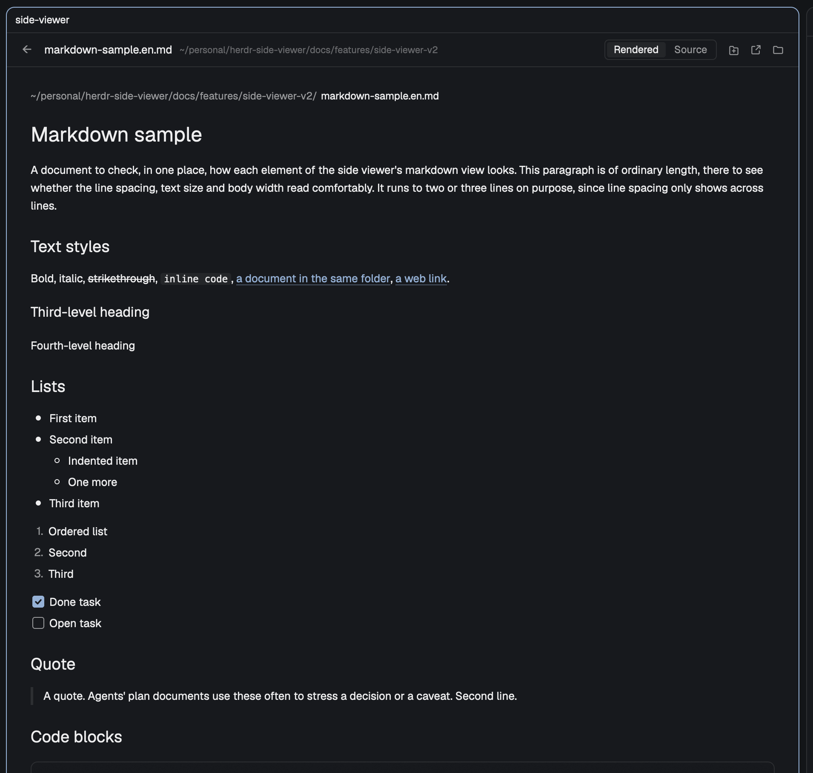

# Side Viewer

Cmd-click a file path in an agent's conversation and the file opens in a pane to the right:
markdown rendered block by block in the manner of Warp, with code blocks as cards; code and
text in an editor with line numbers and syntax colors; images as pictures. The markdown and
svg sources and the code can be edited and saved with cmd+S. A viewer already showing takes
the next file, `←` goes back, the content reloads when the file changes, and the header can
open the file in a tab of its own. Outside Herdr the same files open in the app they opened
in before. macOS only: a small background app, the **router**, becomes the default app for a
list of extensions and passes each file to the viewer or to its **original app**.



## What you see

One pane, to the right of the pane that had focus. `background` fill, `foreground` text.
Top to bottom:

- **Header**, 40px tall, 12px side padding, 8px between items, a 1px `border` line under it.
  Left to right:
  - **Back**, only while there is a file to go back to: a 24×24 square, radius 4, `←` at
    14px in `muted`, `hover` background under the pointer.
  - **File name**, 13px semibold, cut with an ellipsis when the pane is narrow.
  - **Folder**, 11px `dim`, the home folder written as `~`. It takes the room that is left
    and is cut with an ellipsis.
  - **Status**, only while the shown file has unsaved edits: one line of text at 11px, then
    its buttons (24px tall, 8px side padding, radius 4, 1px `border`, 12px text), 6px apart
    (edit-state.js, `statusOf`). `편집됨` in `accent` with `저장` (tooltip `저장 (⌘S)`).
    A failed save in `blocked` with `저장`: `쓰기 권한이 없어요`, `파일이 지워졌어요`,
    `너무 커서 저장할 수 없어요`, or `저장하지 못했어요` for any other error. A change on
    disk, `외부에서 바뀌었어요` in `blocked`, with `다시 읽기` (tooltip `내 수정 버리고 다시
    읽기`) and `덮어쓰기` (tooltip `내 것으로 덮어쓰기`) instead of `저장`. Hovering the text
    shows it whole, or for `저장하지 못했어요` Herdr's error without its function name. It
    is cut with an ellipsis only once the name and folder have given their room; the
    buttons never shrink.
  - **Switch**, only while a markdown document or an svg with a source is drawn:
    `렌더링 | 원문`, two cells in a 24px tall box with a 1px `border`, radius 5. The cell
    shown is filled with `hover` in `foreground`; the other is `muted` and switches on click.
  - **Buttons**, which never shrink: each a 24×24 square, radius 4, a 14px icon in `muted`,
    `hover` background under the pointer, a tooltip, 2px apart. While a markdown document,
    code, an image or an svg is drawn, `새 탭으로 열기` (open in a new tab); for every file
    `원래 앱으로 열기` (open in the original app) and `Finder에서 보기` (show in Finder). A
    notice has only those two.
  - With no file the name reads `Side Viewer` and there are no buttons.
- **Body**, one of:
  - **Markdown view**: a scrolling column as wide as the pane, 28px side and 24px vertical
    padding, 13px text, 12px between blocks, selectable. At the top the folder in `muted`
    and the file name, 12px. Then the blocks:
    - Headings: levels 1 to 3 at 24, 19 and 16px, the rest at 13px, all semibold, no
      underline.
    - Lists: a filled 6px dot at the first level, a hollow one below, `n.` in `muted` for
      numbers, a 14×14 box (radius 3) for tasks, `accent` with a `✓` when checked. The
      item's blocks follow the marker, 6px after it.
    - Tables as wide as their content (scrolling sideways when wider than the pane), cells
      with 10px side padding, the header bold, a 1px `border` line between rows only, each
      column aligned as its `:---:` says.
    - A rule is a 3px `border` bar. A quote has a 3px `border` bar on the left, 12px in, text
      in `muted`. Footnotes are superscript numbers in the text and a 12px `muted` list
      after a `border` line at the end.
    - A picture alone on its line, centered, at most the column's width and 420 high, never
      larger than itself; `그림을 못 읽음: <path>` in `muted` when it can't be read.
    - **Code block cards**: radius 8, a 1px `border`, on a dark theme a fade from `surface`
      at the top to the background darkened to three quarters at the bottom, on a light
      theme `surface` alone. 16px padding, the code at 13px with 21px lines, wrapped, in
      syntax colors, no line numbers. Below it the label at 12px in `muted` on the left and
      16px icons on the right: `>_` on shell blocks, then copy (a check mark for 1.5 s after
      a copy). A card in a list starts at the item's text, one in a quote inside its bar.
  - **Code view**: the app's code editor filling the body, editable, line numbers, no soft
    wrap, in the font from the app's settings. Colors: keyword `ansi5`, string `ansi2`,
    comment `dim`, function `ansi4`, type `ansi3`, number and boolean `ansi1`, constant
    `ansi6`, operator and punctuation `muted`. An extension with no known language draws
    without colors. The markdown source and the svg source are the same editor with soft
    wrap on: the markdown source without colors, the svg source with `xml`'s.
  - **Image view**: the image at its own size, centered, with 20px around it, shrunk to the
    pane's width when it is wider; it scrolls vertically when taller than the pane. An image
    whose size can't be read fills the width as a square. An svg with unsaved edits is drawn
    from them.
  - **Notice**: one line at 13px in `dim`, 20px padding. `열 파일이 없습니다.` (no file),
    `불러오는 중…` (loading), `이 파일은 비어 있습니다.` (an empty `svgz` or picture; an
    empty or blank markdown or svg shows it on its rendering side, under the folder and
    name for markdown, with the `렌더링 | 원문` switch to a source ready to type, and an
    empty or blank code file opens as an empty code view: v2 AC-22),
    `이 파일은 더 이상 없습니다.` (gone), `이 파일을 읽을 수 없습니다.` (unreadable),
    `뷰어에서 열기에는 너무 큽니다.` (too large),
    `이 종류의 파일은 뷰어에서 열 수 없습니다.` (no view for this file).

## How it behaves

The mod shows files, not agents, so it has no agent statuses.

- **Opening.** A cmd-click on a path reaches the router through macOS. The router notes
  which app is in front and runs `open.sh <file> <front app>`. If that app's path contains
  `Herdr.app` (or its name is `herdr-app`), the file goes to the side viewer; otherwise to
  the original app.
- **Reuse.** A side viewer showing in the current tab takes the file: the pane count stays
  and only the content changes. With no viewer showing (none, or only in another tab), a
  new pane splits off to the right of the focused pane about 0.4 s later.
- **Falling back.** The file opens in its original app instead when `herdr-app` is not at
  `~/.local/bin/herdr-app`, the mod is not installed in the app home, the path holds a
  control character, the `pane.split` command fails, or `herdr-app` does not finish within
  5 seconds.
- **View by extension.** `md markdown mdx` → markdown view. `png jpg jpeg jpe gif webp svg
  svgz` → image view, and only when the file's first bytes are an image's (PNG, JPEG, GIF,
  WebP, SVG, or gzip for `.svgz`); otherwise the "no view" notice. A `.svg` whose bytes are
  svg and that is at most 1 MB also has a source; `.svgz` never does. The other extensions in
  `extensions.json` → code view, `html htm shtml shtm` among them (colors `html`). Anything
  else → the "no view" notice.
- **Limits.** Text over 1 MB (1,048,576 bytes) and images over 20 MB (20,971,520 bytes)
  show the "too large" notice and are never read. Exactly at the limit still draws.
- **Back.** Each viewer keeps its own history. Opening a file adds the one being left;
  opening the file already shown adds nothing. `←` returns to the previous file and drops
  the one left behind (there is no forward).
- **Reload.** The viewer watches the shown file's folder and also checks the file again
  every 15 seconds. A file directly in the home folder or in `/` is not watched, only
  checked every 15 seconds. A text file whose size and modified time are as at the last
  read is not read again (unless it changed within the last 2 seconds, since the time is in
  whole seconds). While a read of the shown file is under way, a new change waits for it
  and the file is read once more afterwards; opening another file leaves the read behind.
  Unchanged content leaves the screen and the scroll position alone; changed code keeps
  its editor and only gets the new text. A deleted file turns into the "gone" notice, and
  its content comes back when the file does. "Loading" shows only for a newly opened file.
  A file with unsaved edits is never read over them: see "Changed outside". Nor is it
  replaced by a notice: coming back to one that is now gone, too large or unreadable, or
  an svg now past 1 MiB (a picture alone) or no longer svg, shows its editor with the edits
  (views.js, `editedContentOf`), and the header's status says what it can. A markdown, code
  or svg file emptied outside is no notice at all: it is a changed file, so the edits stay
  and the status says `외부에서 바뀌었어요`.
- **Theme.** The code view's colors are fixed when its editor is made, so each check also
  compares them with the theme: after a theme change the open code is redrawn with the new
  colors within 15 seconds. Code block cards take the new colors at the same check.
- **Source switch.** `렌더링 | 원문`, shown only while a markdown document or an svg with a
  source is drawn, not on a notice. There is no cmd+E. Every file opens rendered: opening
  another file, `←` and a link all switch back from the source.
- **Editing.** The markdown source, the svg source and the code view take typing; the
  rendering, pictures, code block cards and notices do not. The edits are kept per file in
  that viewer (`{file: {disk, text}}`): `disk` is the text last read, `text` the edited one.
  Typing the text back to `disk` drops the entry. Opening another file, `←` or a link and
  coming back brings the entry back into the editor. Closing the pane or quitting Herdr drops
  them all, without asking.
- **Saving.** cmd+S (from the editor or anywhere in the viewer) or the `저장` button runs
  `writeTextFile(file, text, disk)`. With no entry cmd+S does nothing. Text over 1 MiB
  (1,048,576 UTF-8 bytes) is not sent and the status says `너무 커서 저장할 수 없어요`. Typing
  that lands while a save is under way stays unsaved. Nothing is ever saved on a timer.
- **Rendering edits.** Switching an edited source to `렌더링` draws the edited text: the
  markdown blocks are parsed again, and an svg is drawn from a copy of the edited text under
  `previews/`. The file is not written.
- **Changed outside.** A read that finds the disk no longer holds `disk` keeps the edits on
  screen and the status says `외부에서 바뀌었어요`; a read that finds the edited text on
  disk drops the entry; a deleted file says `파일이 지워졌어요`. `다시 읽기` drops the entry
  and shows the disk; `덮어쓰기` saves the edits against the disk text the read found. A
  save that Herdr refuses because the file is not `disk` says the same as the read; a
  refused save of a file that is gone says `파일이 지워졌어요`. Permission errors
  (`os error 13`, `1`, `30`) say `쓰기 권한이 없어요`, anything else `저장하지 못했어요`
  with the error on hover. The edits stay in every case.
- **Checkboxes.** A click on a task box turns over the first `[ ]`, `[x]` or `[X]` on that
  item's source line, in the edited text if there is one, else in the disk text. Without
  edits the result is saved at once against the disk text (a refusal shows in the status); with
  edits it joins them and stays unsaved. A click during a save waits for the save to end.
- **Pictures in markdown.** A picture alone on its line whose path is relative (to the
  document's folder) or absolute is checked by its first bytes and drawn from a copy under
  `images/`, as in the image view. A path with a scheme or starting with `//` is not drawn
  and not fetched; a picture inside a paragraph stays as the TextView draws it.
- **Code block cards.** The fence language gives the label and colors: a known name or
  alias (`JavaScript`, `TypeScript`, `Python`, `HTML`, …), `Shell` for no language and for
  `sh shell bash zsh fish console`, `Mermaid` for `mermaid`, `Code` for anything else. Copy
  puts `block.text` on the clipboard.
- **`>_`** (shell blocks only). Opens a shell pane below the viewer with `pane.split
  {direction: "down", pane: <viewer>, argv: [/bin/zsh -c 'cd -- "$1" 2>/dev/null; exec
  /bin/zsh -l' zsh <folder>]}` and finds it by comparing `panes()` (up to 5 s). The folder: in a viewer tab
  the document's; beside a conversation the `cwd` of a terminal pane in the same tab, an
  agent's first; else home. The command (without its last newline) is written to
  `data/side-viewer/shell/<terminal>.txt` (folder made with `umask 077`; `writeTextFile`
  with the file's current text, or null, as `expected`, tried twice), then `hc keys
  <terminal> ctrl+alt+f12`. Before that key, a zsh not yet prepared gets the prepare line
  with `hc send`: a zle widget `_side_viewer_insert` that pushes a draft aside (`zle
  push-line`), reads the file into `BUFFER`, puts the cursor at its end and removes the file,
  bound to `\e[24;7~` in the emacs, viins and vicmd keymaps, then `clear`. The viewer
  remembers the pid of the zsh it prepared (`hc get`'s `foreground.pid` at the prompt); a
  shell just opened is prepared without alt+q, a zsh with another pid in the same pane is
  prepared again after `hc keys <terminal> alt+q`. The viewer gives that pane the keyboard.
  The next `>_` uses the same pane while it shows the same terminal. When `hc get`'s `foreground` is not zsh, nothing is sent and a Herdr
  notification says `터미널에 넣지 않았습니다` / `셸에서 다른 프로그램(<name>)이 실행
  중입니다. 끝난 뒤 다시 누르세요.`; when no pane can be opened or found,
  `터미널에 넣지 못했습니다` / `셸 pane을 열거나 찾지 못했습니다.`.
- **New tab** (`새 탭으로 열기`). Runs `tab.new {name: <file name>, space, mod:
  "side-viewer", props: {file, viewerTab: true, handoff?}}`, finds the new tab by comparing
  `spaces()` (every 50 ms with `cx.sleep`, up to 3 seconds), then `tab.move` right after the
  viewer's tab and `tab.select`. Not found by then: a notification
  `새 탭으로 넘어가지 못했습니다` names the tab. Every click makes a tab. Unsaved edits go to `handoff-<id>.json` in the data
  folder, its id in the props; the new tab reads and deletes it (ignoring one older than 60
  seconds) and the viewer that opened it drops the edits. A viewer tab renames its tab
  (`tab.rename`) to each file it shows. It starts with an empty history. Being on screen,
  it answers `side-viewer.show` like any viewer, so cmd-clicked files open in it.
- **Open in the original app.** For a listed extension, runs `open -b <bundle id> <file>`
  with the app recorded for the extension; TextEdit (Preview for images) when there is no
  record, when the record names the router, or as a second try when the recorded app
  fails. Naming the app keeps the file from coming back through the router. For an
  extension outside the list, which the router cannot be the default app of, it runs
  `open <file>`.
- **Show in Finder.** Runs `open -R <file>`.
- **Links in the markdown view.** Another markdown file opens in the same viewer and joins
  the history. `http`, `https` and `mailto` go to macOS's handler. Any other local file is
  only shown in Finder, never opened. Relative links start from the shown document's
  folder; `~/`, absolute paths and `file://` work; an anchor alone, or another scheme, does
  nothing.
- **Take over** (`SideViewerRouter --make-default`, or `--make-default code`). Without
  `code` it covers the markdown and image extensions; with it, the code extensions too. It
  records each extension's original app, prints `macOS 확인 창이 N번 뜹니다.` (N = the
  number of file types to change), then sends one request per file type and waits up to
  300 seconds for each confirmation window. Output: `바뀜: …` (changed), `유지를 선택함: …`
  (the person kept the current app), `실패: … (reason)` on stderr, or `바꿀 것이
  없습니다.` (nothing to change). A second run never records the router as an original app.
- **Restore** (`--restore`). Every extension the router still holds goes back to its
  recorded app, with the same count line and windows. An extension with no record goes to
  the app a sibling of the same file type opens in (a sibling the router does not hold
  first, then a sibling's record), because the request changes the whole file type; only
  without such a sibling does it go to TextEdit (Preview for images), and it says so. When
  the app asked for is no longer installed, the same choice is asked for once more
  (sibling's app, else TextEdit or Preview) and printed. A file type whose extensions would
  all go to the app it already opens in gets no request and is not counted. A file type
  that got a request ends one of three ways. When the request succeeds, every extension of
  the file type is read again: those that left the router are listed under `바뀜`, those
  still with it under `라우터에 남음`. A "keep" lists the whole file type under
  `유지를 선택함` and a failure under `실패: … (reason)` on stderr, not per extension. The
  extensions of a file type that got no request go under `라우터에 남음` too. Output order:
  `바뀜`, `유지를 선택함`, then `라우터에 남음: … (이 확장자를 맡은 앱이 라우터뿐입니다)`,
  which follows `바꿀 것이 없습니다.` when nothing was asked. The extensions on that line
  are claimed by no app but the router (`rbw`, `cp` once built) and are neither a failure
  nor kept. The router keeps handling them like any taken-over extension: the side viewer
  from Herdr, otherwise the recorded app, or TextEdit (Preview for images) without a
  record. Deleting the router app frees them.
- **Status** (`--status`). One line per extension: extension, current default app, recorded
  original app or `-`, tab-separated bundle ids.
- **Exit codes** of the three: 0 done or nothing to do, 1 a request failed, 2 wrong usage,
  3 nothing failed but the person kept the current app for some. Any other argument that
  starts with `--` prints the usage and ends with 2.
- **Outside Herdr.** A taken-over file opened from Finder goes through the router to its
  original app (TextEdit, or Preview for images, without a record). The router never comes
  to the front and quits 2 seconds after the last file.

## Built from

- `mods/side-viewer/mod.json`: `{ "place": "none", "title": "Side Viewer", "focusable":
  true }` (focusable for cmd+S). Opened with `pane.split {direction: "right", mod:
  "side-viewer", props: {file}}`; `props.file` is the absolute path to show. A viewer tab's
  props are `{file, viewerTab: true, handoff?}`.
- `mods/side-viewer/main.js`: the one `View`: state, reads, requests, the watch, edits and
  saves, the tab and shell commands' wiring. Drawing is in `header.js`,
  `markdown-view.js`, `code-card.js`, `code-view.js`, `image-view.js`, `notice-view.js`;
  `markdown-image-loader.js` makes the copies of pictures in markdown, `shell-pane.js` runs
  `>_`. The decisions sit in modules without `herdr` imports, so `node --test` runs them:
  `views.js` (extension → view and language, size limits, the probe script, which views
  switch and take typing, the editor options), `document.js` (notices, header label),
  `history.js`, `request.js` (the handoff from `open.sh`), `links.js` (link clicks, watch
  decisions), `original.js` (which app "open in the original app" names), `image-copies.js`
  (image check by first bytes, copy names, sizes, cleanup), `edit-state.js` (unsaved edits,
  disk changes, save results, the header's status, handing edits to a tab, checkbox clicks),
  `markdown-blocks.js` (markdown → blocks), `code-blocks.js` (fence language → label,
  colors, shell; wrapped rows and editor height; card fill), `markdown-images.js` (picture
  paths and sizes), `svg-preview.js` (edited svg previews), `terminal-insert.js` (`>_`'s
  folder, shell state, commands, notices), `viewer-tab.js` (props, handoff file, tab
  placement and name), `checkbox.js` (turning over a task line). Each has a `*.test.mjs`.
- `mods/side-viewer/extensions.json`: the listed extensions in three groups, `markdown`,
  `image`, `code`. The router build and the mod both read it, and it alone says which
  extensions are markdown. A listed extension is taken over only once the router is its
  default app: `markdown` and `image` with `--make-default`, `code` with `--make-default code`.
- `mods/side-viewer/open.sh`: the branch the router calls. It writes
  `request.json` (`{"id","file","at"}`) into the data folder, runs
  `herdr-app do side-viewer.show`, waits 8 × 0.05 s for the viewer's `answer-<id>` file,
  and otherwise runs `herdr-app do pane.split --direction right --mod side-viewer --props
  '{"file":"…"}'`. Answer files older than a minute are deleted on the next run.
- `mods/side-viewer/router/`: `main.swift` (the app: receives files, reads and sets one
  default app at a time), `takeover.sh` (make-default, restore, status), `open-original.sh`,
  `lib.sh`, `build.sh`, `router.test.mjs`. `build.sh` compiles with `swiftc -O` into
  `~/Applications/Side Viewer Router.app` (bundle id `dev.ukkiee.side-viewer-router`,
  `LSBackgroundOnly`, document types from `extensions.json` at rank `Alternate`), copies
  the scripts and the list into its `Resources`, signs it ad hoc and registers it with
  `lsregister`. It builds in a hidden folder beside the app and swaps the result in only
  when every step worked. The binary also answers `--type-info <extension>` (file type, its
  other extensions, its parent types), the check behind the sibling extensions in the list.
- Icons: `new-tab.svg`, `original.svg`, `finder.svg` (header, 14px), `copy.svg`,
  `check.svg`, `terminal.svg` (cards, 16px), 16×16, and `checkbox-check.svg` (a checked
  box's mark, 10×10 with a 1.8 stroke), stroked in `currentColor`, drawn with
  `svg("mods/side-viewer/<name>.svg")`. The "rendering | source" switch is two text cells,
  with no icon.
- `herdr` functions: `props`, `readTextFile`, `writeTextFile`, `nextCommand`, `home`,
  `appHome`, `theme`, `settings`, `exec`, `watchFolder`, `run`, `spaces`, `focused`,
  `panes`, `hc`, `notify`; `cx.spawn`, `cx.timer.every`, `cx.timer.after`, `cx.notify`,
  `cx.write_to_clipboard`. `gpui-kit`: `View`, `div`, `image`, `svg`, `PathBuilder`,
  `Background`. `gpui-base`: `v_flex`, `h_flex`, `TextView.markdown`, `Editor`,
  `EditorState`. Node: `fs/promises` `readFile`.
- Command for scripts: `side-viewer.show`. Herdr commands the mod runs: `pane.split`,
  `tab.new`, `tab.move`, `tab.select`, `tab.rename`; hc: `get`, `keys`, `send`.
- Programs the mod runs: `sh` (with `stat`, `head`, `od`, `cp`, `touch`, `mkdir`), `open`,
  `rm`, `mkdir`, `touch`, `sleep`, and `/bin/zsh` in the shell pane. The scripts also use
  `herdr-app`, `plutil`, `awk`, `sed`, `find`, `mktemp`.
- Files outside the mod folder, all under the app home's `data/side-viewer/`:
  `original-apps.tsv` (`<extension><TAB><bundle id>` per line), `request.json`,
  `answer-<id>`, `images/<path hash>-<bytes>-<modified>.<kind>` (copies of images and of
  pictures in markdown, mode 600), `previews/` (edited svg sources, same names, folder mode
  700), `handoff-<id>.json` (`{"id","file","at","edit"}`, deleted by the tab that reads
  it), and `shell/<terminal>.txt` (the command for `>_`, folder mode 700, deleted by the
  shell's widget as it reads it). A copy or preview is deleted when a newer one of the same file replaces it, or when
  not shown for 30 days. The viewer reads whichever file it is asked to show and writes the
  file it saves.
- `install.sh`: runs `herdr-app check` on the mod folder, runs `build.sh`, then copies the
  mod folder into the app home. It never runs the take-over command; building can still
  change a default (see "Building the app is enough" under Watch out).

## Watch out

Platform:

- A mod gets no click on terminal text. The only way in is the default app that macOS
  opens for a cmd-clicked path, hence the router.
- `<mod>.<command>` reaches showing copies only, and says nothing about whether one took
  it. So the viewer answers by creating `answer-<id>` with `writeTextFile(path, text, null)`
  (new files only), and `open.sh` takes that name itself before splitting, so a viewer that
  wakes late cannot take the file as well.
- A mod can't import JSON and has no `import.meta.url`: the viewer reads
  `mods/side-viewer/extensions.json` under `appHome()` while it runs. A mod not installed
  there shows the "no view" notice for every file. The icon paths assume the same folder
  name.
- `fs/promises` has no `stat`, so size, modified time and the first 4096 bytes come from one
  `exec("sh", …)` before anything is read.
- No `setTimeout`: the 15-second recheck is `cx.timer.every`.
- `EditorState` can't be created while drawing; it is made when the text arrives and
  released when the content is replaced. Its colors are fixed when it is made.
- `TextView.markdown` needs a new element id to draw new text.
- Images are drawn from copies under the app home, on the report that Herdr draws images
  only from there. Only files whose first bytes are an image's are copied.
- `watchFolder` reports subfolders too on macOS, and real paths (`/private/tmp` for `/tmp`):
  batches are matched by path ending. Watching the home folder or `/` would report every
  change under them, so a file there is left to the 15-second check.
- In a layout that gives panes a header (the shipped `pane` mod), its split, zoom and close
  buttons show only while the pointer is on the header, at its right end, one row above the
  viewer's own buttons. A viewer closed there is gone with its history; the next cmd-click
  opens a new one.
- `herdr-app check` draws once, with no file, so it only ever sees `열 파일이 없습니다.`
  It does not finish async work either, so what a save failure really says was never seen
  through it. The tickets checked other screens with temporary copies whose first scene was
  changed; nothing after a read or a click is covered by check.
- Language names the editor knows are not documented. `toml`, `swift`, `kotlin`, `scss`,
  `xml` and `html` are guesses (`html` was only found in Herdr's binary, its colors not seen
  on screen); an unknown name draws without colors, never an error. TypeScript and JSX use
  JavaScript's colors.
- `EditorState.new` can't run while drawing ("cannot run during render"): every editor,
  code cards' too, is made after a read or inside an event.
- cmd+S: with `"focusable": true`, a `track_focus` handle and `on_key_down` on the root,
  `cmd-s` arrives as `"cmd-s"` whether the root or the editor inside it has the keyboard, and
  the editor gets no `s` (seen in the app). Herdr's keys and menu don't take cmd+S.
- `writeTextFile(path, text, expected)` refuses with `The file changed outside Herdr. …`
  when the file is not `expected`, and with the same words when it is gone; so a refusal is
  followed by a read, and null means deleted. Over 1 MiB it says `exceeds 1 MiB`. Both from
  Herdr's source (`src/mod_files.rs`), not seen in the app.
- Herdr saves through a temporary file in the same folder and a rename. A read-only file
  (`chmod 444`) in a writable folder is therefore probably saved anyway; no permission is a
  folder without write (`chmod 555`) or a file with mode 000.
- An editor keeps empty space below its last line (half its height, at least 3 lines) and
  scrolls into it. A card's editor is drawn `max(2 × rows, rows + 3) + 1` rows tall and
  clipped to its text, so there is nothing to scroll and the wheel reaches the document.
  Wrapped rows are estimated from the card's width and a monospace cell of 0.6 × the font
  size, Korean two cells, minus 8px: an estimate short of the real count cuts the last line.
- A focused editor always draws its cursor, and a mod can't turn it off. A clear layer over
  each card swallows clicks, so a card never takes the keyboard; Tab could still reach it.
- `TextView` draws no local picture given as a `data:` address, hence copies under the app
  home, as for the image view. A remote address might be fetched by it, so remote pictures
  are dropped instead of handed to it.
- A mod has no per-character style: text inside a block is a `TextView`. Whether a
  wrapping `div`'s size, weight and color reach the `TextView` (headings, quotes, footnotes)
  was not seen before ticket 12.
- `hc keys` can't type `"` `|` `$` `>` `&` `~` or Korean, and `hc send` presses Enter and
  pastes after a draft (waiting up to 60 seconds after the person's last key). So `>_` never
  sends the command as a line: the shell is prepared once with a zle widget on
  `ctrl+alt+f12` (the highest key `hc keys` names, `\e[24;7~`, unbound in zsh), and each
  command goes through a file and that key. Nothing runs, the prepare line is wiped by
  `clear` (and kept out of history by its leading space with `histignorespace`), and the
  widget's push-line works in every keymap, so a vi-keymap draft is never run. zsh only.
  The one line still sent with `hc send` is the prepare line: to a shell just opened (no
  draft yet), or after alt+q when the pane's zsh has another pid (`zsh` or `exec zsh` run
  there). In that case alt+q is not push-line in a vi keymap, so a draft can run with the
  prepare line, and `clear` wipes that shell's screen (README, Limits).
- zsh reports no hc status, so `hc get`'s `status` is always null; `foreground.name` (`zsh`
  at the prompt, `sleep` while it runs) tells a busy shell.
- `pane.split` takes no folder, so the shell starts as a short zsh that `cd`s and becomes
  the login shell. A mod is not told its own pane id: the viewer is the focused side viewer,
  else the tab's only one.
- `tab.new` returns no id and its new tab's place is Herdr's: the tab is found by
  comparing `spaces()`, which must show it within 3 seconds, or it stays where Herdr put it
  and a notification says so. The rename follows `focused().tab`; several windows were not tried.
- Props are saved with a tab, so unsaved edits never go in them, only a handoff id. After an
  app restart a viewer tab shows its first file under its last name.

macOS:

- Default apps are kept per file type, not per extension, and every change brings up a
  confirmation window, once per file type, on take-over and on restore alike. No app can
  dismiss it. "Keep" comes back as an error with the default unchanged; `takeover.sh` tells
  it from a failure by comparing the default before and after.
- A 30-second wait per window was too short for a person to read and answer; it is 300.
- The windows come one after another in the same place and each names both apps, so they
  are easy to answer the same way every time. On restore the button that names the router
  means keep. Nothing is lost by that: the next run asks only for what is still left.
- Two extensions of one file type can still open in different apps, so the default app is
  asked about a real file with that extension, and the record is per extension. Restore
  sets a file type once, to the original app of the extension that comes first in the list.
- All original apps are recorded before the first request: once one extension of a type is
  taken over, its siblings would report the router.
- Building the app is enough to make it the default for an extension no other app claims
  (seen with `mdx`, `jsonc`, `rbw`, `cp`).
- Left out on purpose: `txt` (its file type includes extensionless text files such as
  `README`), `diff` and `patch` (one file type, different original apps). `ts` is MPEG-2
  video to macOS; it is taken over because that file type has no other extension.
- `public.html` covers `html htm shtml shtm` (looked up with `UTType`, no default changed),
  so they are one window. `xhtml` and `xht` are `public.xhtml` and are not listed. The code
  group is 28 file types, so `--make-default code` asks at most 35 times (7 for markdown
  and images). Whether macOS gives `html` back to the browser when the default browser
  changes is not known.
- The router must never come to the front, or "the app in front" would be itself:
  `LSBackgroundOnly` and activation policy `prohibited`.
- Quitting right after a file lost a second file macOS sent meanwhile; the router waits
  2 seconds without files.
- macOS starts the router without your shell's environment: it uses
  `~/.local/bin/herdr-app` and `~/.config/herdr-app` whatever `HERDR_APP_HOME` was at
  install time. `SIDE_VIEWER_DATA` is for tests; the mod always uses the app home.

Limits and assumptions:

- Line numbers in a path (`app.ts:12`) are ignored; the file shows from the top.
- No web addresses, no paths from another machine's terminal, no binary files (`pdf`,
  `zip`), no keyboard navigation between blocks, no cmd+E, no `{{placeholders}}`.
- Not drawn: `mermaid` as a diagram, math, GitHub alert boxes, HTML tags, definition lists,
  `html` as a page, remote pictures, pictures inside a paragraph. Code in a card can't be
  selected or edited.
- No autosave and no prompt on close: unsaved edits die with the pane. The checkbox click is
  the one save without cmd+S.
- A path with letters stuck to its end (`/tmp/notes/plan.md에서`) is read by Herdr with
  those letters and doesn't open; with a space after it, it does.
- A picture in markdown keeps its first copy while the document's text stays the same: a
  changed picture file shows after the document is opened again or its text changes. Its
  box is 0 high until the block's width is reported, so pictures appear a moment late.
- When `herdr-app` gives up after 5 seconds and Herdr makes the pane late, the file can
  open in both the viewer and the original app.
- A request is ignored when its time is more than 5 seconds off, its id is not
  `[A-Za-z0-9_-]+`, or its path is not absolute.
- Two viewers in one tab: whichever creates the answer file first takes the file.
- Notices, tooltips and command output are in Korean.

## Done when

Two lists: v1's, with the items v2 changed rewritten, and v2's. The AC numbers in the v1
list are those of `docs/features/side-viewer/spec.md`, in the v2 list those of
`docs/features/side-viewer-v2/spec.md`. Both lists are done by hand in the app; nothing
drives the Herdr window.

### v1

Set up: run `./install.sh`, then in a terminal
`router() { "$HOME/Applications/Side Viewer Router.app/Contents/MacOS/SideViewerRouter" "$@"; }`.
Have an agent's conversation in Herdr print the paths of a markdown file, a code file and
an image, as an absolute path, a relative path, a path with a line number (`app.ts:12`)
and a path in code formatting.

1. `./install.sh` prints `check passed`, `built …/Side Viewer Router.app`, and the
   `--make-default` command. Where the router was already built, `router --status` reads
   the same before and after: installing changes no default app. (AC-10)
2. `router --status` prints one line per extension: extension, current default app, recorded
   original app or `-`. (AC-5)
3. `router --make-default` first prints `macOS 확인 창이 N번 뜹니다.`, and exactly N windows
   follow. Pick the router in every window but one, and keep the current app in that one:
   the output lists the kept extensions under `유지를 선택함`, the rest under `바뀜`, the
   exit code is 3, and `router --status` agrees. No code extension changed. (AC-5)
4. `router --make-default` again asks only for what was kept; pick the router. Afterwards
   no line of `original-apps.tsv` names `dev.ukkiee.side-viewer-router`. (AC-5)
5. `router --make-default code` announces its windows and takes over the code extensions,
   `html htm shtml shtm` among them in one window. Where the router held nothing before,
   that is at most 35 windows; where step 3–4 ran first, at most the 28 code ones. The
   count printed matches the windows that come. Run it only if you choose to take over the
   code group (README, "Taking over the code extensions"). (AC-5; v2 AC-17)
6. With no side viewer in the tab, cmd-click the markdown path: a pane appears to the right
   of the focused pane with the document rendered, the file name and folder in the header.
   The same works for the relative path, the line-number path (shown from the top) and the
   code-formatted path. (AC-1, AC-8)
7. Cmd-click the code path with the viewer showing: the pane count stays, the content
   becomes the code with line numbers and syntax colors, in an editor you can type in (v2
   list, 4). `←` appears; clicking it shows the markdown again, and `←` is gone. (AC-2,
   AC-3; v2 AC-1)
8. Cmd-click the image path: the picture shows, no wider than the pane, and shrinks as the
   pane is narrowed. A `.log` or `.csv` file shows as code without colors. (AC-3)
9. In another tab without a viewer, cmd-click a path: a new pane appears in that tab.
   (AC-1, AC-2)
10. With a file showing, change it on disk: the content updates without a click. Delete it:
    `이 파일은 더 이상 없습니다.` Put it back: the content returns. (AC-6)
11. In a markdown document, click a link to another markdown file (relative link): it opens
    in the same viewer and `←` returns. An `https` link opens in the browser. A link to a
    local non-markdown file only shows it in Finder. (AC-7)
12. The `렌더링 | 원문` switch shows for a drawn markdown document (and an svg, v2 list)
    only, never on a notice, and its other cell flips the view. `원래 앱으로 열기` opens the
    file in its original app and the side viewer does not change. `Finder에서 보기` opens a
    Finder window with the file selected. Narrow the pane: name and folder are cut short,
    the switch and the three buttons stay. (AC-8; v2 AC-12)
13. Open, one at a time: a text file over 1 MB with a listed extension, an image over
    20 MB, an empty `.png`, a file with mode 000, and a text file renamed to `.png`. Each
    shows its notice (`뷰어에서 열기에는 너무 큽니다.` for the two large ones,
    `이 파일은 비어 있습니다.`, `이 파일을 읽을 수 없습니다.`,
    `이 종류의 파일은 뷰어에서 열 수 없습니다.`) with `원래 앱으로 열기` and `Finder에서 보기`
    working and no `새 탭으로 열기`, and `herdr-app status` reports no mod error. An empty
    markdown, svg or code file opens in its view instead; v2 step 5 checks it. (AC-9; v2 AC-22)
14. `herdr-app do pane.split --direction right --mod side-viewer --props '{"file":"/etc/hosts"}'`
    shows `이 종류의 파일은 뷰어에서 열 수 없습니다.` with `원래 앱으로 열기` and
    `Finder에서 보기`. (AC-9)
15. In Finder, open a taken-over file with Herdr not in front: it opens in the original app
    `router --status` lists, and no side viewer opens or changes. A `.mdx` file with no
    recorded original app opens in TextEdit. (AC-4)
16. In a terminal, with a real markdown file:
    `SIDE_VIEWER_HERDR_APP=/nonexistent sh "$HOME/Applications/Side Viewer Router.app/Contents/Resources/open.sh" /path/to/file.md /Applications/Herdr.app`
    opens the file in its original app, and no side viewer opens. (AC-11)
17. `node --test mods/side-viewer/` passes with no failures; it covers the cases where
    `herdr-app` is missing, errors, or does not answer. (AC-11, AC-2, AC-3, AC-7, AC-9)
18. `router --restore` announces its windows, and exactly that many follow; pick the original
    app in each (the button that names the other app, not the router). `바뀜` lists only extensions that left the router; any that stay are under
    `라우터에 남음`, and `router --status` then shows the router for those and no others.
    An extension the router got from building alone beside a sibling in another app (the
    router and `-` in `router --status` before the first `--make-default`, such as `rbw`
    beside `rb` or `cp` beside `cpp`) is among them, and its files still open from Finder
    in TextEdit (Preview for images). Every other file opens from Finder in the app it
    opened in before the take-over, except where restore gives a file type one app (see
    Watch out). (AC-5)

### v2

Set up, before v1's step 18 (the router must hold the markdown and image groups; the
`html` step also needs the code group). From the repository root, in a terminal:

```sh
mkdir -p ~/sv2-check
cp docs/features/side-viewer-v2/markdown-sample.md mods/side-viewer/main.js ~/sv2-check/
printf '<svg xmlns="http://www.w3.org/2000/svg" width="200" height="120"><rect width="200" height="120" fill="steelblue"/></svg>\n' > ~/sv2-check/box.svg
gzip -c ~/sv2-check/box.svg > ~/sv2-check/box.svgz
printf '<!doctype html>\n<p>hello</p>\n' > ~/sv2-check/page.html
cp docs/features/side-viewer-v2/markdown-sample.md ~/sv2-conflict.md
```

The samples in the repository (`docs/features/side-viewer-v2/markdown-sample.md`,
`docs/features/side-viewer-v2/code-sample.md`) are only read; every step that writes uses
the copies. `~/sv2-conflict.md` sits directly in the home folder on purpose: such a file is
not watched, only checked every 15 seconds, which leaves time to act before the viewer
notices a change. Have the agent's conversation print the absolute paths of all of these,
each followed by a space or the end of the line. Keep a terminal open for the shell steps.

1. Open `~/sv2-check/markdown-sample.md`, click `원문`. The source has line numbers and the
   long paragraph on line 3 wraps to the pane. Type a word: `편집됨` and `저장` appear.
   Delete the word again: both go. (AC-1, AC-2, AC-7)
2. Type a word and press cmd+S: both go, and `grep <word> ~/sv2-check/markdown-sample.md`
   finds it. Type another and click `저장`: the same. Press cmd+S with nothing changed:
   nothing happens, and `stat -f %m` on the file prints the same time before and after.
   (AC-2)
3. In the source change the `## 목록` heading, then click `렌더링`: the rendering shows the
   new heading, `편집됨` stays, and `grep` finds the old heading in the file. Press
   cmd+S while the rendering shows: the file now has the new heading. (AC-6, AC-2)
4. Open `~/sv2-check/main.js`. Type in it: it changes and `편집됨` appears. Line 16 is
   longer than the pane and does not wrap (scroll sideways to its end); there are line
   numbers. Save with cmd+S. (AC-1, AC-7, AC-2)
5. Try to type into the markdown rendering, a `.png` picture, a code block card and a notice
   (an empty picture, made with `: > ~/sv2-check/empty.png`): nothing changes and no
   `편집됨` appears. Then make `: > ~/sv2-check/empty.md`, `: > ~/sv2-check/empty.svg`
   and `: > ~/sv2-check/empty.js` and open each. The markdown shows its folder and name at
   the top, `이 파일은 비어 있습니다.` under them, and the `렌더링 | 원문` switch; in `원문`
   type a heading, switch back to `렌더링` to see it drawn, press cmd+S, and `cat` shows it
   in the file. The svg shows the same notice and switch; in `원문` (xml colors) type
   `<svg xmlns="http://www.w3.org/2000/svg" width="40" height="40"><circle cx="20" cy="20" r="18" fill="tomato"/></svg>`,
   switch to `렌더링` to see the circle, and save with cmd+S. The `.js` opens as an empty
   code view with no notice; type and save the same way. (AC-1, AC-22)
6. Edit `~/sv2-check/main.js` without saving. Cmd-click `~/sv2-check/markdown-sample.md`,
   then `←`: the edit and `편집됨` are back. Do it again through a link in the markdown
   rendering instead of a cmd-click. Then close the pane: nothing asks. Cmd-click
   `~/sv2-check/main.js` again: it shows the disk text, no `편집됨`. (AC-3)
7. With nothing unsaved in `~/sv2-check/markdown-sample.md`, run
   `echo '밖에서 더한 줄' >> ~/sv2-check/markdown-sample.md`: the view reloads by itself.
   Now edit it without saving and run the same `echo` again: the content is not replaced,
   the header's `편집됨` turns into `외부에서 바뀌었어요` in red, `저장` gives way to
   `다시 읽기` and `덮어쓰기`, there is no bar under the header, and you can keep typing.
   Click `다시 읽기`: the disk text shows, with the new line, and the status is gone. (AC-4)
8. Edit again, `echo` again, and click `덮어쓰기`: the status and its buttons go, and
   `tail -3 ~/sv2-check/markdown-sample.md` shows your text without the last `echo`'s line.
   (AC-4)
9. Open `~/sv2-conflict.md`, click `원문`, type a word. Run
   `echo '밖에서 더한 줄' >> ~/sv2-conflict.md` and press cmd+S within a few seconds: the
   status says `외부에서 바뀌었어요`, and `tail -2 ~/sv2-conflict.md` shows the `echo`'s
   line and not your word. (If it said so before cmd+S, the 15-second check got there
   first: discard and try again.) (AC-4)
10. No permission: edit `~/sv2-check/main.js`, run `chmod 555 ~/sv2-check` (a read-only
    file alone, `chmod 444`, probably still saves: Watch out), press cmd+S: the status says
    `쓰기 권한이 없어요` in red, `저장` stays, and the edit stays. Cmd-click another file's
    path, then `←`: the status still says why. `chmod 755 ~/sv2-check`, cmd+S: saved, the
    status goes. (AC-5)
11. Deleted: edit `~/sv2-check/main.js`, then `mv ~/sv2-check/main.js ~/sv2-check/main.js.bak`:
    the status says `파일이 지워졌어요` and the edit stays; cmd+S says the same and writes
    nothing. `mv` it back: the status is `편집됨` again, the edit is still there. Then, with
    the edit unsaved, cmd-click `~/sv2-check/markdown-sample.md`, run the same `mv` and press
    `←`: `main.js` comes back in its editor with the edit and `파일이 지워졌어요`, not the
    `이 파일은 더 이상 없습니다.` notice. `mv` it back. (AC-5, AC-3)
12. Too large: `head -c 1100000 /dev/zero | tr '\0' a | pbcopy`, paste it into the source of
    `~/sv2-check/markdown-sample.md`, press cmd+S: the status says `너무 커서 저장할 수
    없어요`, the file is unchanged, the edit stays. Narrow the pane until the name and folder
    are gone and the status is cut: the buttons stay whole, and hovering the status shows
    all of it. Undo the paste (cmd+Z, or select it and delete): the status goes. After steps
    10–12, `herdr-app status` reports no mod error. (AC-5)
13. svg: open `~/sv2-check/box.svg`: a blue box, and the header has `렌더링 | 원문`. Click
    `원문`: the source in `xml` colors, wrapped. Change `steelblue` to `tomato`, click
    `렌더링`: a red box, while `grep steelblue ~/sv2-check/box.svg` still finds it. cmd+S:
    `grep tomato` finds it. Open `~/sv2-check/box.svgz`: a picture with no switch.
    (AC-18, AC-1, AC-6)
14. Header: on the markdown and the svg the switch reads `렌더링 | 원문`, the cell shown is
    filled, and cmd+E does nothing. (AC-12)
15. Open `docs/features/side-viewer-v2/markdown-sample.md` (the repository's copy): the
    document fills the pane's width, body at 13pt, with the folder (dimmed) and the file
    name at the top. Headings in four sizes (the `####` one body size, bold), no underline;
    filled dots, hollow dots one level in, numbers, two checkboxes, and the three lists
    drawn apart; the table as wide as its content, its header bold, lines between rows only,
    `가운데` centered and `오른쪽` right-aligned; a thick rule; the quote with a bar and dim
    text; the footnote as a superscript `1` and a list at the end. Bold, italic,
    strikethrough and inline code show. The `같은 폴더의 문서 링크` link opens the v1 spec in
    the viewer, `웹 링크` opens the browser. Also open `README.md`. (AC-12, AC-13)
16. In the same document the picture under `본문 이미지` shows, centered, no taller than 420
    and no wider than the pane; narrow the pane and it shrinks. In `~/sv2-check/markdown-sample.md`
    (whose relative path leads nowhere) the same spot reads
    `그림을 못 읽음: ../../../preview.png`. (AC-14)
17. Open `docs/features/side-viewer-v2/code-sample.md`. Labels: `Shell` for `sh`, `bash`
    and the block without a language, `JavaScript`, `TypeScript`, `Python`, `Rust`, `JSON`,
    and `Code` for `diff`. Syntax colors show. Click a copy button: it becomes a check mark
    for a moment, and `pbpaste` gives the whole block. The `긴 줄` command wraps inside its
    card; the one-line `git status --short` card has no scrollbar; the wheel over any card
    scrolls the document. Click into a card and drag: no cursor, nothing selected, typing
    changes nothing. The card under `1.` starts at the item's text; the card in the quote is
    inside its bar. On a dark theme the cards fade downward; switch Herdr to a light theme:
    flat cards (within 15 seconds). (AC-15)
18. Still in the code sample beside a conversation: `>_` is on the `Shell` cards only. Note
    `pbpaste | shasum`. Click `>_` on `git status --short`: a shell pane opens below the
    viewer, with `git status --short` in its input line, not run, and no other line on its
    screen; its prompt is in the conversation terminal's folder; `pbpaste | shasum` is
    unchanged. Clear the line
    (ctrl+U), click `>_` on the first `Shell` card: the command goes into the same pane, no
    new one. (AC-16)
19. Busy shell, shown for real: in that shell pane clear the line and run `sleep 30`. While
    it runs, click `>_`: a notification `터미널에 넣지 않았습니다` says
    `셸에서 다른 프로그램(sleep)이 실행 중입니다. 끝난 뒤 다시 누르세요.`, and nothing is
    typed. When `sleep` ends, click `>_` again: the command goes into the same pane. (AC-16)
20. In that shell type `echo draft` without Enter, click `>_`: the input line holds the
    command; clear it (ctrl+U) and press Enter on the empty line: `echo draft` comes back.
    The same after ` bindkey -v`: the draft is not run and comes back. (AC-16)
21. In the side viewer showing `~/sv2-check/markdown-sample.md`, click `새 탭으로 열기`: a
    new tab right after the current one, named `markdown-sample.md`, holding only a side
    viewer, and it is shown; there is no `←`. Go back and click it again: a second tab.
    (AC-8, AC-9)
22. In a viewer tab of `docs/features/side-viewer-v2/markdown-sample.md`, click
    `같은 폴더의 문서 링크`: the tab is renamed `spec.md`; `←` names it
    `markdown-sample.md` again. (AC-9)
23. Edit `~/sv2-check/markdown-sample.md` in the side viewer beside the conversation without
    saving, click `새 탭으로 열기`: the new tab shows the edit and `편집됨`; the viewer
    left behind shows the disk text without it. `ls ~/.config/herdr-app/data/side-viewer/`
    shows no `handoff-*.json` left. Save or discard in the tab. (AC-10)
24. In a viewer tab of `docs/features/side-viewer-v2/code-sample.md`, click `>_` on a
    `Shell` card: the shell opens below in `docs/features/side-viewer-v2`. In it run
    `echo ~/sv2-check/main.js` and cmd-click the printed path: it opens in the viewer tab,
    the tab is renamed `main.js`, and the tab still has two panes. (AC-11, AC-9, AC-16)
25. Checkboxes in `~/sv2-check/markdown-sample.md`, rendered, with nothing unsaved: click
    `남은 할 일`: it checks, no `편집됨` stays, and `grep -n '할 일'` shows `- [x] 남은
    할 일`. Click it again: back to `[ ]`. Then edit the source without saving, return to
    `렌더링` and click the box: `편집됨` stays and the file is unchanged until cmd+S.
    (AC-21)
26. Checkbox against an outside change: open `~/sv2-conflict.md` rendered, with nothing
    unsaved (discard what step 9 left). Run `echo '밖에서 더한 줄' >> ~/sv2-conflict.md`
    and click `남은 할 일` within a few seconds: the status says `외부에서 바뀌었어요` and
    `grep -n '할 일' ~/sv2-conflict.md` still shows `- [ ] 남은 할 일`. Both buttons work
    as in steps 7–8. (AC-21, AC-4)
27. `html`, only after you chose to take over the code group (v1 step 5): `router
    --status` names the router for `html htm shtml shtm`. Cmd-click `~/sv2-check/page.html`:
    the code view with `html` colors; edit and cmd+S save it. From Finder it still opens in
    the browser. (AC-17)
28. The v1 list above passes, with its rewritten steps 5, 7, 12, 13 and 14, and
    `herdr-app status` reports no mod error after this whole list. (AC-19)
29. `./install.sh` installs this version and passes `herdr-app check`; `node --test
    mods/side-viewer/` passes with no failures. (AC-20)

Clean up: `rm -rf ~/sv2-check ~/sv2-conflict.md`.
