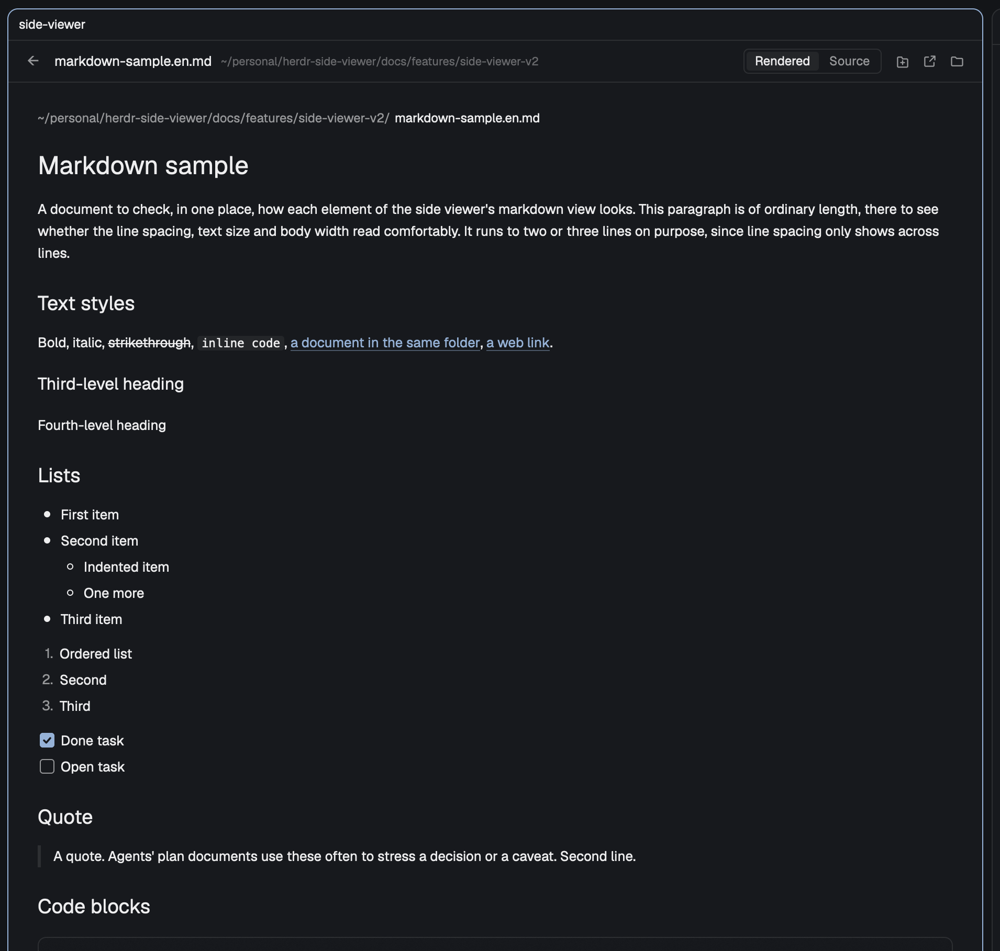

# Markdown sample

A document to check, in one place, how each element of the side viewer's markdown view looks. This paragraph is of ordinary length, there to see whether the line spacing, text size and body width read comfortably. It runs to two or three lines on purpose, since line spacing only shows across lines.

## Text styles

**Bold**, *italic*, ~~strikethrough~~, `inline code`, [a document in the same folder](../side-viewer/spec.md), [a web link](https://herdr.dev).

### Third-level heading

#### Fourth-level heading

## Lists

- First item
- Second item
  - Indented item
  - One more
- Third item

1. Ordered list
2. Second
3. Third

- [x] Done task
- [ ] Open task

## Quote

> A quote. Agents' plan documents use these often to stress a decision or a caveat.
> Second line.

## Code blocks

```js
// A code block with its language
export function greet(name) {
  return `hello, ${name}`;
}
```

```sh
node --test mods/side-viewer/
herdr-app check mods/side-viewer
```

```
A code block without a language
```

## Table

| Item | Left aligned | Centered | Right |
|---|:---|:---:|---:|
| First | Short | Middle | 1 |
| Second | A cell with somewhat longer content | Middle | 1,234 |

## Rule

---

## Image in the body



## Footnotes

A sentence with a footnote.[^1]

[^1]: The footnote's text.
