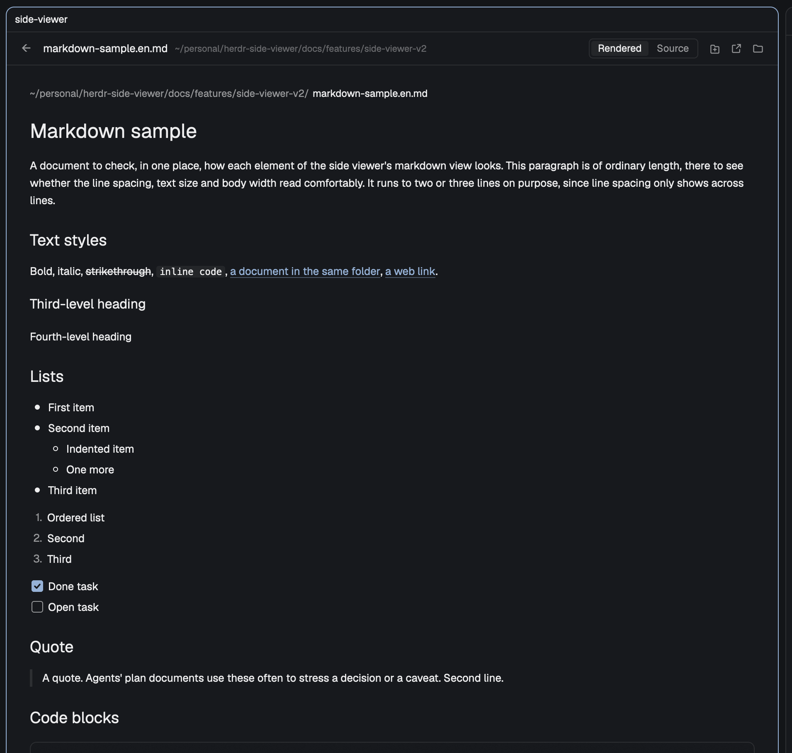

# 마크다운 샘플

사이드 뷰어의 마크다운 보기가 요소마다 어떻게 보이는지 한 번에 확인하는 문서다. 이 문단은 한국어와 English가 섞인 보통 길이의 문단으로, 줄 간격과 글자 크기, 본문 폭이 읽기 편한지 보는 용도다. 문장이 두세 줄로 넘어가야 줄 간격이 드러나므로 조금 길게 쓴다.

## 글자 꾸밈

**굵게**, *기울임*, ~~취소선~~, `인라인 코드`, [같은 폴더의 문서 링크](../side-viewer/spec.md), [웹 링크](https://herdr.dev).

### 세 번째 단계 제목

#### 네 번째 단계 제목

## 목록

- 첫 번째 항목
- 두 번째 항목
  - 들여쓴 항목
  - 또 하나
- 세 번째 항목

1. 순서 있는 목록
2. 두 번째
3. 세 번째

- [x] 끝난 할 일
- [ ] 남은 할 일

## 인용

> 인용문이다. 에이전트의 계획 문서에서 결정이나 주의 사항을 강조할 때 자주 쓴다.
> 두 번째 줄.

## 코드 블록

```js
// 언어가 적힌 코드 블록
export function greet(name) {
  return `hello, ${name}`;
}
```

```sh
node --test mods/side-viewer/
herdr-app check mods/side-viewer
```

```
언어가 없는 코드 블록
```

## 표

| 항목 | 왼쪽 정렬 | 가운데 | 오른쪽 |
|---|:---|:---:|---:|
| 첫째 | 짧음 | 가운데 | 1 |
| 둘째 | 조금 더 긴 내용이 들어간 칸 | 중간 | 1,234 |

## 구분선

---

## 본문 이미지



## 각주

각주가 붙은 문장이다.[^1]

[^1]: 각주의 내용.
